# Workbench 소개

규칙 문서로 Figma 화면설계를 맡기고, 팀이 함께 보고 관리하는 작업 도구

- 기준: v0.24 · 2026.11.13
- 이미지: 같은 폴더의 `p01.jpg` ~ `p22.jpg`(쪽마다 아래에 같은 내용을 글로 정리)

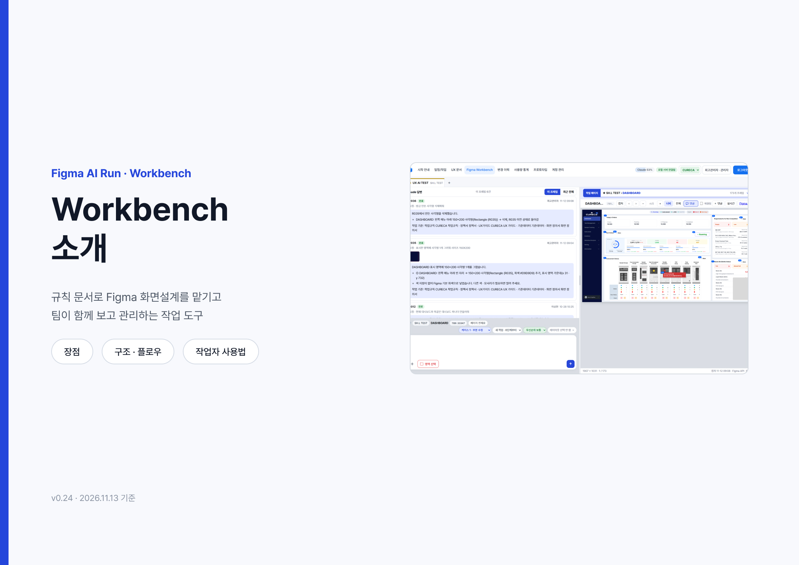

---

## 목차

| 장 | 내용 | 쪽 |
|---|---|---|
| 01 | [한눈에 보기](#01--한눈에-보기) | 03 |
| 02 | [장점 — 규칙이 바뀌어도 반영이 쉬움](#02--장점) | 04 – 05 |
| 03 | [전체 구조 · 구성 요소 · 규칙 파일 구조](#03--전체-구조) | 06 – 10 |
| 04 | [메뉴별 기능](#04--메뉴별-기능) | 11 |
| 05 | [핵심 플로우 (수정 요청 · 규칙 반영 · 데이터 공유)](#05--핵심-플로우) | 12 – 14 |
| 06 | [잘 동작하려면 — 작업 규칙 정의](#06--잘-동작하려면) | 15 – 16 |
| 07 | [작업자 입장에서 쓰는 법](#07--작업자-입장에서) | 17 – 18 |
| 08 | [Claude가 지키는 규칙 · 운영](#08--claude가-지키는-규칙--운영) | 19 |
| 09 | [사용 팁](#09--사용-팁) | 20 |
| 10 | [추가 기능 · 확장 (프로토타입 · 다른 툴 · 다른 AI)](#10--추가-기능--확장) | 21 – 22 |

- 처음 보는 분은 01 → 02 → 05, 실제로 쓸 분은 06 → 07 → 09 순서를 추천
- 10은 기본 업무 흐름과 별도로 필요할 때 쓰는 추가 기능 · 확장 방향
- 설치 · 설정 방법은 별도 「Figma AI Run 사용 매뉴얼 · FAQ」(시작 안내 화면의 매뉴얼)를 참고

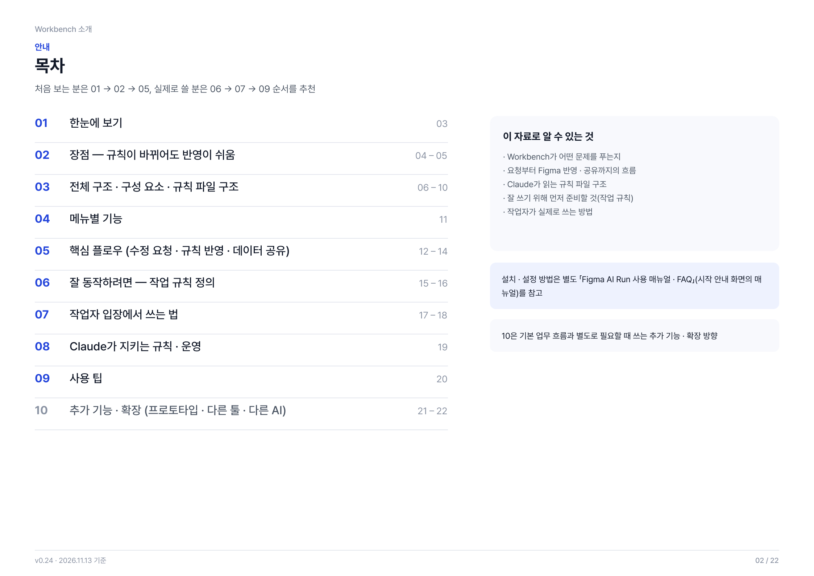

---

## 01 · 한눈에 보기

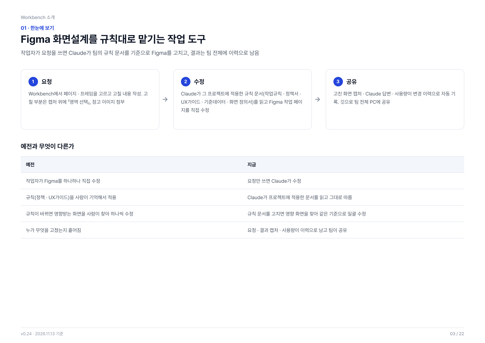

### Figma 화면설계를 규칙대로 맡기는 작업 도구

작업자가 요청을 쓰면 Claude가 팀의 규칙 문서를 기준으로 Figma를 고치고, 결과는 팀 전체에 이력으로 남음

| 단계 | 내용 |
|---|---|
| 1. 요청 | Workbench에서 페이지 · 프레임을 고르고 고칠 내용 작성. 고칠 부분은 캡처 위에 「영역 선택」, 참고 이미지 첨부 |
| 2. 수정 | Claude가 그 프로젝트에 적용한 규칙 문서(작업규칙 · 정책서 · UX가이드 · 기준데이터 · 화면 정의서)를 읽고 Figma 작업 페이지를 직접 수정 |
| 3. 공유 | 고친 화면 캡처 · Claude 답변 · 사용량이 변경 이력으로 자동 기록. 깃으로 팀 전체 PC에 공유 |

### 예전과 무엇이 다른가

| 예전 | 지금 |
|---|---|
| 작업자가 Figma를 하나하나 직접 수정 | 요청만 쓰면 Claude가 수정 |
| 규칙(정책 · UX가이드)을 사람이 기억해서 적용 | Claude가 프로젝트에 적용한 문서를 읽고 그대로 따름 |
| 규칙이 바뀌면 영향받는 화면을 사람이 찾아 하나씩 수정 | 규칙 문서를 고치면 영향 화면을 찾아 같은 기준으로 일괄 수정 |
| 누가 무엇을 고쳤는지 흩어짐 | 요청 · 결과 캡처 · 사용량이 이력으로 남고 팀이 공유 |

---

## 02 · 장점

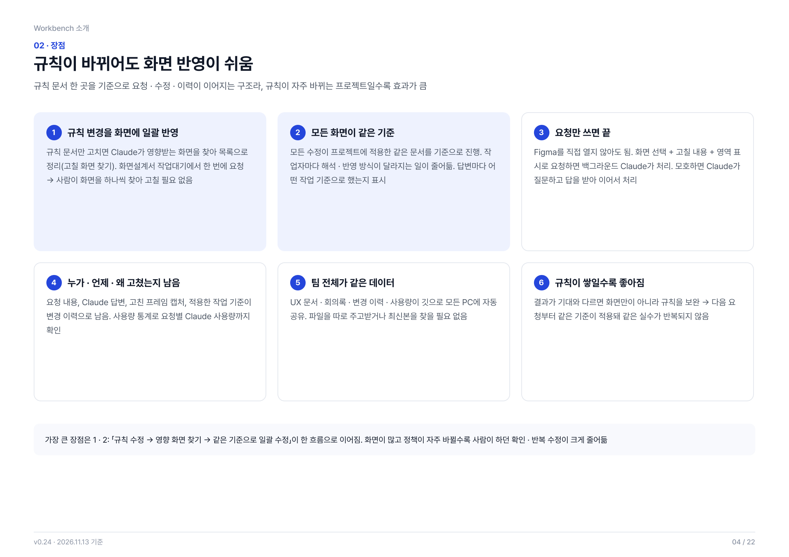

### 규칙이 바뀌어도 화면 반영이 쉬움

규칙 문서 한 곳을 기준으로 요청 · 수정 · 이력이 이어지는 구조라, 규칙이 자주 바뀌는 프로젝트일수록 효과가 큼

1. **규칙 변경을 화면에 일괄 반영**: 규칙 문서만 고치면 Claude가 영향받는 화면을 찾아 목록으로 정리(고칠 화면 찾기). 화면설계서 작업대기에서 한 번에 요청 → 사람이 화면을 하나씩 찾아 고칠 필요 없음
2. **모든 화면이 같은 기준**: 모든 수정이 프로젝트에 적용한 같은 문서를 기준으로 진행. 작업자마다 해석 · 반영 방식이 달라지는 일이 줄어듦. 답변마다 어떤 작업 기준으로 했는지 표시
3. **요청만 쓰면 끝**: Figma를 직접 열지 않아도 됨. 화면 선택 + 고칠 내용 + 영역 표시로 요청하면 백그라운드 Claude가 처리. 모호하면 Claude가 질문하고 답을 받아 이어서 처리
4. **누가 · 언제 · 왜 고쳤는지 남음**: 요청 내용, Claude 답변, 고친 프레임 캡처, 적용한 작업 기준이 변경 이력으로 남음. 사용량 통계로 요청별 Claude 사용량까지 확인
5. **팀 전체가 같은 데이터**: UX 문서 · 회의록 · 변경 이력 · 사용량이 깃으로 모든 PC에 자동 공유. 파일을 따로 주고받거나 최신본을 찾을 필요 없음
6. **규칙이 쌓일수록 좋아짐**: 결과가 기대와 다르면 화면만이 아니라 규칙을 보완 → 다음 요청부터 같은 기준이 적용돼 같은 실수가 반복되지 않음

> 가장 큰 장점은 1 · 2: 「규칙 수정 → 영향 화면 찾기 → 같은 기준으로 일괄 수정」이 한 흐름으로 이어짐. 화면이 많고 정책이 자주 바뀔수록 사람이 하던 확인 · 반복 수정이 크게 줄어듦

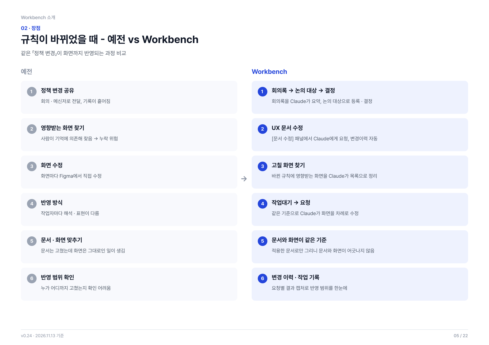

### 규칙이 바뀌었을 때 — 예전 vs Workbench

같은 「정책 변경」이 화면까지 반영되는 과정 비교

| | 예전 | Workbench |
|---|---|---|
| 1 | **정책 변경 공유**: 회의 · 메신저로 전달, 기록이 흩어짐 | **회의록 → 논의 대상 → 결정**: 회의록을 Claude가 요약, 논의 대상으로 등록 · 결정 |
| 2 | **영향받는 화면 찾기**: 사람이 기억에 의존해 찾음 → 누락 위험 | **UX 문서 수정**: [문서 수정] 패널에서 Claude에게 요청, 변경이력 자동 |
| 3 | **화면 수정**: 화면마다 Figma에서 직접 수정 | **고칠 화면 찾기**: 바뀐 규칙에 영향받는 화면을 Claude가 목록으로 정리 |
| 4 | **반영 방식**: 작업자마다 해석 · 표현이 다름 | **작업대기 → 요청**: 같은 기준으로 Claude가 화면을 차례로 수정 |
| 5 | **문서 · 화면 맞추기**: 문서는 고쳤는데 화면은 그대로인 일이 생김 | **문서와 화면이 같은 기준**: 적용한 문서로만 그리니 문서와 화면이 어긋나지 않음 |
| 6 | **반영 범위 확인**: 누가 어디까지 고쳤는지 확인 어려움 | **변경 이력 · 작업 기록**: 요청별 결과 캡처로 반영 범위를 한눈에 |

---

## 03 · 전체 구조

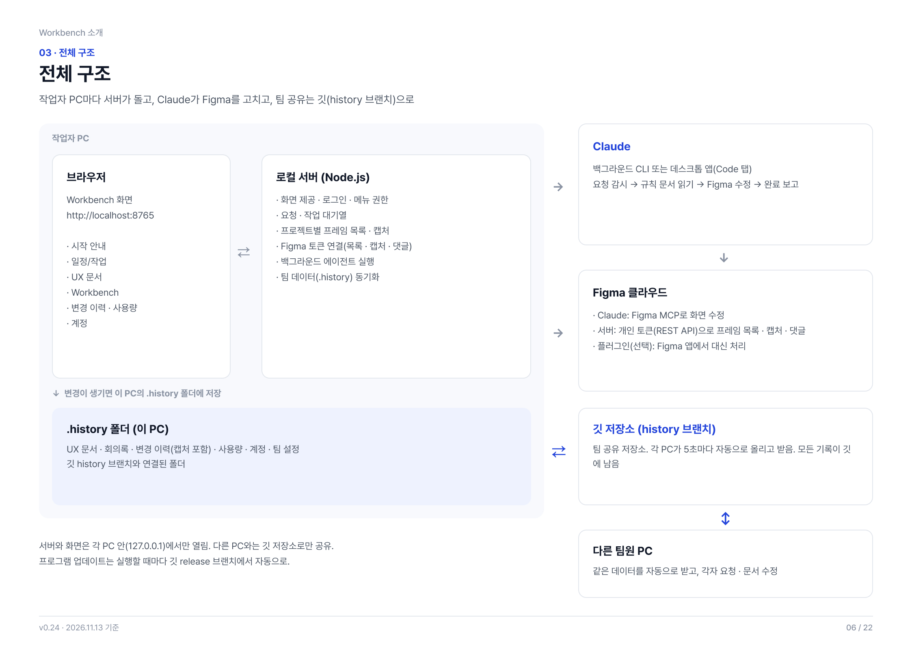

### 전체 구조

작업자 PC마다 서버가 돌고, Claude가 Figma를 고치고, 팀 공유는 깃(history 브랜치)으로

```
[작업자 PC]
  브라우저(Workbench 화면, localhost:8765)
     ⇄ 로컬 서버(Node.js)  ──→  Claude (백그라운드 CLI 또는 데스크톱 앱)
            │                     요청 감시 → 규칙 문서 읽기 → Figma 수정 → 완료 보고
            │                          ↓
            │                     Figma 클라우드
            │                     · Claude: Figma MCP로 화면 수정
            │                     · 서버: 개인 토큰(REST API)으로 프레임 목록 · 캡처 · 댓글
            │                     · 플러그인(선택): Figma 앱에서 대신 처리
            ↓ 변경이 생기면 저장
     .history 폴더(이 PC) ⇄ 깃 저장소(history 브랜치) ↕ 다른 팀원 PC
```

- **브라우저**: Workbench 화면 — 시작 안내 · 일정/작업 · UX 문서 · Workbench · 변경 이력 · 사용량 · 계정
- **로컬 서버**: 화면 제공 · 로그인 · 메뉴 권한, 요청 · 작업 대기열, 프로젝트별 프레임 목록 · 캡처, Figma 토큰 연결, 백그라운드 에이전트 실행, 팀 데이터(.history) 동기화
- **.history 폴더(이 PC)**: UX 문서 · 회의록 · 변경 이력(캡처 포함) · 사용량 · 계정 · 팀 설정. 깃 history 브랜치와 연결된 폴더
- **깃 저장소(history 브랜치)**: 팀 공유 저장소. 각 PC가 5초마다 자동으로 올리고 받음. 모든 기록이 깃에 남음
- **다른 팀원 PC**: 같은 데이터를 자동으로 받고, 각자 요청 · 문서 수정
- 서버와 화면은 각 PC 안(127.0.0.1)에서만 열림. 다른 PC와는 깃 저장소로만 공유
- 프로그램 업데이트는 실행할 때마다 깃 release 브랜치에서 자동으로

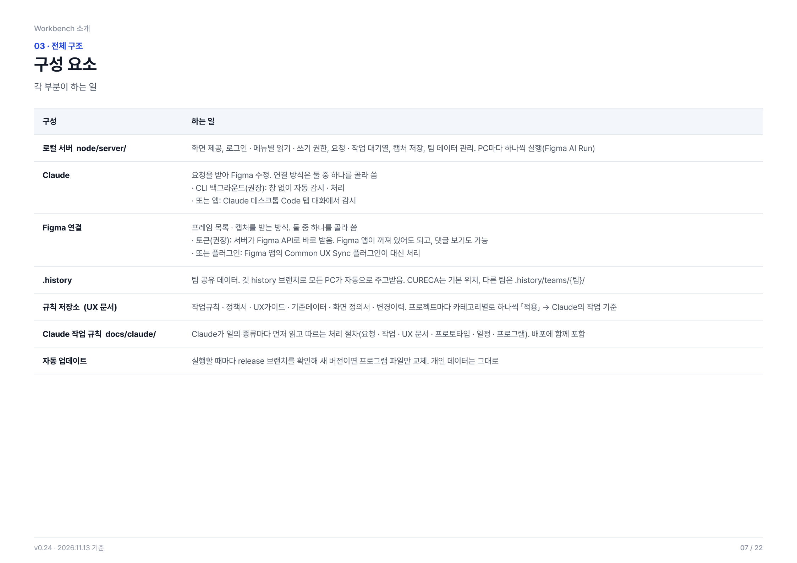

### 구성 요소

| 구성 | 하는 일 |
|---|---|
| 로컬 서버 `node/server/` | 화면 제공, 로그인 · 메뉴별 읽기 · 쓰기 권한, 요청 · 작업 대기열, 캡처 저장, 팀 데이터 관리. PC마다 하나씩 실행(Figma AI Run) |
| Claude | 요청을 받아 Figma 수정. 연결 방식은 둘 중 하나를 골라 씀<br>· CLI 백그라운드(권장): 창 없이 자동 감시 · 처리<br>· 또는 앱: Claude 데스크톱 Code 탭 대화에서 감시 |
| Figma 연결 | 프레임 목록 · 캡처를 받는 방식. 둘 중 하나를 골라 씀<br>· 토큰(권장): 서버가 Figma API로 바로 받음. Figma 앱이 꺼져 있어도 되고, 댓글 보기도 가능<br>· 또는 플러그인: Figma 앱의 Common UX Sync 플러그인이 대신 처리 |
| .history | 팀 공유 데이터. 깃 history 브랜치로 모든 PC가 자동으로 주고받음. CURECA는 기본 위치, 다른 팀은 `.history/teams/{팀}/` |
| 규칙 저장소 (UX 문서) | 작업규칙 · 정책서 · UX가이드 · 기준데이터 · 화면 정의서 · 변경이력. 프로젝트마다 카테고리별로 하나씩 「적용」 → Claude의 작업 기준 |
| Claude 작업 규칙 `docs/claude/` | Claude가 일의 종류마다 먼저 읽고 따르는 처리 절차(요청 · 작업 · UX 문서 · 프로토타입 · 일정 · 프로그램). 배포에 함께 포함 |
| 자동 업데이트 | 실행할 때마다 release 브랜치를 확인해 새 버전이면 프로그램 파일만 교체. 개인 데이터는 그대로 |

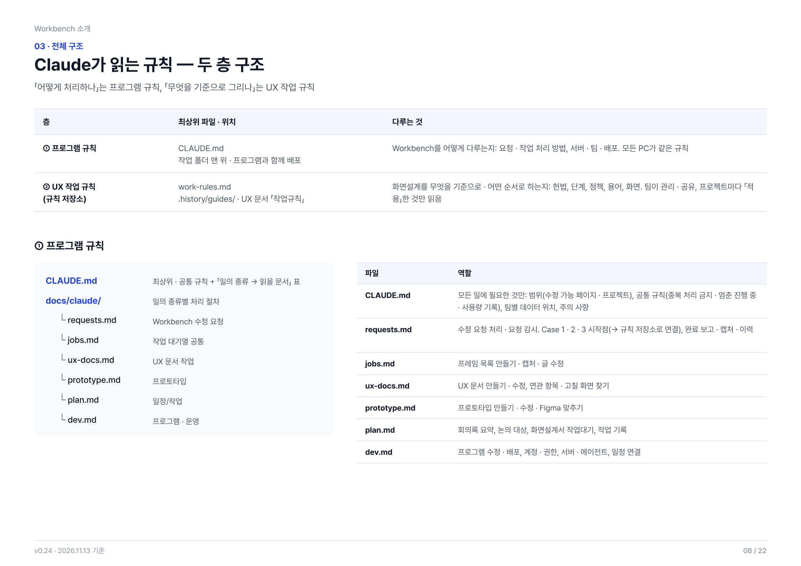

### Claude가 읽는 규칙 — 두 층 구조

「어떻게 처리하나」는 프로그램 규칙, 「무엇을 기준으로 그리나」는 UX 작업 규칙

| 층 | 최상위 파일 · 위치 | 다루는 것 |
|---|---|---|
| ① 프로그램 규칙 | `CLAUDE.md` — 작업 폴더 맨 위 · 프로그램과 함께 배포 | Workbench를 어떻게 다루는지: 요청 · 작업 처리 방법, 서버 · 팀 · 배포. 모든 PC가 같은 규칙 |
| ② UX 작업 규칙 (규칙 저장소) | `work-rules.md` — `.history/guides/` · UX 문서 「작업규칙」 | 화면설계를 무엇을 기준으로 · 어떤 순서로 하는지: 헌법, 단계, 정책, 용어, 화면. 팀이 관리 · 공유, 프로젝트마다 「적용」한 것만 읽음 |

#### ① 프로그램 규칙

```
CLAUDE.md                 최상위 · 공통 규칙 + 「일의 종류 → 읽을 문서」 표
docs/claude/              일의 종류별 처리 절차
  ├ requests.md           Workbench 수정 요청
  ├ jobs.md               작업 대기열 공통
  ├ ux-docs.md            UX 문서 작업
  ├ prototype.md          프로토타입
  ├ plan.md               일정/작업
  └ dev.md                프로그램 · 운영
```

| 파일 | 역할 |
|---|---|
| `CLAUDE.md` | 모든 일에 필요한 것만: 범위(수정 가능 페이지 · 프로젝트), 공통 규칙(중복 처리 금지 · 멈춘 진행 중 · 사용량 기록), 팀별 데이터 위치, 주의 사항 |
| `requests.md` | 수정 요청 처리 · 요청 감시. Case 1 · 2 · 3 시작점(→ 규칙 저장소로 연결), 완료 보고 · 캡처 · 이력 |
| `jobs.md` | 프레임 목록 만들기 · 캡처 · 글 수정 |
| `ux-docs.md` | UX 문서 만들기 · 수정, 연관 항목 · 고칠 화면 찾기 |
| `prototype.md` | 프로토타입 만들기 · 수정 · Figma 맞추기 |
| `plan.md` | 회의록 요약, 논의 대상, 화면설계서 작업대기, 작업 기록 |
| `dev.md` | 프로그램 수정 · 배포, 계정 · 권한, 서버 · 에이전트, 일정 연결 |

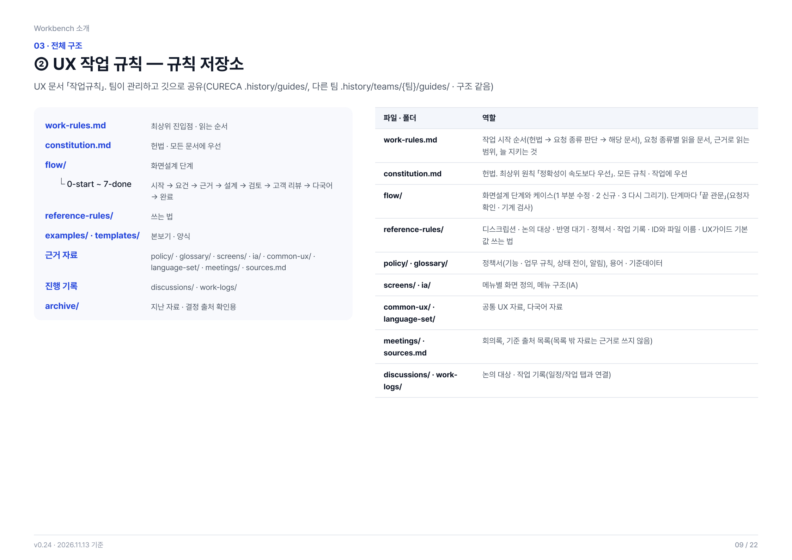

### ② UX 작업 규칙 — 규칙 저장소

UX 문서 「작업규칙」. 팀이 관리하고 깃으로 공유(CURECA `.history/guides/`, 다른 팀 `.history/teams/{팀}/guides/` · 구조 같음)

```
work-rules.md             최상위 진입점 · 읽는 순서
constitution.md           헌법 · 모든 문서에 우선
flow/                     화면설계 단계
  └ 0-start ~ 7-done      시작 → 요건 → 근거 → 설계 → 검토 → 고객 리뷰 → 다국어 → 완료
reference-rules/          쓰는 법
examples/ · templates/    본보기 · 양식
근거 자료                 policy/ · glossary/ · screens/ · ia/ · common-ux/ · language-set/ · meetings/ · sources.md
진행 기록                 discussions/ · work-logs/
archive/                  지난 자료 · 결정 출처 확인용
```

| 파일 · 폴더 | 역할 |
|---|---|
| `work-rules.md` | 작업 시작 순서(헌법 → 요청 종류 판단 → 해당 문서), 요청 종류별 읽을 문서, 근거로 읽는 범위, 늘 지키는 것 |
| `constitution.md` | 헌법. 최상위 원칙 「정확성이 속도보다 우선」. 모든 규칙 · 작업에 우선 |
| `flow/` | 화면설계 단계와 케이스(1 부분 수정 · 2 신규 · 3 다시 그리기). 단계마다 「끝 관문」(요청자 확인 · 기계 검사) |
| `reference-rules/` | 디스크립션 · 논의 대상 · 반영 대기 · 정책서 · 작업 기록 · ID와 파일 이름 · UX가이드 기본값 쓰는 법 |
| `policy/` · `glossary/` | 정책서(기능 · 업무 규칙, 상태 전이, 알림), 용어 · 기준데이터 |
| `screens/` · `ia/` | 메뉴별 화면 정의, 메뉴 구조(IA) |
| `common-ux/` · `language-set/` | 공통 UX 자료, 다국어 자료 |
| `meetings/` · `sources.md` | 회의록, 기준 출처 목록(목록 밖 자료는 근거로 쓰지 않음) |
| `discussions/` · `work-logs/` | 논의 대상 · 작업 기록(일정/작업 탭과 연결) |

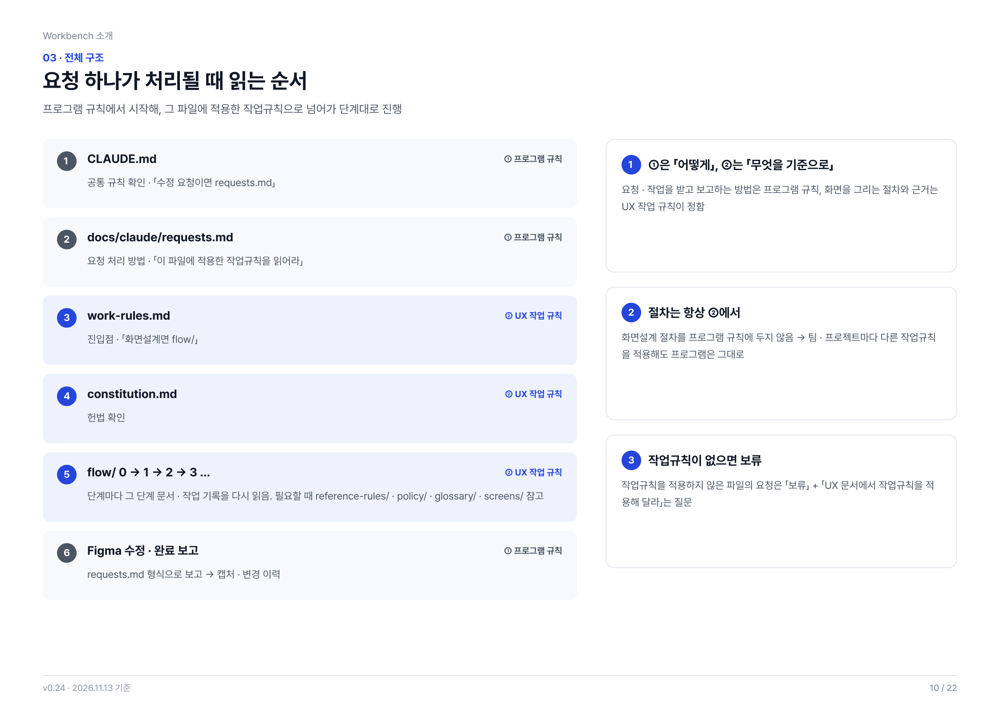

### 요청 하나가 처리될 때 읽는 순서

프로그램 규칙에서 시작해, 그 파일에 적용한 작업규칙으로 넘어가 단계대로 진행

| 순서 | 파일 | 층 | 내용 |
|---|---|---|---|
| 1 | `CLAUDE.md` | ① 프로그램 규칙 | 공통 규칙 확인 · 「수정 요청이면 requests.md」 |
| 2 | `docs/claude/requests.md` | ① 프로그램 규칙 | 요청 처리 방법 · 「이 파일에 적용한 작업규칙을 읽어라」 |
| 3 | `work-rules.md` | ② UX 작업 규칙 | 진입점 · 「화면설계면 flow/」 |
| 4 | `constitution.md` | ② UX 작업 규칙 | 헌법 확인 |
| 5 | `flow/` 0 → 1 → 2 → 3 … | ② UX 작업 규칙 | 단계마다 그 단계 문서 · 작업 기록을 다시 읽음. 필요할 때 reference-rules/ · policy/ · glossary/ · screens/ 참고 |
| 6 | Figma 수정 · 완료 보고 | ① 프로그램 규칙 | requests.md 형식으로 보고 → 캡처 · 변경 이력 |

- **①은 「어떻게」, ②는 「무엇을 기준으로」**: 요청 · 작업을 받고 보고하는 방법은 프로그램 규칙, 화면을 그리는 절차와 근거는 UX 작업 규칙이 정함
- **절차는 항상 ②에서**: 화면설계 절차를 프로그램 규칙에 두지 않음 → 팀 · 프로젝트마다 다른 작업규칙을 적용해도 프로그램은 그대로
- **작업규칙이 없으면 보류**: 작업규칙을 적용하지 않은 파일의 요청은 「보류」 + 「UX 문서에서 작업규칙을 적용해 달라」는 질문

---

## 04 · 메뉴별 기능

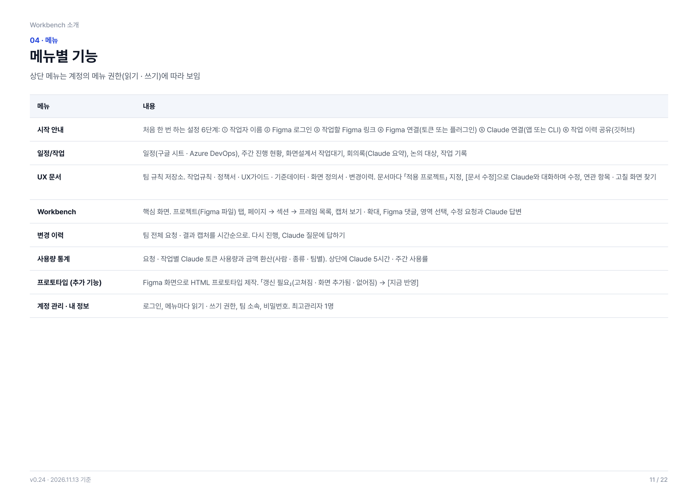

상단 메뉴는 계정의 메뉴 권한(읽기 · 쓰기)에 따라 보임

| 메뉴 | 내용 |
|---|---|
| 시작 안내 | 처음 한 번 하는 설정 6단계: ① 작업자 이름 ② Figma 로그인 ③ 작업할 Figma 링크 ④ Figma 연결(토큰 또는 플러그인) ⑤ Claude 연결(앱 또는 CLI) ⑥ 작업 이력 공유(깃허브) |
| 일정/작업 | 일정(구글 시트 · Azure DevOps), 주간 진행 현황, 화면설계서 작업대기, 회의록(Claude 요약), 논의 대상, 작업 기록 |
| UX 문서 | 팀 규칙 저장소. 작업규칙 · 정책서 · UX가이드 · 기준데이터 · 화면 정의서 · 변경이력. 문서마다 「적용 프로젝트」 지정, [문서 수정]으로 Claude와 대화하며 수정, 연관 항목 · 고칠 화면 찾기 |
| Workbench | 핵심 화면. 프로젝트(Figma 파일) 탭, 페이지 → 섹션 → 프레임 목록, 캡처 보기 · 확대, Figma 댓글, 영역 선택, 수정 요청과 Claude 답변 |
| 변경 이력 | 팀 전체 요청 · 결과 캡처를 시간순으로. 다시 진행, Claude 질문에 답하기 |
| 사용량 통계 | 요청 · 작업별 Claude 토큰 사용량과 금액 환산(사람 · 종류 · 팀별). 상단에 Claude 5시간 · 주간 사용률 |
| 프로토타입 (추가 기능) | Figma 화면으로 HTML 프로토타입 제작. 「갱신 필요」(고쳐짐 · 화면 추가됨 · 없어짐) → [지금 반영] |
| 계정 관리 · 내 정보 | 로그인, 메뉴마다 읽기 · 쓰기 권한, 팀 소속, 비밀번호. 최고관리자 1명 |

---

## 05 · 핵심 플로우

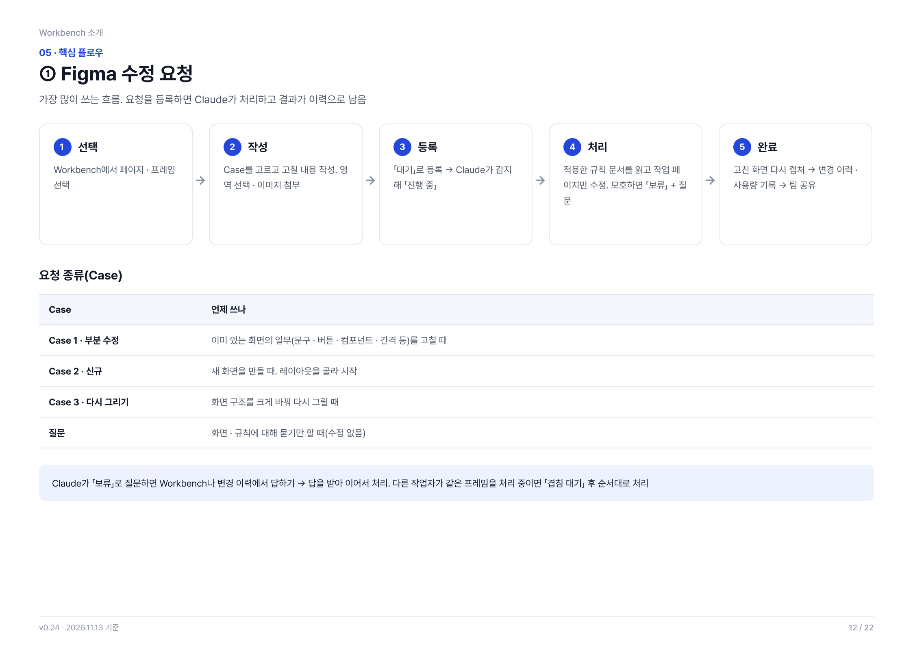

### ① Figma 수정 요청

가장 많이 쓰는 흐름. 요청을 등록하면 Claude가 처리하고 결과가 이력으로 남음

1. **선택**: Workbench에서 페이지 · 프레임 선택
2. **작성**: Case를 고르고 고칠 내용 작성. 영역 선택 · 이미지 첨부
3. **등록**: 「대기」로 등록 → Claude가 감지해 「진행 중」
4. **처리**: 적용한 규칙 문서를 읽고 작업 페이지만 수정. 모호하면 「보류」 + 질문
5. **완료**: 고친 화면 다시 캡처 → 변경 이력 · 사용량 기록 → 팀 공유

| Case | 언제 쓰나 |
|---|---|
| Case 1 · 부분 수정 | 이미 있는 화면의 일부(문구 · 버튼 · 컴포넌트 · 간격 등)를 고칠 때 |
| Case 2 · 신규 | 새 화면을 만들 때. 레이아웃을 골라 시작 |
| Case 3 · 다시 그리기 | 화면 구조를 크게 바꿔 다시 그릴 때 |
| 질문 | 화면 · 규칙에 대해 묻기만 할 때(수정 없음) |

> Claude가 「보류」로 질문하면 Workbench나 변경 이력에서 답하기 → 답을 받아 이어서 처리. 다른 작업자가 같은 프레임을 처리 중이면 「겹침 대기」 후 순서대로 처리

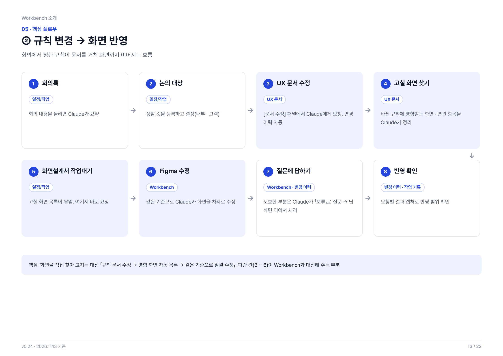

### ② 규칙 변경 → 화면 반영

회의에서 정한 규칙이 문서를 거쳐 화면까지 이어지는 흐름

| 순서 | 단계 | 어디서 | 내용 |
|---|---|---|---|
| 1 | 회의록 | 일정/작업 | 회의 내용을 올리면 Claude가 요약 |
| 2 | 논의 대상 | 일정/작업 | 정할 것을 등록하고 결정(내부 · 고객) |
| 3 | UX 문서 수정 | UX 문서 | [문서 수정] 패널에서 Claude에게 요청. 변경이력 자동 |
| 4 | 고칠 화면 찾기 | UX 문서 | 바뀐 규칙에 영향받는 화면 · 연관 항목을 Claude가 정리 |
| 5 | 화면설계서 작업대기 | 일정/작업 | 고칠 화면 목록이 쌓임. 여기서 바로 요청 |
| 6 | Figma 수정 | Workbench | 같은 기준으로 Claude가 화면을 차례로 수정 |
| 7 | 질문에 답하기 | Workbench · 변경 이력 | 모호한 부분은 Claude가 「보류」로 질문 → 답하면 이어서 처리 |
| 8 | 반영 확인 | 변경 이력 · 작업 기록 | 요청별 결과 캡처로 반영 범위 확인 |

> 핵심: 화면을 직접 찾아 고치는 대신 「규칙 문서 수정 → 영향 화면 자동 목록 → 같은 기준으로 일괄 수정」. 3 ~ 6이 Workbench가 대신해 주는 부분

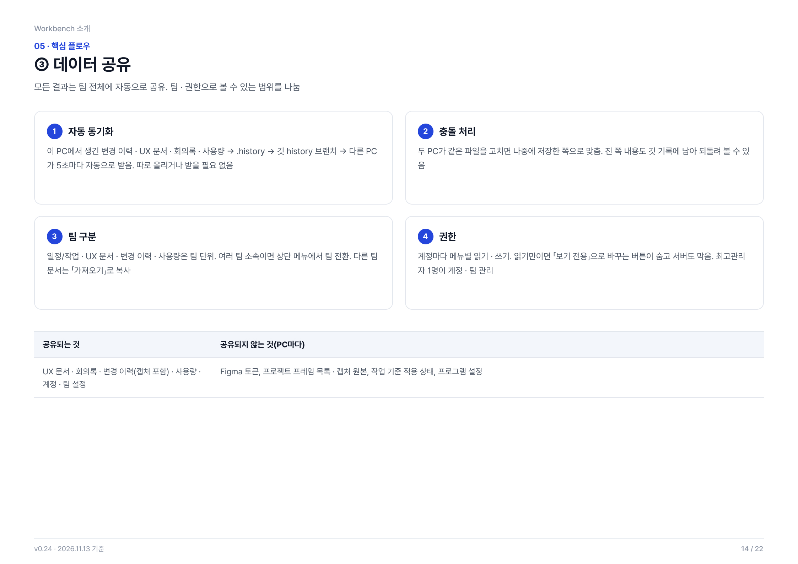

### ③ 데이터 공유

모든 결과는 팀 전체에 자동으로 공유. 팀 · 권한으로 볼 수 있는 범위를 나눔

1. **자동 동기화**: 이 PC에서 생긴 변경 이력 · UX 문서 · 회의록 · 사용량 → .history → 깃 history 브랜치 → 다른 PC가 5초마다 자동으로 받음. 따로 올리거나 받을 필요 없음
2. **충돌 처리**: 두 PC가 같은 파일을 고치면 나중에 저장한 쪽으로 맞춤. 진 쪽 내용도 깃 기록에 남아 되돌려 볼 수 있음
3. **팀 구분**: 일정/작업 · UX 문서 · 변경 이력 · 사용량은 팀 단위. 여러 팀 소속이면 상단 메뉴에서 팀 전환. 다른 팀 문서는 「가져오기」로 복사
4. **권한**: 계정마다 메뉴별 읽기 · 쓰기. 읽기만이면 「보기 전용」으로 바꾸는 버튼이 숨고 서버도 막음. 최고관리자 1명이 계정 · 팀 관리

| 공유되는 것 | 공유되지 않는 것(PC마다) |
|---|---|
| UX 문서 · 회의록 · 변경 이력(캡처 포함) · 사용량 · 계정 · 팀 설정 | Figma 토큰, 프로젝트 프레임 목록 · 캡처 원본, 작업 기준 적용 상태, 프로그램 설정 |

---

## 06 · 잘 동작하려면

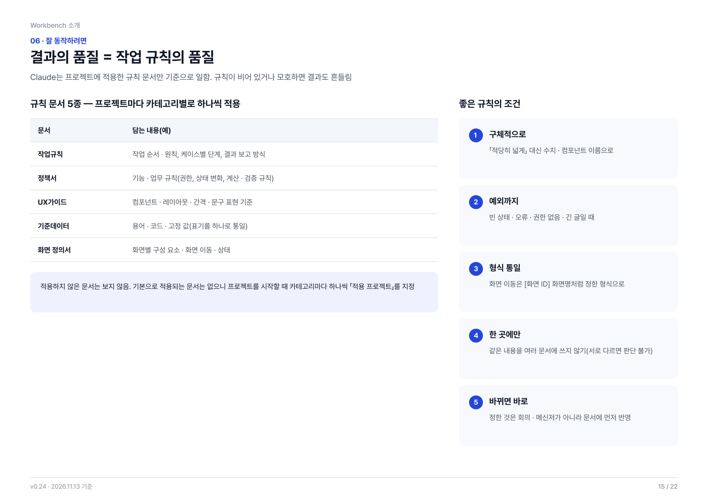

### 결과의 품질 = 작업 규칙의 품질

Claude는 프로젝트에 적용한 규칙 문서만 기준으로 일함. 규칙이 비어 있거나 모호하면 결과도 흔들림

**규칙 문서 5종 — 프로젝트마다 카테고리별로 하나씩 적용**

| 문서 | 담는 내용(예) |
|---|---|
| 작업규칙 | 작업 순서 · 원칙, 케이스별 단계, 결과 보고 방식 |
| 정책서 | 기능 · 업무 규칙(권한, 상태 변화, 계산 · 검증 규칙) |
| UX가이드 | 컴포넌트 · 레이아웃 · 간격 · 문구 표현 기준 |
| 기준데이터 | 용어 · 코드 · 고정 값(표기를 하나로 통일) |
| 화면 정의서 | 화면별 구성 요소 · 화면 이동 · 상태 |

> 적용하지 않은 문서는 보지 않음. 기본으로 적용되는 문서는 없으니 프로젝트를 시작할 때 카테고리마다 하나씩 「적용 프로젝트」를 지정

**좋은 규칙의 조건**

1. **구체적으로**: 「적당히 넓게」 대신 수치 · 컴포넌트 이름으로
2. **예외까지**: 빈 상태 · 오류 · 권한 없음 · 긴 글일 때
3. **형식 통일**: 화면 이동은 [화면 ID] 화면명처럼 정한 형식으로
4. **한 곳에만**: 같은 내용을 여러 문서에 쓰지 않기(서로 다르면 판단 불가)
5. **바뀌면 바로**: 정한 것은 회의 · 메신저가 아니라 문서에 먼저 반영

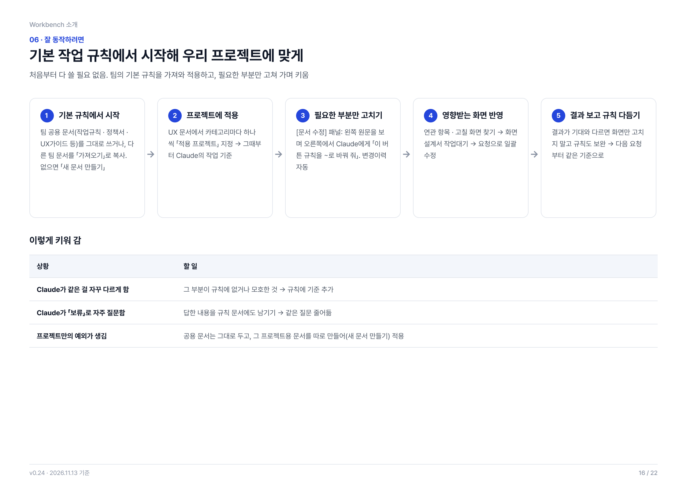

### 기본 작업 규칙에서 시작해 우리 프로젝트에 맞게

처음부터 다 쓸 필요 없음. 팀의 기본 규칙을 가져와 적용하고, 필요한 부분만 고쳐 가며 키움

1. **기본 규칙에서 시작**: 팀 공용 문서(작업규칙 · 정책서 · UX가이드 등)를 그대로 쓰거나, 다른 팀 문서를 「가져오기」로 복사. 없으면 「새 문서 만들기」
2. **프로젝트에 적용**: UX 문서에서 카테고리마다 하나씩 「적용 프로젝트」 지정 → 그때부터 Claude의 작업 기준
3. **필요한 부분만 고치기**: [문서 수정] 패널 — 왼쪽 원문을 보며 오른쪽에서 Claude에게 「이 버튼 규칙을 ~로 바꿔 줘」. 변경이력 자동
4. **영향받는 화면 반영**: 연관 항목 · 고칠 화면 찾기 → 화면설계서 작업대기 → 요청으로 일괄 수정
5. **결과 보고 규칙 다듬기**: 결과가 기대와 다르면 화면만 고치지 말고 규칙도 보완 → 다음 요청부터 같은 기준으로

**이렇게 키워 감**

| 상황 | 할 일 |
|---|---|
| Claude가 같은 걸 자꾸 다르게 함 | 그 부분이 규칙에 없거나 모호한 것 → 규칙에 기준 추가 |
| Claude가 「보류」로 자주 질문함 | 답한 내용을 규칙 문서에도 남기기 → 같은 질문 줄어듦 |
| 프로젝트만의 예외가 생김 | 공용 문서는 그대로 두고, 그 프로젝트용 문서를 따로 만들어(새 문서 만들기) 적용 |

---

## 07 · 작업자 입장에서

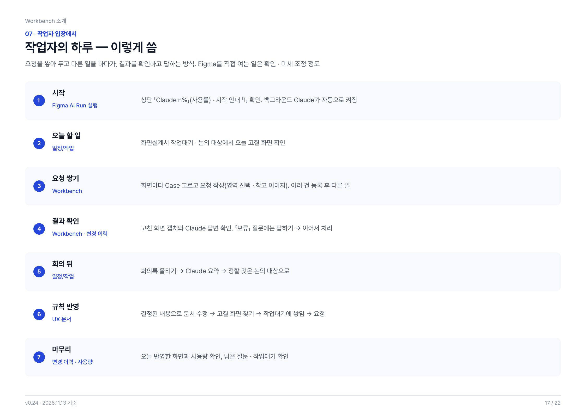

### 작업자의 하루 — 이렇게 씀

요청을 쌓아 두고 다른 일을 하다가, 결과를 확인하고 답하는 방식. Figma를 직접 여는 일은 확인 · 미세 조정 정도

| 순서 | 할 일 | 어디서 | 내용 |
|---|---|---|---|
| 1 | 시작 | Figma AI Run 실행 | 상단 「Claude n%」(사용률) · 시작 안내 「!」 확인. 백그라운드 Claude가 자동으로 켜짐 |
| 2 | 오늘 할 일 | 일정/작업 | 화면설계서 작업대기 · 논의 대상에서 오늘 고칠 화면 확인 |
| 3 | 요청 쌓기 | Workbench | 화면마다 Case 고르고 요청 작성(영역 선택 · 참고 이미지). 여러 건 등록 후 다른 일 |
| 4 | 결과 확인 | Workbench · 변경 이력 | 고친 화면 캡처와 Claude 답변 확인. 「보류」 질문에는 답하기 → 이어서 처리 |
| 5 | 회의 뒤 | 일정/작업 | 회의록 올리기 → Claude 요약 → 정할 것은 논의 대상으로 |
| 6 | 규칙 반영 | UX 문서 | 결정된 내용으로 문서 수정 → 고칠 화면 찾기 → 작업대기에 쌓임 → 요청 |
| 7 | 마무리 | 변경 이력 · 사용량 | 오늘 반영한 화면과 사용량 확인, 남은 질문 · 작업대기 확인 |

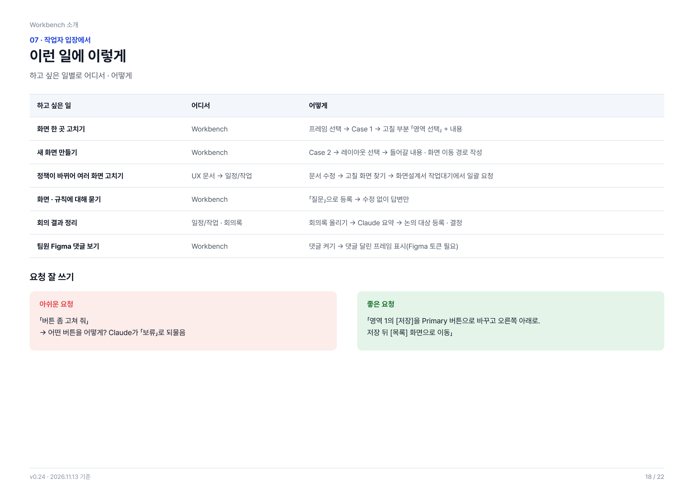

### 이런 일에 이렇게

| 하고 싶은 일 | 어디서 | 어떻게 |
|---|---|---|
| 화면 한 곳 고치기 | Workbench | 프레임 선택 → Case 1 → 고칠 부분 「영역 선택」 + 내용 |
| 새 화면 만들기 | Workbench | Case 2 → 레이아웃 선택 → 들어갈 내용 · 화면 이동 경로 작성 |
| 정책이 바뀌어 여러 화면 고치기 | UX 문서 → 일정/작업 | 문서 수정 → 고칠 화면 찾기 → 화면설계서 작업대기에서 일괄 요청 |
| 화면 · 규칙에 대해 묻기 | Workbench | 「질문」으로 등록 → 수정 없이 답변만 |
| 회의 결과 정리 | 일정/작업 · 회의록 | 회의록 올리기 → Claude 요약 → 논의 대상 등록 · 결정 |
| 팀원 Figma 댓글 보기 | Workbench | 댓글 켜기 → 댓글 달린 프레임 표시(Figma 토큰 필요) |

**요청 잘 쓰기**

- 아쉬운 요청: 「버튼 좀 고쳐 줘」 → 어떤 버튼을 어떻게? Claude가 「보류」로 되물음
- 좋은 요청: 「영역 1의 [저장]을 Primary 버튼으로 바꾸고 오른쪽 아래로. 저장 뒤 [목록] 화면으로 이동」

---

## 08 · Claude가 지키는 규칙 · 운영

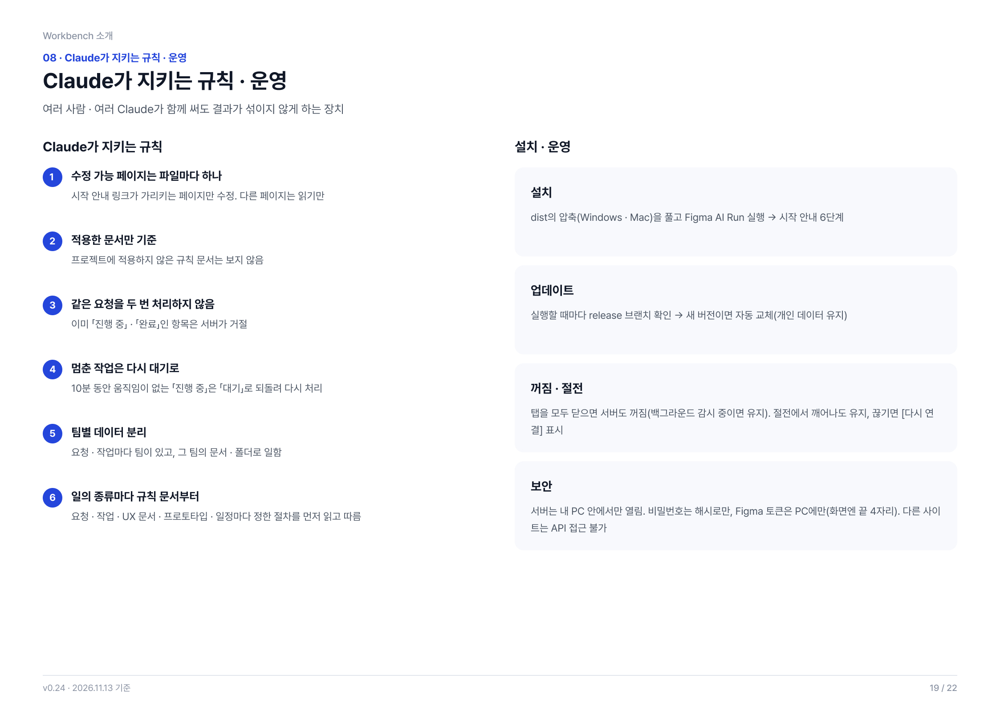

여러 사람 · 여러 Claude가 함께 써도 결과가 섞이지 않게 하는 장치

**Claude가 지키는 규칙**

1. **수정 가능 페이지는 파일마다 하나**: 시작 안내 링크가 가리키는 페이지만 수정. 다른 페이지는 읽기만
2. **적용한 문서만 기준**: 프로젝트에 적용하지 않은 규칙 문서는 보지 않음
3. **같은 요청을 두 번 처리하지 않음**: 이미 「진행 중」 · 「완료」인 항목은 서버가 거절
4. **멈춘 작업은 다시 대기로**: 10분 동안 움직임이 없는 「진행 중」은 「대기」로 되돌려 다시 처리
5. **팀별 데이터 분리**: 요청 · 작업마다 팀이 있고, 그 팀의 문서 · 폴더로 일함
6. **일의 종류마다 규칙 문서부터**: 요청 · 작업 · UX 문서 · 프로토타입 · 일정마다 정한 절차를 먼저 읽고 따름

**설치 · 운영**

| 항목 | 내용 |
|---|---|
| 설치 | dist의 압축(Windows · Mac)을 풀고 Figma AI Run 실행 → 시작 안내 6단계 |
| 업데이트 | 실행할 때마다 release 브랜치 확인 → 새 버전이면 자동 교체(개인 데이터 유지) |
| 꺼짐 · 절전 | 탭을 모두 닫으면 서버도 꺼짐(백그라운드 감시 중이면 유지). 절전에서 깨어나도 유지, 끊기면 [다시 연결] 표시 |
| 보안 | 서버는 내 PC 안에서만 열림. 비밀번호는 해시로만, Figma 토큰은 PC에만(화면엔 끝 4자리). 다른 사이트는 API 접근 불가 |

---

## 09 · 사용 팁

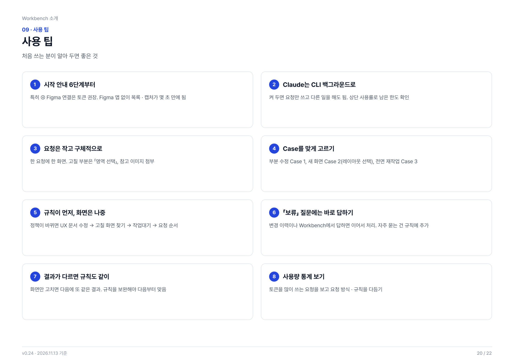

1. **시작 안내 6단계부터**: 특히 ④ Figma 연결은 토큰 권장. Figma 앱 없이 목록 · 캡처가 몇 초 만에 됨
2. **Claude는 CLI 백그라운드로**: 켜 두면 요청만 쓰고 다른 일을 해도 됨. 상단 사용률로 남은 한도 확인
3. **요청은 작고 구체적으로**: 한 요청에 한 화면. 고칠 부분은 「영역 선택」, 참고 이미지 첨부
4. **Case를 맞게 고르기**: 부분 수정 Case 1, 새 화면 Case 2(레이아웃 선택), 전면 재작업 Case 3
5. **규칙이 먼저, 화면은 나중**: 정책이 바뀌면 UX 문서 수정 → 고칠 화면 찾기 → 작업대기 → 요청 순서
6. **「보류」 질문에는 바로 답하기**: 변경 이력이나 Workbench에서 답하면 이어서 처리. 자주 묻는 건 규칙에 추가
7. **결과가 다르면 규칙도 같이**: 화면만 고치면 다음에 또 같은 결과. 규칙을 보완해야 다음부터 맞음
8. **사용량 통계 보기**: 토큰을 많이 쓰는 요청을 보고 요청 방식 · 규칙을 다듬기

---

## 10 · 추가 기능 · 확장

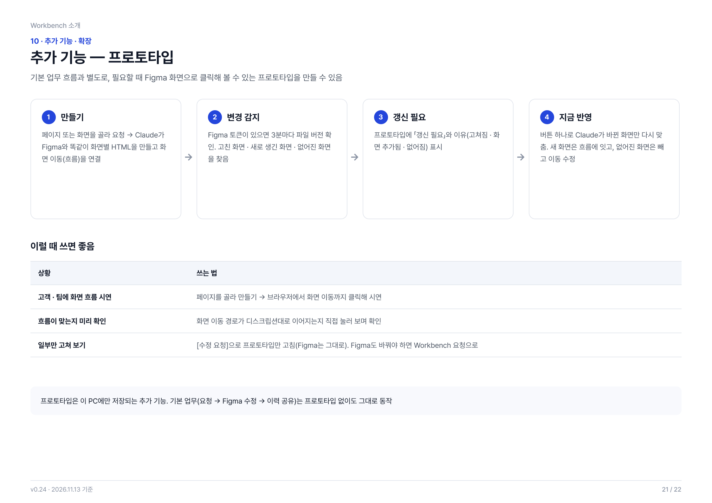

### 추가 기능 — 프로토타입

기본 업무 흐름과 별도로, 필요할 때 Figma 화면으로 클릭해 볼 수 있는 프로토타입을 만들 수 있음

1. **만들기**: 페이지 또는 화면을 골라 요청 → Claude가 Figma와 똑같이 화면별 HTML을 만들고 화면 이동(흐름)을 연결
2. **변경 감지**: Figma 토큰이 있으면 3분마다 파일 버전 확인. 고친 화면 · 새로 생긴 화면 · 없어진 화면을 찾음
3. **갱신 필요**: 프로토타입에 「갱신 필요」와 이유(고쳐짐 · 화면 추가됨 · 없어짐) 표시
4. **지금 반영**: 버튼 하나로 Claude가 바뀐 화면만 다시 맞춤. 새 화면은 흐름에 잇고, 없어진 화면은 빼고 이동 수정

| 상황 | 쓰는 법 |
|---|---|
| 고객 · 팀에 화면 흐름 시연 | 페이지를 골라 만들기 → 브라우저에서 화면 이동까지 클릭해 시연 |
| 흐름이 맞는지 미리 확인 | 화면 이동 경로가 디스크립션대로 이어지는지 직접 눌러 보며 확인 |
| 일부만 고쳐 보기 | [수정 요청]으로 프로토타입만 고침(Figma는 그대로). Figma도 바꿔야 하면 Workbench 요청으로 |

> 프로토타입은 이 PC에만 저장되는 추가 기능. 기본 업무(요청 → Figma 수정 → 이력 공유)는 프로토타입 없이도 그대로 동작

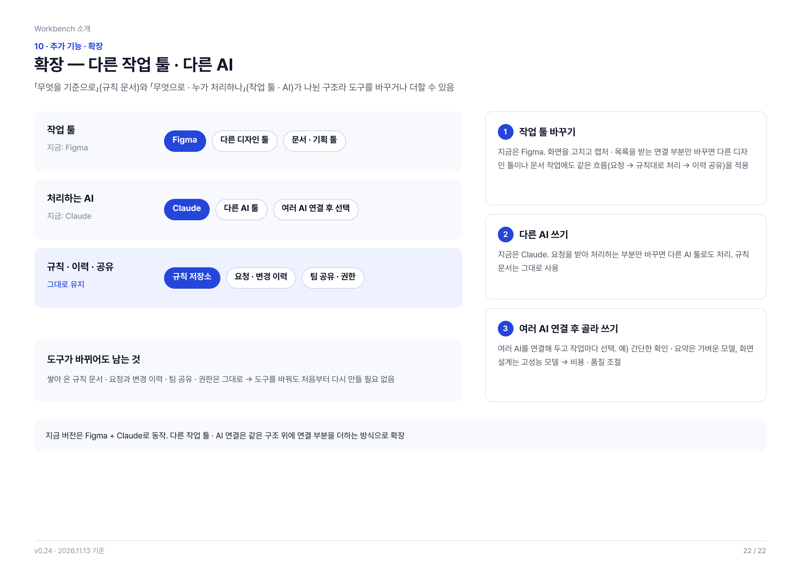

### 확장 — 다른 작업 툴 · 다른 AI

「무엇을 기준으로」(규칙 문서)와 「무엇으로 · 누가 처리하나」(작업 툴 · AI)가 나뉜 구조라 도구를 바꾸거나 더할 수 있음

| 층 | 지금 | 바꾸거나 더할 수 있는 것 |
|---|---|---|
| 작업 툴 | Figma | 다른 디자인 툴, 문서 · 기획 툴 |
| 처리하는 AI | Claude | 다른 AI 툴, 여러 AI 연결 후 선택 |
| 규칙 · 이력 · 공유 | 그대로 유지 | 규칙 저장소, 요청 · 변경 이력, 팀 공유 · 권한 |

1. **작업 툴 바꾸기**: 지금은 Figma. 화면을 고치고 캡처 · 목록을 받는 연결 부분만 바꾸면 다른 디자인 툴이나 문서 작업에도 같은 흐름(요청 → 규칙대로 처리 → 이력 공유)을 적용
2. **다른 AI 쓰기**: 지금은 Claude. 요청을 받아 처리하는 부분만 바꾸면 다른 AI 툴로도 처리. 규칙 문서는 그대로 사용
3. **여러 AI 연결 후 골라 쓰기**: 여러 AI를 연결해 두고 작업마다 선택. 예) 간단한 확인 · 요약은 가벼운 모델, 화면설계는 고성능 모델 → 비용 · 품질 조절

- **도구가 바뀌어도 남는 것**: 쌓아 온 규칙 문서 · 요청과 변경 이력 · 팀 공유 · 권한은 그대로 → 도구를 바꿔도 처음부터 다시 만들 필요 없음
- 지금 버전은 Figma + Claude로 동작. 다른 작업 툴 · AI 연결은 같은 구조 위에 연결 부분을 더하는 방식으로 확장
