## 5. Component

Figma 목차(COMM-0)에 정의된 컴포넌트 23개(5-a ~ 5-w)의 번호와 상세 규칙이다.

| CID | 컴포넌트 | 기존 CID | 상세 프레임 |
|---|---|---|---|
| `COMM-5-a` | Accordion | COMM-5-a | 1장 |
| `COMM-5-b` | Breadcrumb | 새로 추가 | 1장 |
| `COMM-5-c` | Button | COMM-5-c | 1장 |
| `COMM-5-d` | Calendar | COMM-5-d | 1장 |
| `COMM-5-e` | Card | COMM-5-t | 1장 |
| `COMM-5-f` | Chips | COMM-5-e | 1장 |
| `COMM-5-g` | Data Table | COMM-5-m | 1장 |
| `COMM-5-h` | Dropdown | COMM-5-f | 2장 (1/2 · 2/2) |
| `COMM-5-i` | Info Box | 새로 추가 | 1장 |
| `COMM-5-j` | Label | COMM-5-r | 1장 |
| `COMM-5-k` | Loading | COMM-5-g | 1장 |
| `COMM-5-l` | Pagination | COMM-5-i | 1장 |
| `COMM-5-m` | Popup | COMM-5-j | 4장 (1/4 ~ 4/4) |
| `COMM-5-n` | Progress Bar | COMM-5-b | 1장 |
| `COMM-5-o` | Scroll Bar | COMM-5-k | 1장 |
| `COMM-5-p` | Search Bar | COMM-5-s | 1장 |
| `COMM-5-q` | Selection Controls | COMM-5-l | 1장 |
| `COMM-5-r` | Sorting | COMM-5-v | 1장 |
| `COMM-5-s` | Tab | 새로 추가 | 1장 |
| `COMM-5-t` | Text Field | COMM-5-n | 1장 |
| `COMM-5-u` | Toast | COMM-5-w | 1장 |
| `COMM-5-v` | Tool Tip | COMM-5-o | 1장 |
| `COMM-5-w` | Validation Check | COMM-5-Y | 1장 |

- 화면 디스크립션 · 요청에서 컴포넌트를 가리킬 때는 **이 표의 CID**를 쓴다. 「기존 CID」는 Figma Header에 적힌 이전 번호다.
- CURECA UX 가이드(`g20261028-brex-06-J003`, 2026-10-30 판 20개)와 번호가 다르다. 예: Badge → **Label(5-j)**, Table → **Data Table(5-g)**, Text Input → **Text Field(5-t)**, Progress Step → **Progress Bar(5-n)**, Tooltip → **Tool Tip(5-v)**.

### Figma 컴포넌트 (P-Components · PC)

Common UX 페이지의 **P-Components (PC)**(`1801:15821`, 「CURECA Common UX PC 컴포넌트 · 기준 화면 1920 × 1080 · Inter · 무채색 SB용(키트 기반) · 2026-11-02」)에 이 가이드 규칙대로 만든 컴포넌트가 있다. 화면을 만들거나 고칠 때는 이 컴포넌트의 인스턴스를 쓰고 상태 · 크기는 변형(Variant)으로 바꾼다. 묶음: Navigation · Status · Badge · Button · Chip · Input · Selection · List · Card · Accordion · Table · Tab · Overlay · Popup · Feedback · Progress · Document · Icon.

| CID | 컴포넌트 | 변형(Variant) | 노드 |
|---|---|---|---|
| 2-a | Navigation/GNB · LNB | System = L-IOS · T-IOS (Single) · T-IOS (Multi) | `367:627` · `360:448` |
| 2-b | Icon/Profile | Role = User · Admin · Service | `510:13096` |
| 4-a | Status/CURECA · Module · Device · Sample · Plate · Batch · Inventory 등 | 상태값별 (4장 표기 규칙) | `286:1114` 외 |
| `COMM-5-a` | Accordion | Type = Card · Line / State = Enabled · Expanded · Disabled | `1001:10558` |
| `COMM-5-b` | Breadcrumb · Breadcrumb/Item | Class = 2 ~ 5 / State = Parent · More · Current Page | `1943:15926` · `1943:15853` |
| `COMM-5-c` | Square | Style = Filled · Gray · Outlined / Size = XL · L · M · S / State = Enabled · Pressed · Focused · Disabled · Loading | `550:23829` |
| `COMM-5-c` | Basic · Underline (Text Button) | Size = XXL ~ XS / State 5종 | `550:22851` · `550:23236` |
| `COMM-5-c` | Floating Button | Type = Top · Expand · Close / State = Enabled · Pressed · Focused | `1069:10821` |
| `COMM-5-d` | Calendar/Date · Month Calendar · Day · Month · Picker | Day State = Unselected · Selected Oneday · Start · End · Range · Today · Disabled … | `1092:10673` · `1092:10788` · `1091:10697` |
| `COMM-5-e` | Card/List · Card/Table | Item = 1 ~ 10 / Columns = 1 ~ 4 | `594:10269` · `574:10871` |
| `COMM-5-f` | Chip/Filter · Chip/Anchor | Size = L · S / State = Unselected · Selected | `1167:11098` · `1165:11102` |
| `COMM-5-g` | Table/Header Cell · Table/Cell | Cell State = Default · Hover · Selected | `1349:12206` · `1349:12217` |
| `COMM-5-h` | Dropdown · Combine Dropdown | Type = Basic · Date · Period (Combine: Basic+Date · Basic+Basic) / Size = L · M / State 6종 / Label Position = Top · Left | `1187:11672` · `1188:11976` |
| `COMM-5-i` | Info Box | Type = Default | `1943:15975` |
| `COMM-5-j` | Number Badge · Dot Badge · Square Text Badge | Theme = Light · Dark | `550:21226` · `550:21243` · `550:21271` |
| `COMM-5-l` | Pagination/Number · Pagination/Indicator | State = First · Second · Middle · Last · One · Two Page | `1255:12249` · `1272:12304` |
| `COMM-5-m` | Popup/Alert | Type = Alert · Confirm / Status = Done · Error · Warning · Progress | `611:10632` |
| `COMM-5-n` | Progress Step/Horizontal · Vertical Item | Current = Step 1 ~ 4 / State = Done · Current · Upcoming | `1289:12235` · `1289:12272` |
| `COMM-5-q` | Square Checkbox · Checkbox · Circle Radio Button · Toggle Switch | State = Selected · Unselected · Disabled · Disabled Selected (· Mix Selected) | `1332:2108` · `550:24720` · `550:27070` · `550:32030` |
| `COMM-5-r` | Sort Icon | State = Default · Descending · Ascending | `1335:12204` |
| `COMM-5-s` | Tab/Underline · Outline · Outline Container · Filled Container | Size = M · S / State = Active · Inactive / Count = 2 ~ 10 | `1972:15912` · `1972:15945` · `1972:15965` · `1972:16017` |
| `COMM-5-t` | Text Input · Text Input/Inline | Size = L · M / State = Enabled · Focused · Typing · Complete · Read Only · Disabled · Error / Password = Off · On | `1298:12245` · `1363:12434` |
| `COMM-5-u` | Toast | Type = Single · Double | `1375:47481` |
| `COMM-5-v` | Tooltip · Tooltip/Event · Tooltip/Table | Type = Ellipsis · Info / Event = Error · Warning / Items = 1 ~ 10 | `1388:14748` · `1401:14739` · `1531:15035` |

- `⛔️`가 붙은 컴포넌트(Item_Line Tabs · Item_Segment Tabs · Item_Overflow Menu)는 쓰지 않는다.
- Loading(5-k) · Scroll Bar(5-o) · Search Bar(5-p)는 이 묶음에 따로 된 컴포넌트가 없다. 화면에 쓸 때는 아래 규칙대로 그린다.
- **Tab 생성 가이드**(`Tab` 프레임 `1964:30940`): 탭은 오토 레이아웃으로 구성, 최소 2개(Active · Inactive)이고 활성 탭은 반드시 1개. 탭이 콘텐츠 폭보다 길면 오른쪽 끝에 Fade out edges(Scroll Fog)를 최상위 레이어로 둔다. Underline은 하단 Stroke gray400 1px · Padding 8px, Outline은 Padding 8px, 건수는 0이면 미노출 · 1~99 노출. Item은 단독으로 쓰지 않는다.

### 5-a. Accordion

하위 패널을 접고 펼쳐 화면 영역을 효과적으로 활용하는 아코디언을 정의한다. (기존 COMM-5-a)

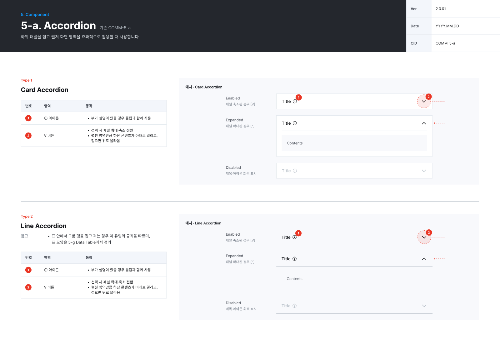
*COMM-5-a · Accordion*

| Type | 이름 | 설명 |
|---|---|---|
| Type 1 | Card Accordion | 카드 모양 패널을 접고 편다 |
| Type 2 | Line Accordion | 선으로 구분한 패널을 접고 편다. 표 안에서 그룹 행을 접고 펴는 경우도 이 규칙을 따르고 표 모양은 5-g Data Table을 따른다 |

| 상태 | 표시 |
|---|---|
| Enabled | 패널 축소, `[V]` |
| Expanded | 패널 확대, `[^]` |
| Disabled | 제목 · 아이콘 회색 |

| 번호 | 영역 | 동작 |
|---|---|---|
| 1 | ⓘ 아이콘 | 부가 설명이 있을 때 툴팁과 함께 사용 |
| 2 | V 버튼 | 선택 시 패널 확대 · 축소 전환. 펼친 만큼 아래 콘텐츠가 밀리고, 접으면 올라온다 |

### 5-b. Breadcrumb

현재 위치를 안내하고 상위 계층으로 이동할 수 있는 경로를 정의한다. (새로 추가)

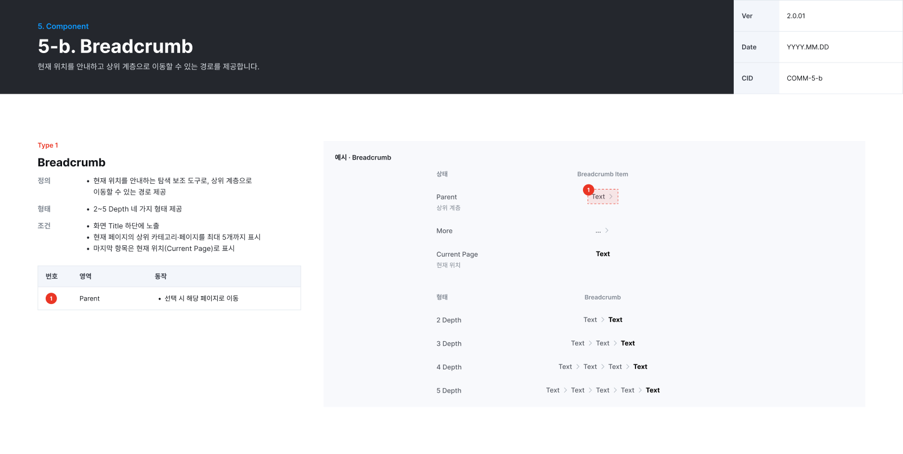
*COMM-5-b · Breadcrumb*

- **형태**: 2 Depth ~ 5 Depth 네 가지.
- **조건**: 화면 Title 아래에 노출. 현재 페이지의 상위 카테고리 · 페이지를 최대 5개까지 표시하고, 마지막 항목은 현재 위치(Current Page).

| 번호 | 영역(상태) | 동작 |
|---|---|---|
| 1 | Parent (상위 계층) | 선택 시 해당 페이지로 이동 |
| — | More | 생략된 중간 계층 |
| — | Current Page | 현재 위치 표시 |

### 5-c. Button

선택을 통해 상호작용을 유도하거나 작업을 수행하는 버튼을 정의한다. (기존 COMM-5-c)

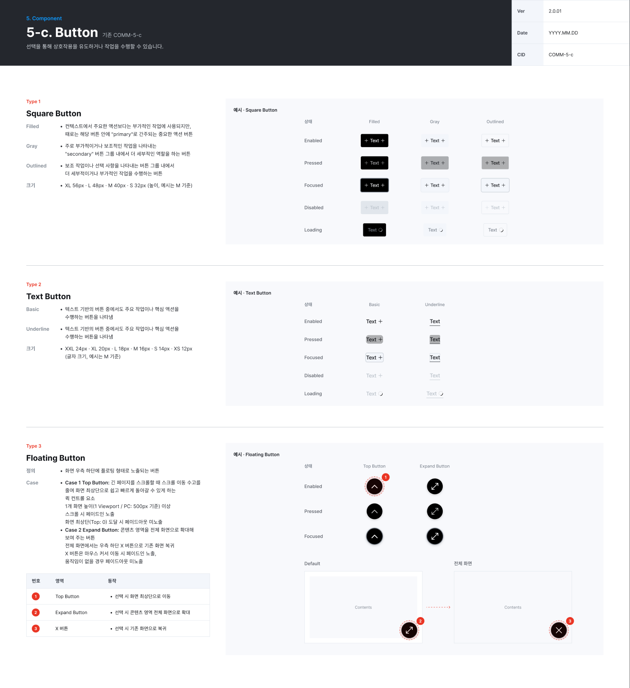
*COMM-5-c · Button*

**Type 1 · Square Button**

| 스타일 | 쓰임 |
|---|---|
| Filled | 화면의 주요(primary) 액션 |
| Gray | 보조(secondary) 버튼 그룹 안의 세부 작업 |
| Outlined | 보조 작업 · 선택 사항 |

- 상태: Enabled · Pressed · Focused · Disabled · Loading
- 크기(높이): XL 56px · L 48px · M 40px · S 32px

**Type 2 · Text Button** — Basic · Underline. 텍스트 기반 버튼 중 주요 작업을 수행하는 버튼. 글자 크기 XXL 24 · XL 20 · L 18 · M 16 · S 14 · XS 12px.

**Type 3 · Floating Button** — 화면 오른쪽 아래에 떠 있는 버튼.

| Case | 버튼 | 규칙 |
|---|---|---|
| Case 1 | Top Button | 화면 높이 1개(1 Viewport, PC 500px 기준) 이상 스크롤하면 페이드인, 최상단(Top 0)에 닿으면 페이드아웃. 선택 시 최상단으로 이동 |
| Case 2 | Expand Button | 선택 시 콘텐츠 영역을 전체 화면으로 확대. 전체 화면에서는 오른쪽 아래 X 버튼으로 복귀(커서를 움직이면 페이드인, 움직임이 없으면 페이드아웃) |

### 5-d. Calendar

년/월/일을 확인하거나 선택하는 캘린더를 정의한다. (기존 COMM-5-d)

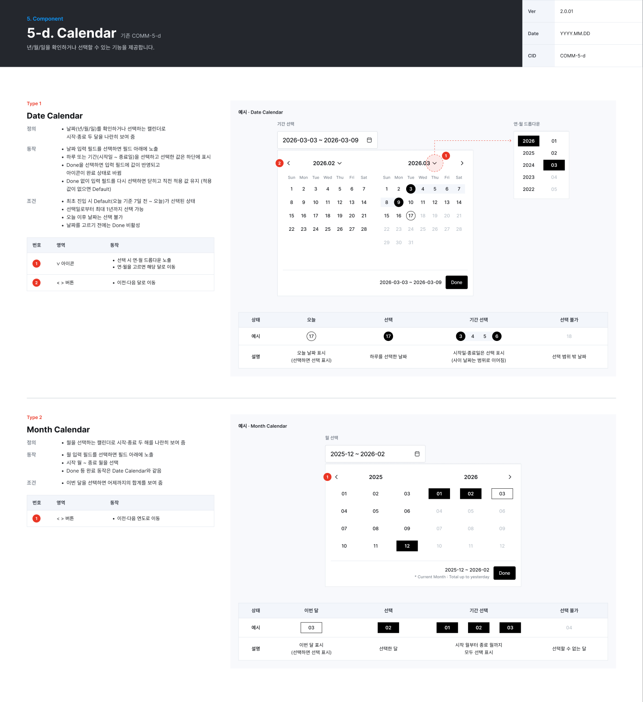
*COMM-5-d · Calendar*

**Type 1 · Date Calendar** — 시작 · 종료 두 달을 나란히 보여 준다.

- 동작: 날짜 입력 필드를 선택하면 필드 아래에 노출. 하루 또는 기간(시작일 ~ 종료일)을 고르고 고른 값은 아래에 표시. Done을 누르면 필드에 반영되고 아이콘이 완료 상태로 바뀜. Done 없이 필드를 다시 누르면 닫히고 직전 적용 값 유지(없으면 Default).
- 조건: 처음엔 Default(오늘 기준 7일 전 ~ 오늘). 선택일로부터 최대 1년. 오늘 이후는 선택 불가. 날짜를 고르기 전에는 Done 비활성.

| 번호 | 영역 | 동작 |
|---|---|---|
| 1 | ∨ 아이콘 | 연 · 월 드롭다운 노출, 고르면 그 달로 이동 |
| 2 | < > 버튼 | 이전 · 다음 달로 이동 |

| 상태 | 설명 |
|---|---|
| 오늘 | 오늘 날짜 표시(선택하면 선택 표시) |
| 선택 | 하루를 고른 날짜, 기간은 시작일 · 종료일 선택 표시 + 사이 날짜 범위 |
| 선택 불가 | 선택 범위 밖 날짜 |

**Type 2 · Month Calendar** — 시작 · 종료 두 해를 나란히 보여 주고 시작 월 ~ 종료 월을 고른다. Done 등 완료 동작은 Date Calendar와 같다. 이번 달을 고르면 어제까지의 합계를 보여 준다. < >는 이전 · 다음 연도로 이동.

### 5-e. Card

하나의 주제에 대한 정보를 묶어 보여 주고 필요하면 관련 페이지로 연결하는 카드를 정의한다. (기존 COMM-5-t)

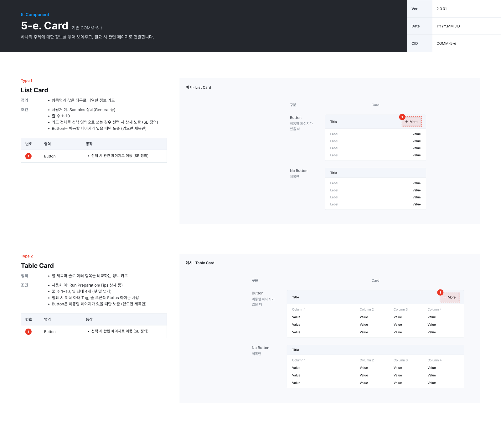
*COMM-5-e · Card*

| Type | 이름 | 정의 | 조건 |
|---|---|---|---|
| Type 1 | List Card | 항목명과 값을 좌우로 나열 | 사용처 예: Samples 상세(General 등). 줄 수 1~10. 카드 전체를 선택 영역으로 쓰면 선택 시 상세 노출(SB 정의) |
| Type 2 | Table Card | 열 제목과 줄로 여러 항목 비교 | 사용처 예: Run Preparation(Tips 상세 등). 줄 수 1~10, 열 최대 4개(첫 열 넓게). 필요 시 제목 아래 Tag, 줄 오른쪽 Status 아이콘 |

- Button은 이동할 페이지가 있을 때만 노출(없으면 제목만). 선택 시 관련 페이지로 이동(SB 정의).

### 5-f. Chips

콘텐츠를 구분해 보여 줄 때 쓰는 칩을 정의한다. 임시 상태가 아닌 완결된 메뉴 영역에서 쓴다. (기존 COMM-5-e)

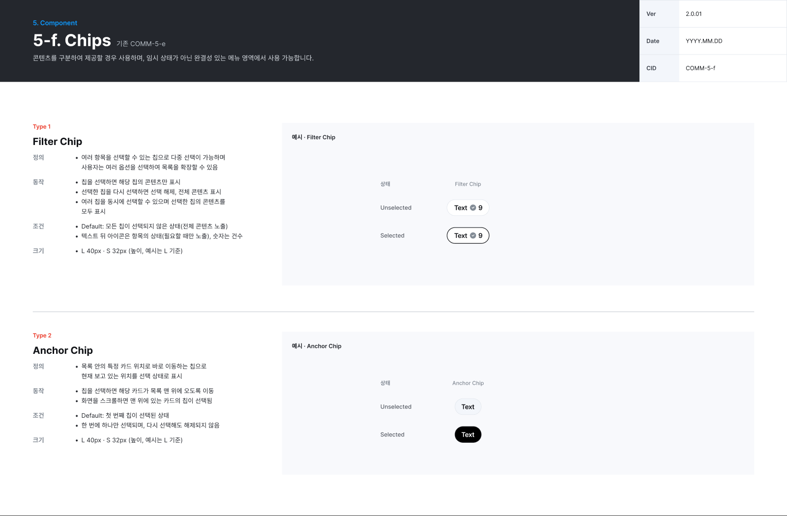
*COMM-5-f · Chips*

| Type | 이름 | 동작 | 조건 |
|---|---|---|---|
| Type 1 | Filter Chip | 칩을 고르면 그 칩의 콘텐츠만 표시, 다시 고르면 해제 · 전체 표시. 여러 개 동시 선택 가능 | Default: 아무것도 선택 안 됨(전체 노출). 글 뒤 아이콘은 상태(필요할 때만), 숫자는 건수 |
| Type 2 | Anchor Chip | 칩을 고르면 그 카드가 목록 맨 위로 이동. 스크롤하면 맨 위 카드의 칩이 선택됨 | Default: 첫 번째 칩 선택. 한 번에 하나만, 다시 골라도 해제되지 않음 |

- 상태: Unselected · Selected / 크기(높이): L 40px · S 32px

### 5-g. Data Table

그리드 형식의 표로 많은 데이터를 정리해 빠르게 파악하게 하는 표를 정의한다. (기존 COMM-5-m)

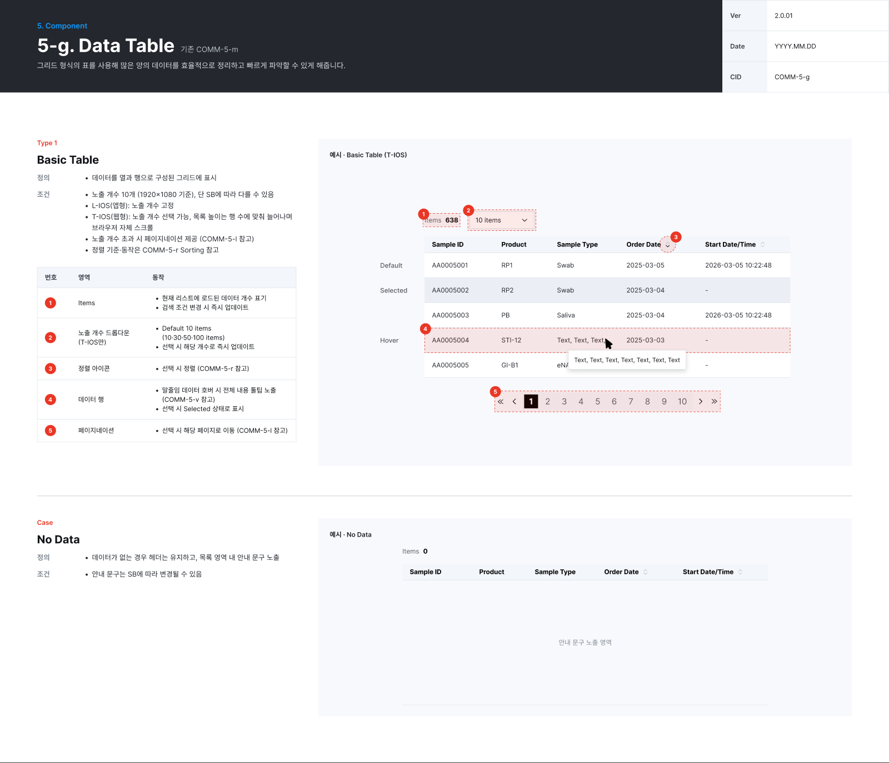
*COMM-5-g · Data Table*

**Type 1 · Basic Table**

- 노출 개수 10개(1920×1080 기준, SB에 따라 다를 수 있음).
- L-IOS(앱형): 노출 개수 고정 / T-IOS(웹형): 노출 개수 선택 가능, 목록 높이는 행 수에 맞춰 늘고 브라우저 스크롤.
- 노출 개수를 넘으면 페이지네이션(COMM-5-l). 정렬은 COMM-5-r.

| 번호 | 영역 | 동작 |
|---|---|---|
| 1 | Items 건수 | 지금 목록에 불러온 데이터 개수. 검색 조건이 바뀌면 바로 갱신 |
| 2 | 노출 개수 드롭다운 (T-IOS만) | Default 10 items(10 · 30 · 50 · 100). 고르면 바로 갱신 |
| 3 | 정렬 아이콘 | 선택 시 정렬(COMM-5-r) |
| 4 | 데이터 행 | 말줄임 데이터에 호버 시 전체 내용 툴팁(COMM-5-v). 선택 시 Selected. 상태: Default · Hover · Selected |
| 5 | 페이지네이션 | 선택 시 그 페이지로 이동(COMM-5-l) |

**Case · No Data** — 데이터가 없으면 헤더는 두고 목록 영역에 안내 문구를 노출한다(문구는 SB에 따라 다름). 건수는 0.

### 5-h. Dropdown (1/2) · Basic · Multi-Select

옵션 목록에서 하나 또는 여러 개를 고르는 드롭다운을 정의한다. (기존 COMM-5-f)

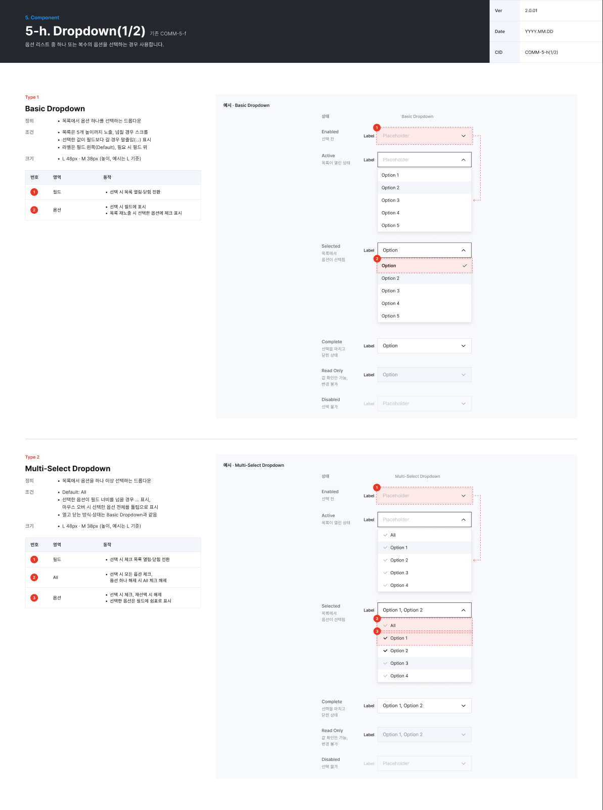
*COMM-5-h(1/2) · Basic · Multi-Select Dropdown*

| 상태 | 설명 |
|---|---|
| Enabled | 선택 전 |
| Active | 목록이 열린 상태 |
| Selected | 목록에서 옵션이 선택됨 |
| Complete | 선택을 마치고 닫힌 상태 |
| Read Only | 값 확인만, 변경 불가 |
| Disabled | 선택 불가 |

- 크기(높이): L 48px · M 38px. 라벨은 필드 왼쪽(Default), 필요 시 위.

**Type 1 · Basic Dropdown** — 옵션 하나를 고른다. 목록은 5개 높이까지, 넘치면 스크롤. 값이 필드보다 길면 말줄임(…).

| 번호 | 영역 | 동작 |
|---|---|---|
| 1 | 필드 | 선택 시 목록 열림 · 닫힘 |
| 2 | 옵션 | 선택 시 필드에 표시, 다시 열면 고른 옵션에 체크 |

**Type 2 · Multi-Select Dropdown** — 하나 이상 고른다. Default: All. 고른 옵션이 필드 폭을 넘으면 …, 마우스 오버 시 전체를 툴팁으로. 여닫는 방식 · 상태는 Basic과 같다.

| 번호 | 영역 | 동작 |
|---|---|---|
| 1 | 필드 | 선택 시 체크 목록 열림 · 닫힘 |
| 2 | All | 선택 시 모든 옵션 체크, 옵션 하나를 해제하면 All 해제 |
| 3 | 옵션 | 선택 시 체크, 다시 선택하면 해제. 고른 옵션은 필드에 쉼표로 표시 |

### 5-h. Dropdown (2/2) · Date · Period · Combine

날짜 · 기간 드롭다운과 두 필드를 묶은 Combine 드롭다운을 정의한다. (기존 COMM-5-f)

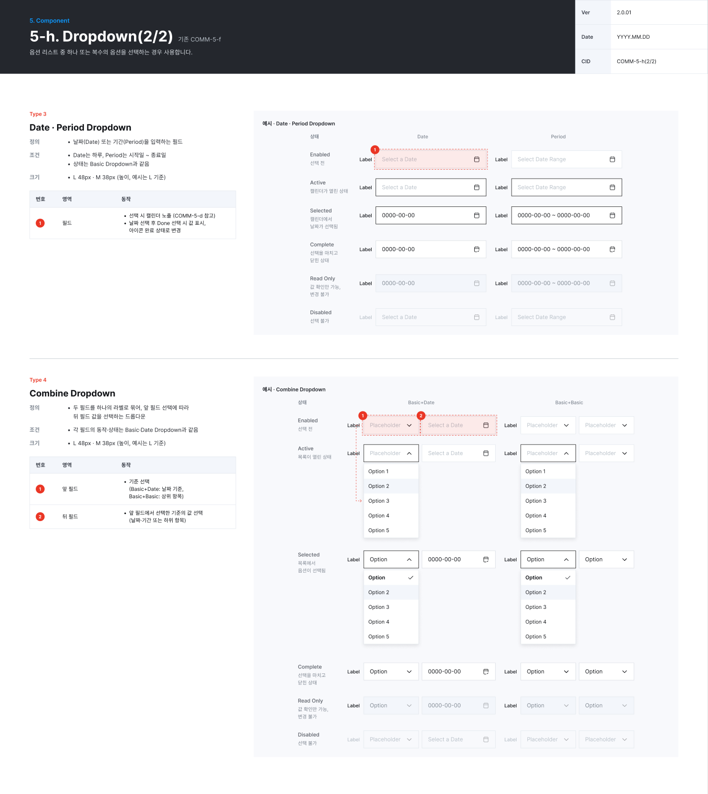
*COMM-5-h(2/2) · Date · Period · Combine Dropdown*

**Type 3 · Date · Period Dropdown** — Date는 하루, Period는 시작일 ~ 종료일. 상태 · 크기는 Basic과 같다(Active = 캘린더가 열린 상태). 필드를 선택하면 캘린더 노출(COMM-5-d), 날짜를 고르고 Done을 누르면 값 표시 · 아이콘 완료 상태.

**Type 4 · Combine Dropdown** — Basic+Date · Basic+Basic. 두 필드를 라벨 하나로 묶어 앞 필드 선택에 따라 뒤 필드 값을 고른다. 각 필드의 동작 · 상태는 Basic · Date와 같다.

| 번호 | 영역 | 동작 |
|---|---|---|
| 1 | 앞 필드 | 기준 선택(Basic+Date: 날짜 기준, Basic+Basic: 상위 항목) |
| 2 | 뒤 필드 | 앞에서 고른 기준의 값 선택(날짜 · 기간 또는 하위 항목) |

### 5-i. Info Box

화면 안에 안내 문구를 표시하는 박스를 정의한다. (새로 추가)

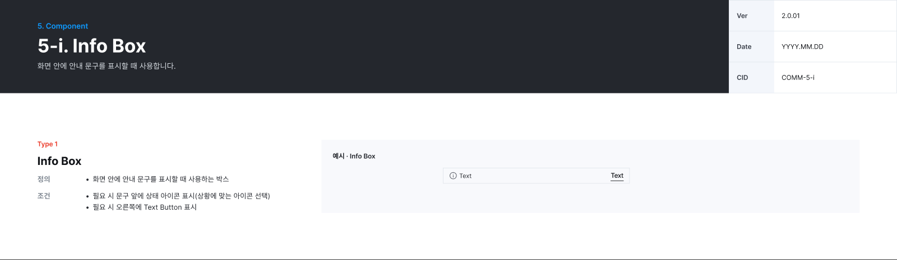
*COMM-5-i · Info Box*

- 필요하면 문구 앞에 상태 아이콘(상황에 맞는 아이콘)을 표시한다.
- 필요하면 오른쪽에 Text Button(COMM-5-c Type 2)을 표시한다.

### 5-j. Label

정보의 상태나 개수를 시각적으로 나타내는 라벨을 정의한다. (기존 COMM-5-r)

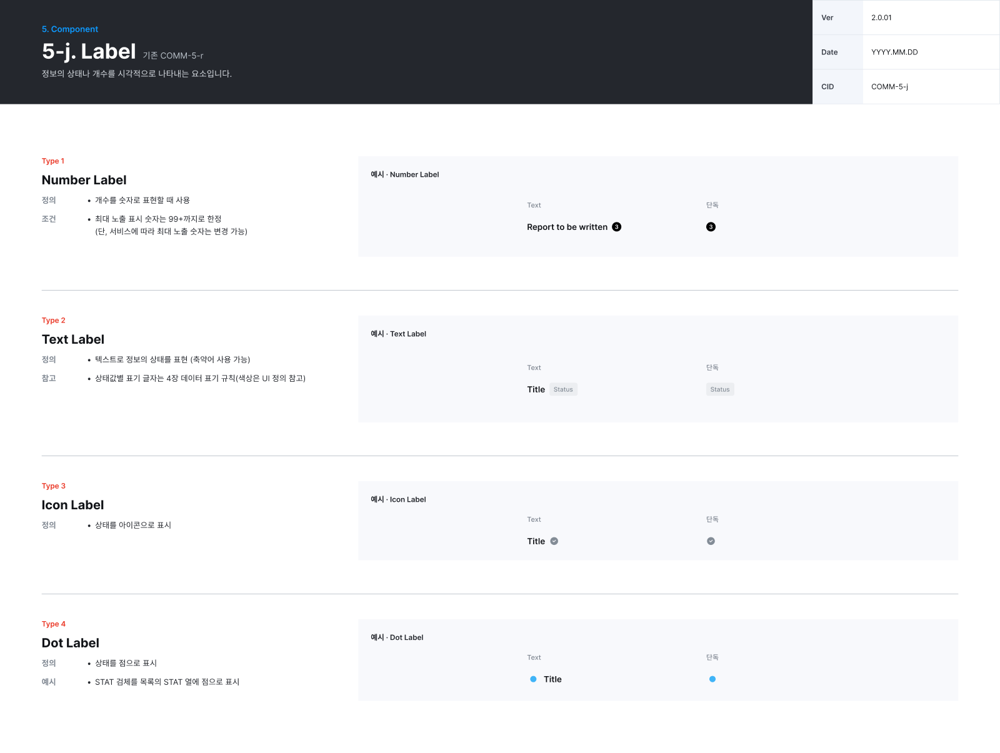
*COMM-5-j · Label*

| Type | 이름 | 정의 · 조건 |
|---|---|---|
| Type 1 | Number Label | 개수를 숫자로 표시(글 옆 · 단독). 최대 `99+`(서비스에 따라 바꿀 수 있음) |
| Type 2 | Text Label | 상태를 글로 표시(축약어 가능). 상태값별 글자는 4장 표기 규칙, 색은 UI 정의 |
| Type 3 | Icon Label | 상태를 아이콘으로 표시 |
| Type 4 | Dot Label | 상태를 점으로 표시. 예: STAT 검체를 목록의 STAT 열에 점으로 |

### 5-k. Loading

데이터 · 화면을 처리하는 동안 정지나 오류로 느끼지 않게 표시하는 로딩을 정의한다. (기존 COMM-5-g)

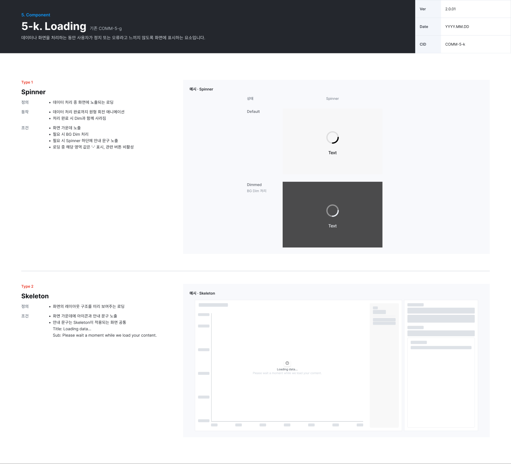
*COMM-5-k · Loading*

| Type | 이름 | 규칙 |
|---|---|---|
| Type 1 | Spinner | 처리 완료까지 원형 회전, 완료되면 Dim과 함께 사라짐. 화면 가운데, 필요 시 BG Dim(상태 Dimmed) · 아래 안내 문구. 로딩 중 그 영역 값은 `-`, 관련 버튼 비활성 |
| Type 2 | Skeleton | 화면 레이아웃 구조를 미리 보여 줌. 가운데에 아이콘과 안내 문구: Title `Loading data...` · Sub `Please wait a moment while we load your content.` |

### 5-l. Pagination

페이지를 이동하며 내용을 탐색하는 페이지네이션을 정의한다. (기존 COMM-5-i)

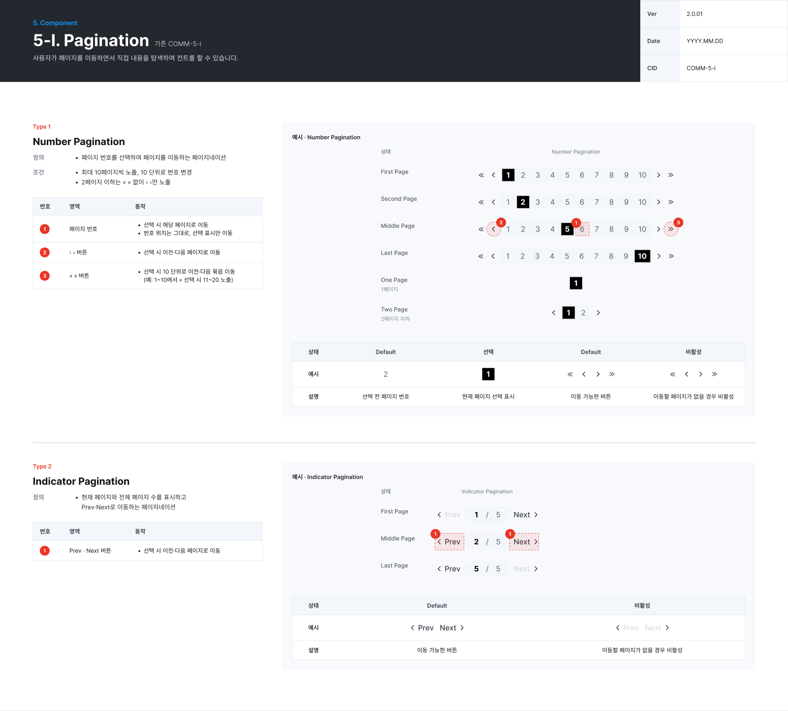
*COMM-5-l · Pagination*

**Type 1 · Number Pagination** — 최대 10페이지씩, 10 단위로 번호가 바뀐다. 2페이지 이하는 « » 없이 ‹ ›만. 상태 예시: First · Second · Middle · Last · One Page · Two Page.

| 번호 | 영역 | 동작 |
|---|---|---|
| 1 | 페이지 번호 | 선택 시 그 페이지로 이동. 번호 위치는 그대로, 선택 표시만 이동 |
| 2 | ‹ › 버튼 | 이전 · 다음 페이지 |
| 3 | « » 버튼 | 10 단위로 이전 · 다음 묶음(예: 1~10에서 » → 11~20) |

| 상태 | 설명 |
|---|---|
| Default | 선택 전 페이지 번호 · 이동 가능한 버튼 |
| 선택 | 현재 페이지 |
| 비활성 | 이동할 페이지가 없는 버튼 |

**Type 2 · Indicator Pagination** — 현재 페이지와 전체 페이지 수를 표시하고 Prev · Next 버튼으로 이동한다.

### 5-m. Popup (1/4) · Basic Popup

별도 화면을 띄워 중요한 정보를 전달하거나 작업을 완료하도록 돕는 팝업을 정의한다. (기존 COMM-5-j)

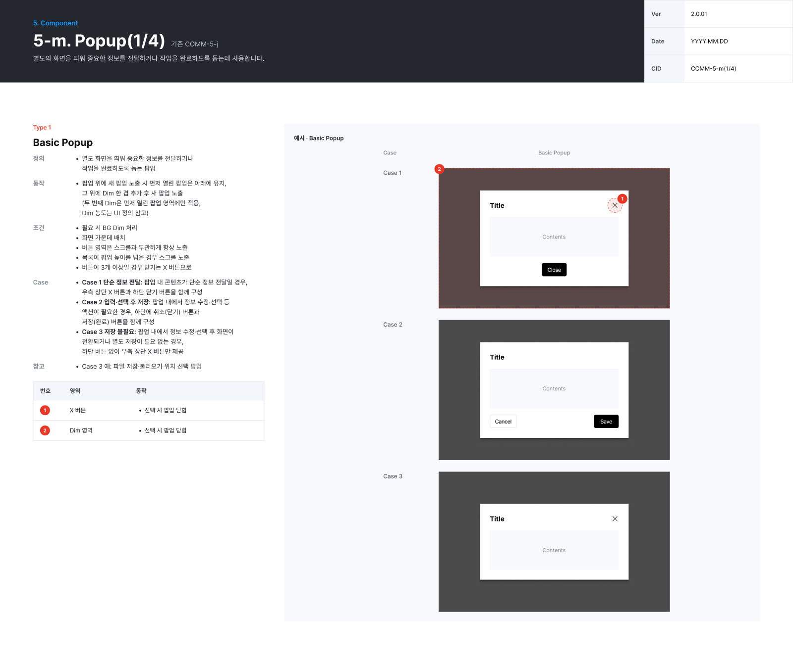
*COMM-5-m(1/4) · Basic Popup*

- 조건: 필요 시 BG Dim, 화면 가운데. 버튼 영역은 스크롤과 관계없이 항상 노출. 내용이 팝업 높이를 넘으면 스크롤. 버튼이 3개 이상이면 닫기는 X 버튼으로.
- 동작: 팝업 위에 새 팝업이 뜨면 먼저 열린 팝업은 아래에 두고 Dim 한 겹을 더한 뒤 새 팝업을 띄운다(두 번째 Dim은 먼저 열린 팝업 영역에만, 농도는 UI 정의).

| Case | 쓰임 | 버튼 |
|---|---|---|
| Case 1 | 단순 정보 전달 | 오른쪽 위 X + 아래 닫기 |
| Case 2 | 입력 · 선택 후 저장 | 아래 취소(닫기) + 저장(완료) |
| Case 3 | 저장 불필요(고른 뒤 화면 전환 등, 예: 파일 저장 · 불러오기 위치 선택) | 아래 버튼 없이 오른쪽 위 X만 |

| 번호 | 영역 | 동작 |
|---|---|---|
| 1 | Title · Contents | 팝업 제목 · 내용 |
| 2 | X 버튼 | 선택 시 팝업 닫힘 |

### 5-m. Popup (2/4) · Import / Export Popup

Import · Export 기능을 고르면 뜨는 위치 선택 팝업을 정의한다(Basic Popup Case 3 형태).

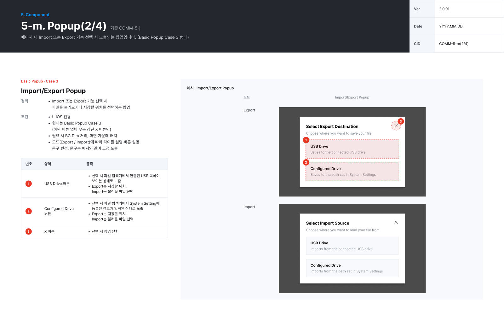
*COMM-5-m(2/4) · Import / Export Popup*

- L-IOS 전용. 아래 버튼 없이 오른쪽 위 X만. 필요 시 BG Dim, 화면 가운데.
- 모드에 따라 문구가 바뀌고 예시대로 고정 노출: Export = `Select Export Destination` / `Choose where you want to save your file`, Import = `Select Import Source` / `Choose where you want to load your file from`.

| 번호 | 영역 | 동작 |
|---|---|---|
| 1 | USB Drive 버튼 | 파일 탐색기를 연결된 USB 목록이 보이는 상태로 연다(Export는 저장 위치, Import는 불러올 파일). 설명: `Saves to the connected USB drive` / `Imports from the connected USB drive` |
| 2 | Configured Drive 버튼 | 파일 탐색기를 System Setting에 등록된 경로로 연다. 설명: `Saves to the path set in System Settings` / `Imports from the path set in System Settings` |
| 3 | X 버튼 | 팝업 닫힘 |

### 5-m. Popup (3/4) · Stacked Popup

여러 개가 생기면 쌓아 두고 한 영역에서 하나씩 확인하는 팝업을 정의한다(Basic Popup Case 2 형태).

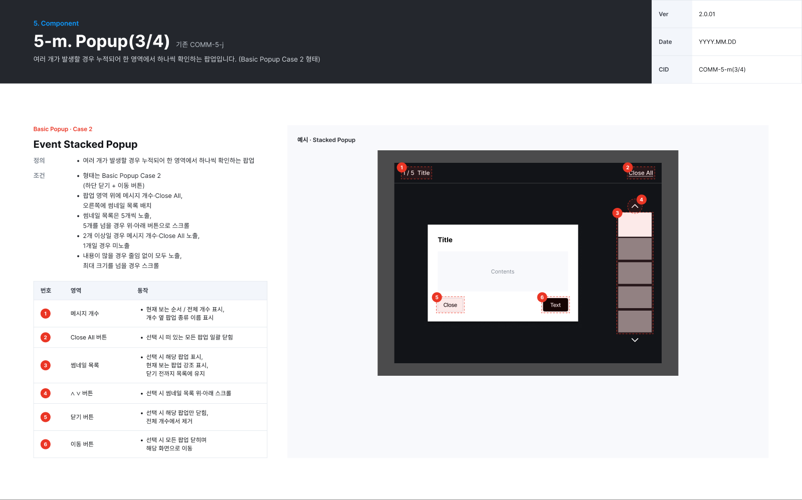
*COMM-5-m(3/4) · Event Stacked Popup*

- 팝업 위에 메시지 개수 · Close All, 오른쪽에 썸네일 목록. 썸네일은 5개씩, 넘으면 위 · 아래 버튼으로 스크롤.
- 2개 이상일 때만 메시지 개수 · Close All 노출. 내용이 많으면 줄이지 않고 모두 보이고, 최대 크기를 넘으면 스크롤.

| 번호 | 영역 | 동작 |
|---|---|---|
| 1 | 메시지 개수 | 지금 보는 순서 / 전체 개수(예: `1 / 5`), 옆에 팝업 종류 이름 |
| 2 | Close All 버튼 | 떠 있는 팝업 모두 닫힘 |
| 3 | 썸네일 목록 | 선택 시 그 팝업 표시, 지금 보는 팝업 강조, 닫기 전까지 목록에 유지 |
| 4 | ∧ ∨ 버튼 | 썸네일 목록 위 · 아래 스크롤 |
| 5 | 닫기 버튼 | 그 팝업만 닫히고 전체 개수에서 빠짐 |
| 6 | 이동 버튼 | 모든 팝업이 닫히고 해당 화면으로 이동 |

### 5-m. Popup (4/4) · Alert · Confirm

정보를 일방적으로 전달하는 Alert와 동의 · 확인을 구하는 Confirm을 정의한다.

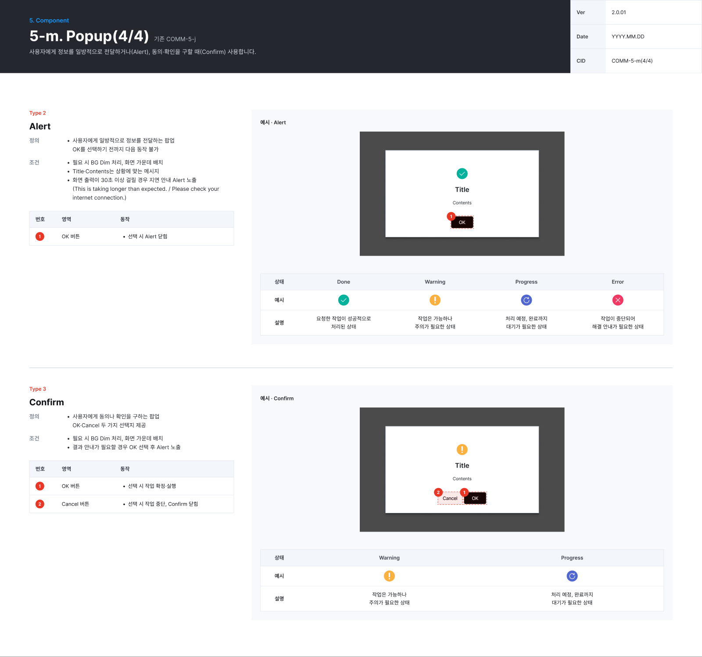
*COMM-5-m(4/4) · Alert · Confirm*

**Type 2 · Alert** — OK를 누르기 전까지 다음 동작 불가. 필요 시 BG Dim, 화면 가운데. 화면 출력이 30초 이상 걸리면 지연 안내 Alert(`This is taking longer than expected.` / `Please check your internet connection.`).

| 상태 | 설명 |
|---|---|
| Done | 요청한 작업이 성공적으로 처리됨 |
| Warning | 작업은 가능하나 주의가 필요함 |
| Progress | 처리 예정, 완료까지 대기 필요 |
| Error | 작업이 중단되어 해결 안내가 필요함 |

**Type 3 · Confirm** — OK · Cancel 두 선택지. 결과 안내가 필요하면 OK 뒤 Alert 노출.

| 번호 | 영역 | 동작 |
|---|---|---|
| 1 | OK 버튼 | Alert: 닫힘 / Confirm: 작업 확정 · 실행 |
| 2 | Cancel 버튼 | 작업 중단, Confirm 닫힘 |

### 5-n. Progress Bar

길거나 복잡한 과정의 진행 상태와 단계를 보여 주는 표시를 정의한다. (기존 COMM-5-b)

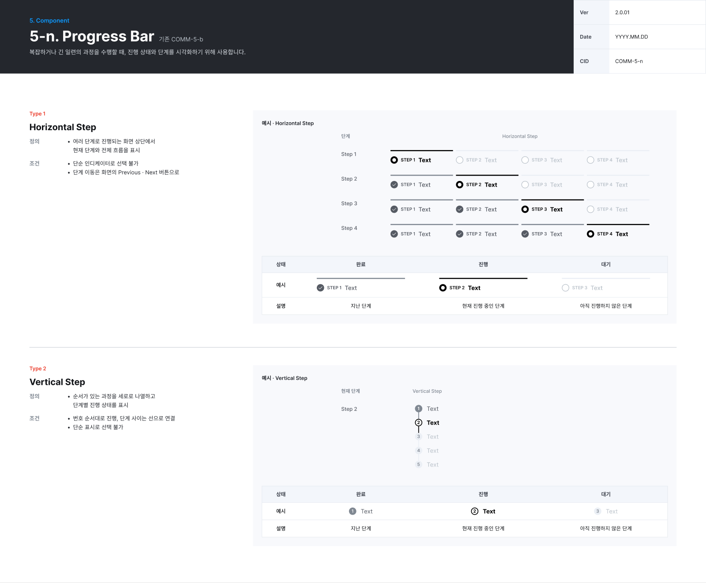
*COMM-5-n · Progress Bar*

| Type | 이름 | 규칙 |
|---|---|---|
| Type 1 | Horizontal Step | 여러 단계 화면 위쪽에 현재 단계와 전체 흐름(Step 1 ~ 4) 표시. 단순 인디케이터라 선택 불가, 단계 이동은 화면의 Previous · Next 버튼 |
| Type 2 | Vertical Step | 순서 있는 과정을 세로로 나열하고 단계별 상태 표시. 번호 순서대로, 단계 사이는 선으로 연결. 선택 불가 |

| 상태 | 설명 |
|---|---|
| 완료 | 지난 단계 |
| 진행 | 지금 진행 중인 단계 |
| 대기 | 아직 진행하지 않은 단계 |

### 5-o. Scroll Bar

제한된 영역을 넘는 콘텐츠를 스크롤로 이동하는 방식을 정의한다. (기존 COMM-5-k)

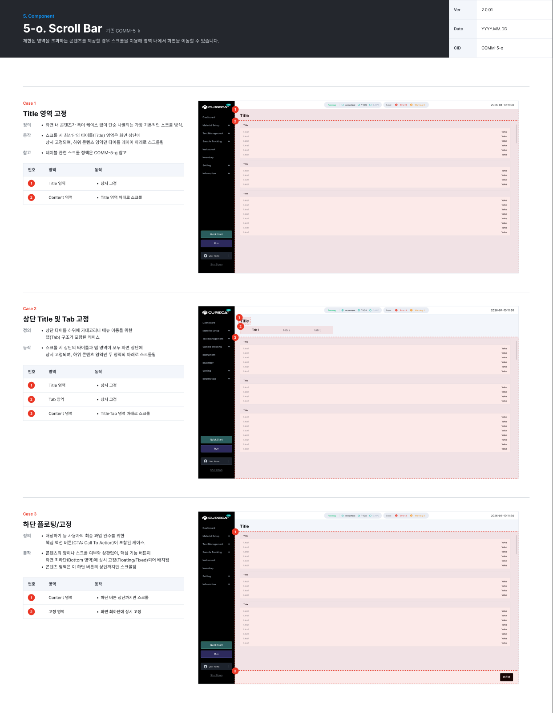
*COMM-5-o · Scroll Bar*

| Case | 구성 | 동작 |
|---|---|---|
| Case 1 | Title 영역 고정 | 가장 기본. Title 영역은 위에 늘 고정, Content 영역만 그 아래로 스크롤 |
| Case 2 | 상단 Title · Tab 고정 | Title 아래 Tab이 있는 화면. Title · Tab 모두 고정, Content만 그 아래로 스크롤 |
| Case 3 | 하단 플로팅/고정 | 저장 등 핵심 액션 버튼(CTA)은 콘텐츠 양과 관계없이 화면 맨 아래 고정, 콘텐츠는 그 버튼 위까지만 스크롤 |

- 표 안의 스크롤은 COMM-5-g를 따른다.

### 5-p. Search Bar

조회 조건을 AND로 묶어 목록 데이터를 빠르게 찾는 검색 영역을 정의한다. (기존 COMM-5-s)

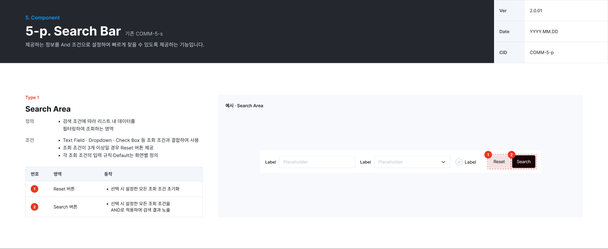
*COMM-5-p · Search Bar*

- Text Field · Dropdown · Check Box 등 조회 조건과 함께 쓴다. 조건이 3개 이상이면 Reset 버튼을 둔다. 각 조건의 입력 규칙 · Default는 화면별로 정의한다.

| 번호 | 영역 | 동작 |
|---|---|---|
| 1 | Reset 버튼 | 설정한 조회 조건을 모두 초기화 |
| 2 | Search 버튼 | 모든 조회 조건을 AND로 적용해 결과 노출 |

### 5-q. Selection Controls

여러 항목 중 원하는 것을 고르거나 선택 상태를 바꾸는 컨트롤을 정의한다. (기존 COMM-5-l)

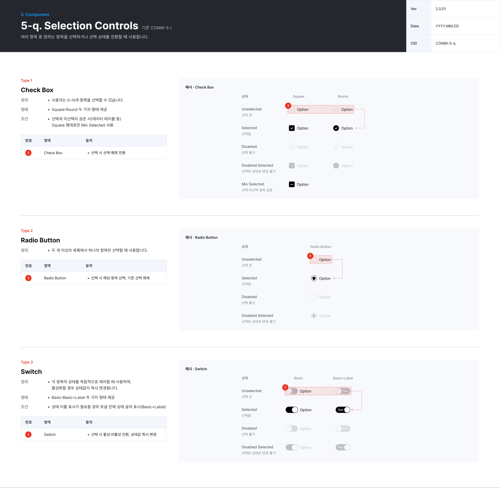
*COMM-5-q · Selection Controls*

| Type | 이름 | 규칙 |
|---|---|---|
| Type 1 | Check Box | 0~N개 선택. Square · Round 두 형태. 선택 · 미선택이 섞이는 곳(데이터 테이블 등)은 Square만 Mix Selected 사용. 선택 시 선택 · 해제 전환 |
| Type 2 | Radio Button | 두 개 이상 중 하나만 선택. 선택 시 그 항목 선택, 기존 선택 해제 |
| Type 3 | Switch | 항목 상태를 따로 제어, 켜면 상태값이 바로 바뀜. Basic · Basic+Label(토글 안에 상태 글자) |

| 상태 | 설명 |
|---|---|
| Unselected | 선택 전 |
| Selected | 선택됨 |
| Disabled | 선택 불가 |
| Disabled Selected | 선택된 채 변경 불가 |
| Mix Selected | 선택 · 미선택 항목 공존 (Check Box Square만) |

### 5-r. Sorting

표 데이터를 날짜 · 숫자 · 글 등의 기준으로 정렬하는 기능을 정의한다. (기존 COMM-5-v)

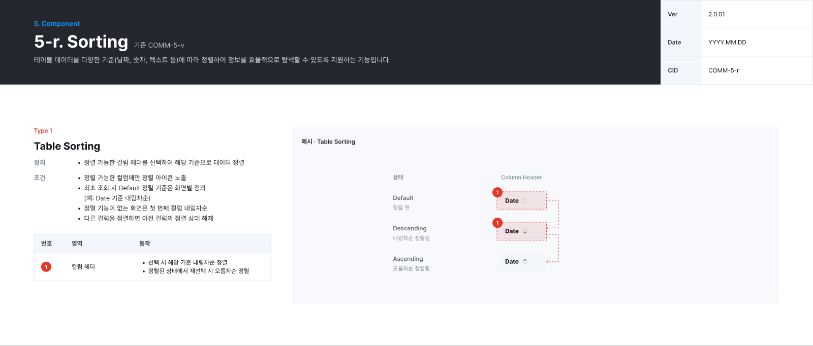
*COMM-5-r · Sorting*

- 정렬할 수 있는 열에만 정렬 아이콘. 처음 조회할 때 Default 정렬은 화면별 정의(예: Date 내림차순). 정렬 기능이 없는 화면은 첫 번째 열 내림차순. 다른 열을 정렬하면 이전 열의 정렬은 풀린다.

| 상태 | 설명 |
|---|---|
| Default | 정렬 전 |
| Descending | 내림차순 정렬됨 |
| Ascending | 오름차순 정렬됨 |

| 번호 | 영역 | 동작 |
|---|---|---|
| 1 | 열 헤더 | 선택 시 그 기준 내림차순, 정렬된 상태에서 다시 선택하면 오름차순 |

### 5-s. Tab

화면 안에서 콘텐츠 영역을 바꾸는 탭을 정의한다. (새로 추가)

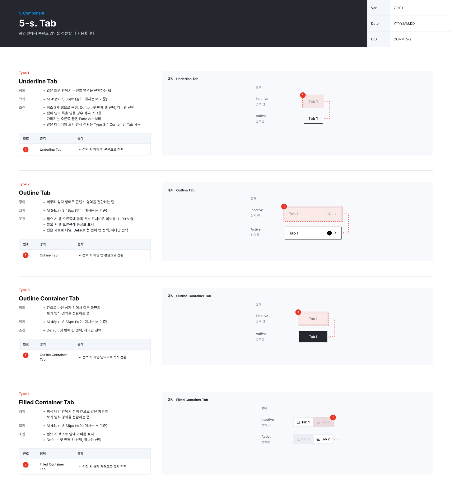
*COMM-5-s · Tab*

| Type | 이름 | 크기(높이) | 규칙 |
|---|---|---|---|
| Type 1 | Underline Tab | M 45px · S 36px | 같은 화면에서 콘텐츠 영역 전환. 최소 2개, Default 첫 번째 탭, 하나만 선택. 영역 폭을 넘으면 좌우 스크롤, 가려지는 오른쪽 끝은 Fade out. 같은 데이터의 보기 방식 전환은 Type 3 · 4 |
| Type 2 | Outline Tab | M 54px · S 48px | 테두리 상자 형태, 세로로 나열. 필요 시 오른쪽에 건수(0 미노출, 1~99 노출) · 화살표. Default 첫 번째, 하나만 선택 |
| Type 3 | Outline Container Tab | M 48px · S 36px | 칸으로 나뉜 상자 안에서 같은 화면의 보기 방식 · 영역 전환. Default 첫 칸, 하나만 선택, 선택 시 바로 전환 |
| Type 4 | Filled Container Tab | M 44px · S 36px | 회색 바탕 안 선택 칸으로 전환. 필요 시 글 앞 아이콘. Default 첫 칸, 하나만 선택 |

- 상태: Inactive(선택 전) · Active(선택됨). 선택 시 그 탭 콘텐츠로 전환.

### 5-t. Text Field

텍스트를 입력하고 고치는 입력 필드를 정의한다. (기존 COMM-5-n)

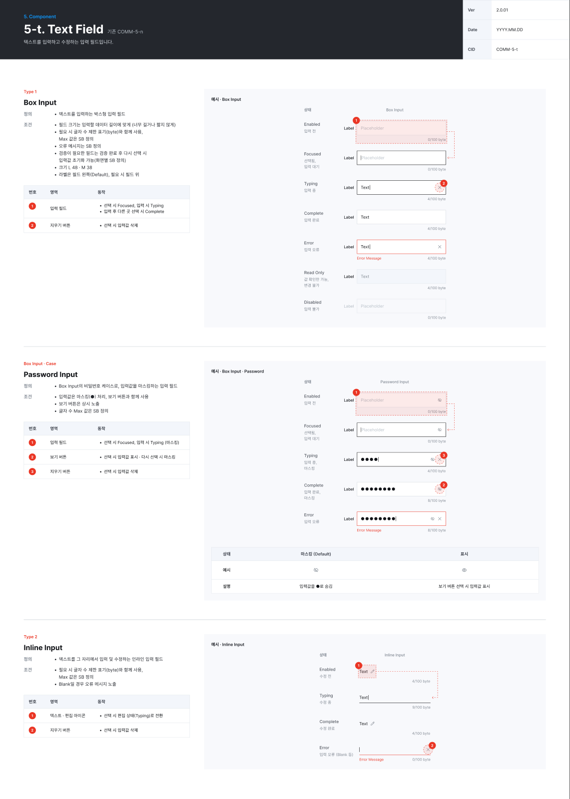
*COMM-5-t · Text Field*

**Type 1 · Box Input**

- 필드 크기는 입력할 데이터 길이에 맞게. 필요 시 글자 수 제한(byte) 표기, Max · 오류 메시지는 SB 정의. 검증이 필요한 필드는 검증 뒤 다시 선택하면 입력값을 초기화할 수 있다(화면별 SB). 크기 L 48 · M 38. 라벨은 왼쪽(Default), 필요 시 위.

| 상태 | 설명 |
|---|---|
| Enabled | 입력 전 |
| Focused | 선택됨, 입력 대기 |
| Typing | 입력 중 |
| Complete | 입력 완료 |
| Error | 입력 오류 |
| Read Only | 값 확인만, 변경 불가 |
| Disabled | 입력 불가 |

| 번호 | 영역 | 동작 |
|---|---|---|
| 1 | 입력 필드 | 선택 시 Focused, 입력 시 Typing, 다른 곳을 누르면 Complete |
| 2 | 지우기 버튼 | 입력값 삭제 |
| 3 | 보기 버튼 (Password) | 입력값 표시, 다시 누르면 마스킹 |

**Box Input · Password Input** — 입력값은 `●`로 마스킹(Default), 보기 버튼은 늘 노출. 글자 수 Max는 SB 정의.

**Type 2 · Inline Input** — 글을 그 자리에서 입력 · 수정. 텍스트 · 편집 아이콘을 누르면 편집 상태(Typing). 상태: 수정 전 · 수정 중 · 수정 완료 · 입력 오류(Blank 등). 필요 시 글자 수 제한(byte), Blank면 오류 메시지.

### 5-u. Toast

작업 완료 · 오류 때 화면 아래에 잠깐 나타나는 알림을 정의한다. (기존 COMM-5-w)

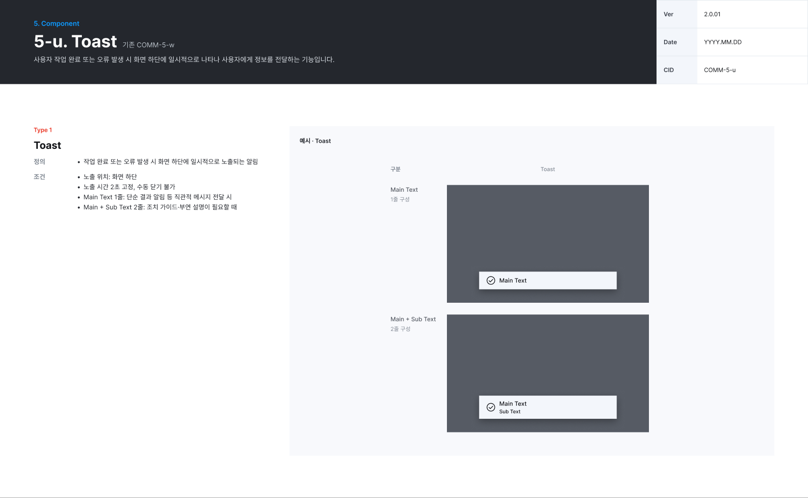
*COMM-5-u · Toast*

- 위치: 화면 아래. 노출 시간 2초 고정, 직접 닫을 수 없다.

| 구분 | 구성 | 쓰임 |
|---|---|---|
| Main Text | 1줄 | 단순 결과 알림 등 바로 알 수 있는 메시지 |
| Main + Sub Text | 2줄 | 조치 가이드 · 부연 설명이 필요할 때 |

### 5-v. Tool Tip

요소의 도움말 · 부가 정보를 화면을 가리지 않게 보여 주는 툴팁을 정의한다. (기존 COMM-5-o)

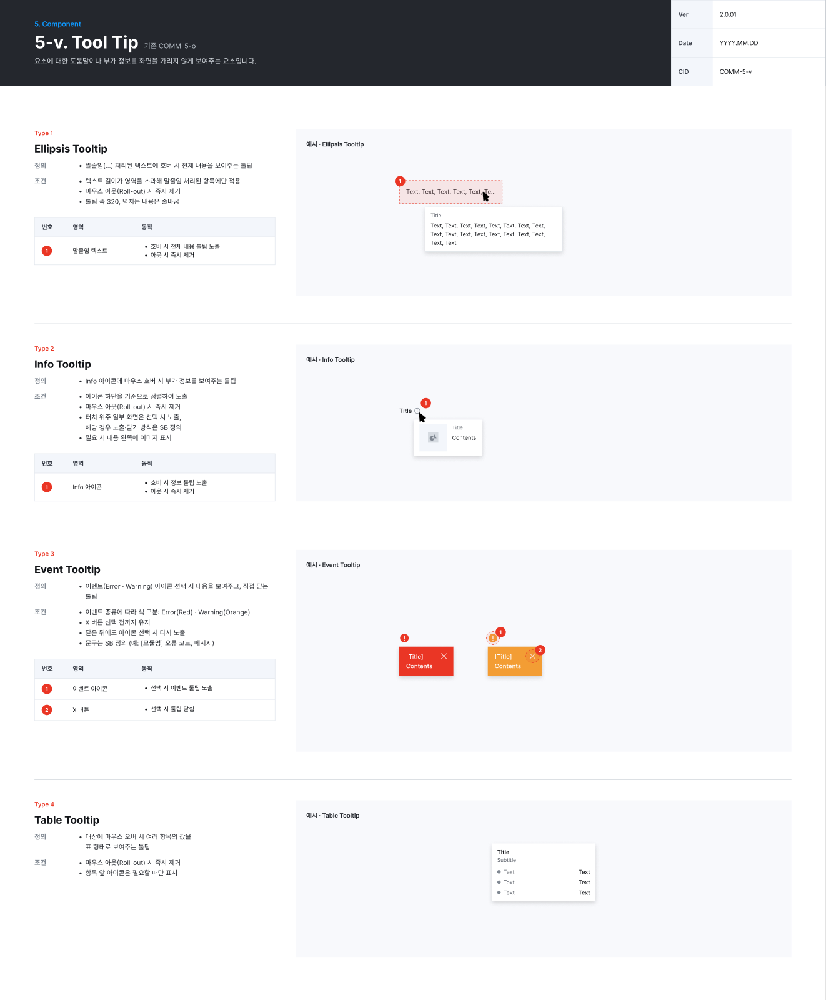
*COMM-5-v · Tool Tip*

| Type | 이름 | 규칙 |
|---|---|---|
| Type 1 | Ellipsis Tooltip | 말줄임(…)된 글에 호버하면 전체 내용. 말줄임된 항목에만, 마우스 아웃 시 바로 사라짐. 폭 320, 넘치면 줄바꿈 |
| Type 2 | Info Tooltip | Info 아이콘에 호버하면 부가 정보. 아이콘 아래 기준 정렬, 아웃 시 바로 사라짐. 터치 위주 화면은 선택 시 노출(노출 · 닫기는 SB 정의). 필요 시 내용 왼쪽에 이미지 |
| Type 3 | Event Tooltip | 이벤트(Error · Warning) 아이콘을 누르면 내용 표시, X로 직접 닫음. Error Red · Warning Orange. 닫은 뒤에도 아이콘을 누르면 다시 노출. 문구는 SB 정의(예: `[모듈명] 오류 코드, 메시지`) |
| Type 4 | Table Tooltip | 대상에 마우스 오버 시 여러 항목 값을 표로. 아웃 시 바로 사라짐. 항목 앞 아이콘은 필요할 때만 |

### 5-w. Validation Check

입력값과 처리 결과를 확인해 알려 주는 규칙을 정의한다. 화면마다 따로 정할 것은 개별 SB에서 정의한다. (기존 COMM-5-Y)

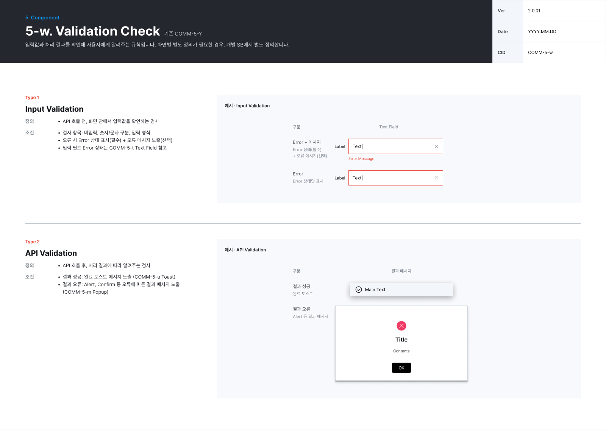
*COMM-5-w · Validation Check*

| Type | 이름 | 규칙 |
|---|---|---|
| Type 1 | Input Validation | API 호출 전 화면에서 입력값 확인. 검사 항목: 미입력 · 숫자/문자 구분 · 입력 형식. 오류 시 Error 상태(필수) + 오류 메시지(선택). 필드 Error 상태는 COMM-5-t |
| Type 2 | API Validation | API 호출 뒤 결과 알림. 성공: 완료 토스트(COMM-5-u). 오류: Alert · Confirm 등 결과 메시지(COMM-5-m) |

## 6. Mobile

모바일(MO) Common UX의 목차와 PC 정의와의 관계를 정리한다.

### 6-a. MO 목차 (M-COMM-0)

모바일 문서의 CID 규칙과 항목별 정의 방식을 정의한다.

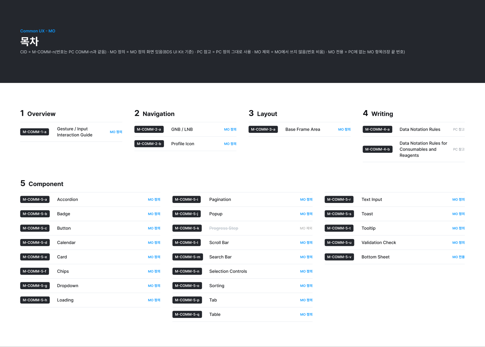
*M-COMM-0 · Common UX - MO 목차*

- CID = `M-COMM-n`(번호는 PC `COMM-n`과 같음).
- **MO 정의** = MO 정의 화면이 있음(BDS UI Kit 기준) · **PC 참고** = PC 정의를 그대로 씀 · **MO 제외** = MO에서 쓰지 않음(번호 비움) · **MO 전용** = PC에 없는 MO 항목(5장 끝 번호).

| CID | 항목 | 구분 |
|---|---|---|
| `M-COMM-1-a` | Gesture / Input Interaction Guide | MO 정의 |
| `M-COMM-2-a` · `2-b` | GNB / LNB · Profile Icon | MO 정의 |
| `M-COMM-3-a` | Base Frame Area | MO 정의 |
| `M-COMM-4-a` · `4-b` | Data Notation Rules · Consumables and Reagents | PC 참고 |
| `M-COMM-5-a` ~ `5-j` | Accordion · Badge · Button · Calendar · Card · Chips · Dropdown · Loading · Pagination · Popup | MO 정의 |
| `M-COMM-5-k` | Progress Step | MO 제외 |
| `M-COMM-5-l` ~ `5-u` | Scroll Bar · Search Bar · Selection Controls · Sorting · Tab · Table · Text Input · Toast · Tooltip · Validation Check | MO 정의 |
| `M-COMM-5-v` | Bottom Sheet | MO 전용 |

- MO 목차의 컴포넌트 번호는 PC 2.2 번호(5-a ~ 5-w)가 아니라 이전 번호 체계(Badge · Progress Step · Table · Text Input …)를 쓰고 있다. MO 화면을 볼 때는 이 표의 이름으로 찾는다.
- MO 정의 화면은 Common UX 페이지의 `M-COMM-*` 프레임과 `Connon UX (Mobile)` 섹션(`1796:183895`, `M-Components (Mobile)` 포함)에 있다. 이 가이드에는 목차만 옮겼다.
