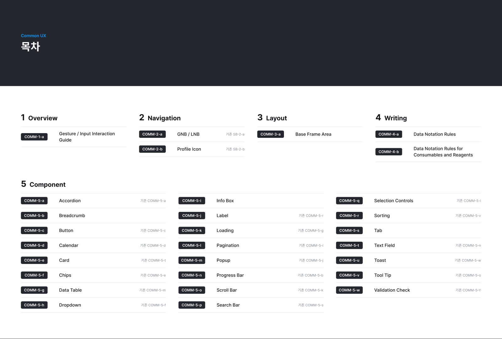

# Common UX 가이드 _1105

UX AI TEST 파일의 **Common UX** 페이지(`355:53300`, Common UX 2.2 · V2.2.00 · 2026-10-30)를 기준으로 정리한 UX 가이드다. 화면을 설계하거나 기존 화면을 고칠 때 이 규칙을 따른다. 구성은 CURECA UX 가이드(`g20261028-brex-06-J003`)를 본보기로 했고, 1~4장은 그 가이드와 Figma 내용이 같아 같은 글을 쓰고 캡처만 새로 받았다. 5장 컴포넌트는 2.2 목차에 맞춰 **23개(5-a ~ 5-w)**로 새로 정리했다. 상태값 · 표기 정의는 씨젠이 공유하는 「CURECA 시스템 구성 요소 및 상태 정보」 문서를 최우선으로 한다.

> 왼쪽 목차는 Figma 문서의 목차(COMM-0)와 같은 구조다. 대분류를 누르면 그 아래 항목이, 항목을 누르면 세부 내용이 오른쪽에 나온다. 그림을 누르면 크게 볼 수 있다. 모바일(MO) 정의는 「6. Mobile」에 목록으로 정리했다.

### 프레임 구성

| 구분 | 크기 | 구성 |
|---|---|---|
| 표지 (`Cover`) | 1920 × 1080 | CURECA · Common UX |
| 변경 이력 (`Revision History`) | 1920 × 495 | 버전 · 변경날짜 · 기능 · 변경사항 · 페이지 · 담당자 (V2.2.00 · 26/10/30 · All) |
| 목차 (`COMM-0`) | 1920 × 1295 | 대분류 1~5와 각 상세 프레임 CID · 이름, 기존 번호 |
| 대분류 표지 (`COMM-1` ~ `COMM-5`) | 1920 × 1080 | `Title`(Common UX · 대분류명 · 번호) + `Items`(하위 CID · 이름) |
| 상세 프레임 (`COMM-1-a` …) | 폭 1920, 높이는 내용에 맞춤 | `Header` + `Body` |
| 컴포넌트 (`P-Components (PC)`) | 7360 × 25548 | PC 컴포넌트 모음(Navigation · Status · Button · Input · List · Overlay · Feedback · Icon) |
| 모바일 (`M-COMM-*`, `Connon UX (Mobile)` 섹션) | 1920 × 내용 | MO 목차 · MO 정의 화면 |

- **Header 항목**: 대분류(예: `5. Component`) · 제목(예: `5-a. Accordion`) · 기존 번호(예: `기존 COMM-5-a`) · 한 줄 설명(「…합니다.」)
- **Body**: `Type n` 블록마다 예시 그림 + 「상태 · 정의 · 동작 · 조건 · 크기」 표 + 「번호 · 영역 · 동작」 표.
- 한 주제가 길면 `(1/2)`, `(1/4)`처럼 나눠 프레임을 이어 붙인다.

## 0. 문서 구성 (목차)

*COMM-0 · 목차 (V2.2.00, 2026-10-30)*

문서는 5개 대분류로 구성한다. 대분류마다 표지 프레임 1장과 상세 프레임이 이어진다.

| 대분류 | 표지 | 상세 프레임 |
|---|---|---|
| 1. Overview | `COMM-1` | `COMM-1-a` Gesture / Input Interaction Guide |
| 2. Navigation | `COMM-2` | `COMM-2-a` GNB / LNB (기존 SB-2-a), `COMM-2-b` Profile Icon (기존 SB-2-b) |
| 3. Layout | `COMM-3` | `COMM-3-a` Base Frame Area (1/2 · 2/2) |
| 4. Writing | `COMM-4` | `COMM-4-a` Data Notation Rules (1/4 ~ 4/4), `COMM-4-b` Data Notation Rules for Consumables and Reagents (1/5 ~ 5/5) |
| 5. Component | `COMM-5` | `COMM-5-a` ~ `COMM-5-w` 23개 (아래 「5. Component」 번호표) |

### CID 규칙

- 형식: `COMM-{대분류 번호}-{소분류 알파벳}` · 나눈 프레임은 `({현재}/{전체})`를 붙인다(예: `COMM-4-a(2/4)`).
- 컴포넌트 번호는 **알파벳 순서**로 매긴다. 2.2에서 Breadcrumb · Info Box · Tab이 더해져 번호가 다시 바뀌었다. 기존 번호는 「5. Component」의 대응표로 찾는다.
- 모바일은 `M-COMM-{n}`을 쓰고 번호는 PC `COMM-{n}`과 같다(「6. Mobile」).

