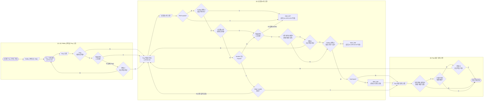

# 소모품 Tray 적재 정책서

## 1. 개요

| 항목 | 내용 |
|---|---|
| 대상 | 소모품 Tray 적재 |
| 시나리오 | (1) Trolley 선택 팝업 노출 → (2) Trolley 선택 또는 Skip → (3) Tray 전체 바코드 스캔 → (4) 적재할 소모품/시약 스캔 → (5) 적재할 Tray 내부 영역 스캔 |
| LCR-01-02 | `LI-TSS-PSI-LCR-01-02` Tray 스캔 화면 (소모품 Tray 가이드 진입 후 Trolley 선택 또는 Skip을 거쳐 진입) |
| LCR-01-03 | `LI-TSS-PSI-LCR-01-03` Tray 적재 가이드. 흐름도의 복귀 지점이며, 소모품/시약 스캔과 Tray 내부 위치 스캔은 이 가이드에서 진행한다 |

- 이 메뉴의 목적은 **소모품/시약을 Tray 내부 위치에 적재하는 행위**이다.
- Trolley 선택은 필요 수량 표시용이며 데이터 연결은 생기지 않는다(공통 정책서 2.3-1). 다만 Trolley를 선택한 경우에만 아래 두 가지 제한이 적용된다.
  - 필요 목록에 없는 소모품/시약 → **Alert_027**
  - 필요 수량을 이미 모두 적재한 소모품/시약을 새로 스캔 → **Alert_046** *(초과 적재 허용 여부는 현업 문의 중, 10장 4번)*
- Skip한 경우에는 필요 목록이 없으므로 모든 소모품/시약 바코드를 스캔할 수 있다.
- **필요 수량 카운트**
  - 선택한 검체 Trolley는 "그 Trolley의 검체를 검사하는 데 필요한 소모품/시약"을 보여 주는 용도이다. 실제 적재는 소모품 Tray에 하고, 그 Tray는 소모품 Trolley에 올린다.
  - 수량은 **`[Done]` 기준**으로 **선택한 검체 Trolley 몫**에 저장한다. 다시 같은 Trolley를 선택하면 저장된 수량부터 이어서 센다. 다른 Trolley는 각자 따로 센다.
  - 필요 수량은 검체 Trolley A를 SAM-03-02에서 다시 `[Done]`하면 새로 계산한다. 저장된 A 몫 수량은 그대로 둔다. 예) 3/5 저장 후 필요 수량이 7로 늘면 3/7. 필요 수량이 저장 수량보다 작아질 때의 표기는 현업 문의 중(10장 4번).
  - 작업 중 화면 수량과 Alert_046 판단은 `[Done]` 전 변경(적재·`[Remove]`·컨펌 C)까지 반영한 수량으로 한다. 예) 5/5에서 1개 `[Remove]` → 4/5로 표시, 새로 1개 적재 가능.
  - `[Done]` 없이 메뉴를 벗어나면 그 작업의 수량은 사라진다. 예) Tray 1 적재 후 `[Done]`, Tray 2 적재 중 이탈 → Tray 1 수량만 남는다.
  - Skip으로 적재한 수량은 어느 Trolley 몫으로도 세지 않는다. *(Skip으로 구성한 Tray 처리는 현업 문의 중, 10장 5번)*
  - 카운트한 소모품/시약을 `[Remove]`하거나 다른 위치로 옮기거나(컨펌 C), 그 Tray가 검체 Tray로 바뀌면(검체 Tray 정책서 컨펌 A) `[Done]` 시 원래 몫에서 뺀다. 옮긴 경우 지금 선택한 Trolley 몫으로 다시 센다.
  - socket·frame에 담는 시약(Standard tube, PK/IC tube, Tub)은 socket·frame **1개를 1개**로 센다.
  - 같은 작업에서 여러 Tray에 적재한 수량은 **합산**한다(LCR-01-04 `[Add New]` 후에도 유지).
  - 이미 Tray에 있던 소모품/시약을 옮기는 경우(컨펌 C)는 **Y를 누른 뒤** 필요 수량을 확인한다. Y를 누르면 원래 자리 연결이 해제 예정으로 기록되고, 그 소모품/시약이 지금 선택한 Trolley 몫이었다면 수량이 하나 줄어든 상태로 본다. 그 상태에서 다 찼으면 Alert_046을 노출한다.
    - 예) A 몫 PBS 5/5, A 몫인 P1을 다른 Tray로 옮김 → Y 후 4/5 → 적재 가능 → 5/5
    - 예) A 몫 PBS 5/5, Skip으로 적재한 P1을 옮김 → Y 후에도 5/5 → Alert_046 *(현업 문의 결과에 따라 바뀔 수 있음, 10장 4·5번)*
- **필요 수량과 테스트 수는 별개**이다. 필요 수량은 개수로 세고, 스캔 완료 토스트는 시약의 테스트 수를 `N rxns` 형식으로 보여 준다(예: `24 rxns / 192 rxns`). 남은 수량이 있는 시약도 스캔할 수 있기 때문이다.
- **Alert_046 확인 시점** *(초과 적재를 허용하면 바뀔 수 있음, 10장 4번)*
  - 데이터 있는 socket·Tub frame: 내용물로 종류를 알 수 있으므로 **스캔 즉시** 확인한다. 다 채웠으면 Alert_046만 노출하고 Alert_042는 노출하지 않는다.
  - 데이터 없는 G10 socket: Standard tube용으로 본다. Standard tube가 **모두** 다 채워졌으면 socket 스캔 시 Alert_046, 일부만 채워졌으면 Step 1에서 tube를 스캔할 때 확인한다.
  - 데이터 없는 Tub frame: Tub가 **모두** 다 채워졌으면 frame 스캔 시 Alert_046, 일부만 채워졌으면 Step 1에서 Tub를 스캔할 때 확인한다.
- LCR-01-03에는 **[Remove] 기능**이 있어, 스캔한 Tray의 내부 위치에 적재된 소모품/시약을 제거할 수 있다. `[Remove]`도 변경 예정 사항으로 기록되며 `[Done]`을 눌러야 반영된다(8장).
- 공통 데이터·컨펌·저장·복귀 원칙은 `common-loading-policy.md`를 따른다. 공통 정책서의 Trolley·Tray·Floor는 이 흐름에서 Tray·소모품/시약·Tray 내부 위치로 읽는다(공통 정책서 2.6).
- 검체 Tray 흐름은 `specimen-tray-policy.md`를 따른다.
- PK/IC socket은 PK/IC Setup(`pkic-setup-policy.md`)에서 PK/IC tube를 적재한 뒤 이 흐름에서 Tray에 적재한다.

---

## 2. 용어 및 적재 계층

### 2.1 적재 단위

적재 단위의 종류와 소모품/시약의 결합 구조는 공통 정책서 2.1·2.2를 따른다.

- 소모품 Tray에는 소모품/시약만 적재한다. 소모품/시약은 DWP, Standard tube, Tub, Tip/Swab, PK/IC tube이다.
- DWP는 소모품 rack과 결합하지 않고 단독으로 적재한다. Tip/Swab은 소모품 rack과 결합하여 적재한다. Standard tube와 PK/IC tube는 socket에 적재한 뒤 소모품 rack과 결합하여 적재하고, Tub는 frame에 적재한 뒤 소모품 rack과 결합하여 적재한다.
- PK/IC tube를 socket에 적재하는 작업은 PK/IC Setup(`pkic-setup-policy.md`)에서 먼저 진행한다. 이 흐름에서는 PK/IC socket을 소모품 rack과 결합하여 Tray에 적재한다.
- 이 흐름에서 스캔하는 대상은 Tray에 올리는 소모품/시약의 바코드(socket, frame, Tip/Swab 자체 바코드, DWP)이며, 본 정책서에서는 이를 **소모품/시약**으로 표기한다.
- 소모품 rack은 스캔하지 않으며 물리적으로만 결합한다.
- PCR socket(PCR box용·MM tube용 모두)은 소모품 rack과 다른 종류이며, Tray에 적재하지 않고 cold storage에 적재하므로 소모품 Tray에 적재할 수 없다(`pcr-setup-policy.md`).

### 2.2 적재 계층

| 구분 | 하위 | 중위 | 상위 |
|---|---|---|---|
| 검체 계열 | 검체, 검체 socket | 검체 Tray | 검체 Trolley |
| 소모품 계열 | 소모품/시약 (DWP 단독, 또는 소모품 rack과 결합) | 소모품 Tray | 소모품 Trolley |

- 본 정책서에서 "상위"는 **Tray(Tray 내부 위치)**, "하위"는 Tray에 적재된 **소모품/시약**를 뜻한다.
- 소모품 Tray에는 소모품/시약만 적재할 수 있다.
- PCR socket은 데이터 유무와 용도에 관계없이 소모품 Tray에 적재할 수 없다(Alert_027).
- 흐름도와 문구에서 쓰는 "Tray 위치", "Tray 내부 위치", "Tray 내부 영역", "Tray slot"은 모두 같은 대상이며, 본 정책서에서는 **Tray 내부 위치**로 표기한다. 영문 문구에서는 **Tray slot**(복수 slots)으로 쓴다. 이전 표기 "section"은 쓰지 않는다(2026-10-30 현업 변경).

---

## 3. 공통 정책 적용

### 3.1 컨펌 적용

| 스캔 대상 | 데이터 상태 | 컨펌 / 얼럿 |
|---|---|---|
| Tray | 데이터 없음 | 없음 |
| Tray | 데이터 있음 + 적재 항목 = 소모품 | 없음 (기존 소모품 Tray에 이어서 적재하는 것이 정상) |
| Tray | 데이터 있음 + 적재 항목 = 검체 | **컨펌 A** |
| 소모품/시약 | PCR socket (데이터 유무·용도 무관) | **Alert_027** |
| 소모품/시약 | Trolley 선택 + 필요 목록에 없는 항목 | **Alert_027** |
| 소모품/시약 | 폐기된 소모품/시약 (빈 socket·frame은 Step 1에서 스캔 시) | **Alert_047** |
| 소모품/시약 | 유효기간이 만료된 시약 (빈 socket·frame은 Step 1에서 대표 tube·Tub 스캔 시) | **Alert_029** |
| 소모품/시약 | Trolley 선택 + 필요 수량을 이미 모두 적재한 항목 (새로 적재하는 경우) | **Alert_046** |
| 소모품/시약 | 데이터 없음 + Socket 또는 Frame | **Step 1 guide 팝업** |
| 소모품/시약 | 데이터 없음 + Socket/Frame 아님 | 없음 (적재 항목 판단으로 진행) |
| 소모품/시약 | 데이터 있음 + 적재 항목 = 검체 | **Alert_027** |
| 소모품/시약 | 데이터 있음 + 적재 항목 = 소모품 + 어떤 Tray 내부 위치와도 연결 없음 | 없음 (Tub frame이면 **Alert_042**) |
| 소모품/시약 | 데이터 있음 + 적재 항목 = 소모품 + 이미 Tray 내부 위치와 연결됨 (다른 Tray, 현재 작업 중인 Tray, 변경 예정 상태에 기록된 연결 포함) | **컨펌 C** (Y 후 Tub frame이면 **Alert_042**) |
| 소모품/시약 | `[Remove]`로 제거 예정인 소모품/시약 (상위 연결 없음으로 판단) | 없음 |
| Tray 내부 위치 | 적재 데이터 없음 | 없음 |
| Tray 내부 위치 | 적재 데이터 있음 (저장된 연결과 변경 예정 상태에 기록된 연결 모두 포함) + 해당 연결이 C에서 해제 예정으로 기록되지 않음 | **컨펌 B** |
| Tray 내부 위치 | 적재 데이터 있음 + 해당 연결이 C에서 이미 해제 예정으로 기록됨 (동일 소모품/시약·동일 위치 포함) | 없음 |
| Tray 내부 위치 | 컨펌 A에서 Y로 동의한 Tray (변경 예정 상태에서 모든 위치가 빈 값) | 없음 |
| Tray 내부 위치 | `[Remove]`로 소모품/시약을 제거한 위치 (변경 예정 상태에서 빈 값) | 없음 |

### 3.2 Trolley 흐름과의 대응

| 구분 | Trolley 흐름 | Tray 흐름 (본 정책서) |
|---|---|---|
| 진입 단위 (컨펌 A) | Trolley | Tray |
| 하위 단위 (컨펌 C) | Tray | 소모품/시약 |
| 적재 위치 (컨펌 B) | Floor | Tray 내부 위치 |

---

## 4. 전체 플로우

- 흐름은 좌 → 우 방향이며, 얼럿 박스에는 닫힘 후 복귀 화면을 함께 표기했다(복귀 화살표는 생략).
- 위 플로우에서 `G`(LCR-01-03)로의 복귀는 모두 **초기화**(소모품/시약 스캔부터 다시 시작)이다.
- 컨펌 A의 N만 Tray 스캔 화면(LCR-01-02)으로 복귀한다.
- PCR socket 여부는 소모품/시약 스캔 직후 가장 먼저 판단한다. PCR socket이면 데이터 유무와 관계없이 Alert_027을 노출하고 `G`(LCR-01-03)로 복귀한다.
- Step 1 guide 팝업을 완료하지 않고 닫으면 Step 1 미완료로 보고 `G`(LCR-01-03)로 복귀한다. 해당 소모품/시약은 데이터가 없는 상태 그대로이며 소모품/시약 스캔부터 다시 시작한다.
- `L1`(필요 목록 외)과 `Q46`(필요 수량 다 참)은 Trolley를 선택한 경우에만 판단한다. Skip이면 둘 다 N으로 지나간다.
- `Q46`은 컨펌 C의 Y 뒤에 판단한다. 옮기는 항목이 선택한 Trolley 몫이면 하나 뺀 수량으로 본다(1장).
- 데이터 없는 Socket/Frame은 `E0`에서 해당 종류가 모두 찼으면 Alert_046, 일부만 찼으면 Step 1에서 tube·Tub를 스캔할 때 판단한다(1장). 흐름도에는 표시하지 않았다.
- Tub frame 확인은 컨펌 C 이후에 한다. 컨펌 C에서 Y를 선택한 소모품/시약이 Tub frame이면 Alert_042를 노출한 뒤 Tray 내부 위치 스캔으로 이동한다.
- `P2`(C에서 이미 해제 예정인 연결의 B 제외)와 변경 예정 상태 기준의 판단은 Trolley 정책서와 동일하게 적용하는 규칙이며, 흐름도에는 표시되어 있지 않다.
- "정상 적재 완료"는 소모품/시약 1건의 스캔 흐름이 끝난 상태이며, 데이터는 `[Done]`을 눌러야 저장된다.

---

## 5. 단계별 정책

### 5.1 (3) Tray 스캔 (Tray 스캔 화면, LCR-01-02)

| # | 조건 | 노출 | 다음 |
|---|---|---|---|
| 1 | Tray 데이터 없음 | 없음 | Tray 적재 가이드 노출(LCR-01-03) → 소모품/시약 스캔 |
| 2 | Tray 데이터 있음 + 적재 항목 = 소모품 | 없음 | Tray 적재 가이드 노출(LCR-01-03) → 소모품/시약 스캔 |
| 3 | Tray 데이터 있음 + 적재 항목 = 검체 | 컨펌 A | Y: Tray 적재 가이드 노출 후 소모품/시약 스캔 / N: Tray 스캔 화면 복귀 |

### 5.2 (4) 적재할 소모품/시약 스캔 (LCR-01-03)

| # | 조건 | 노출 | 다음 |
|---|---|---|---|
| 1 | PCR socket (데이터 유무·용도 무관) | Alert_027 | 얼럿 닫힘 & LCR-01-03 복귀 |
| 1-1 | Trolley 선택 + 필요 목록에 없는 항목 | Alert_027 | 얼럿 닫힘 & LCR-01-03 복귀 |
| 1-0 | 폐기된 소모품/시약 (빈 socket·frame은 Step 1에서 스캔 시, 5.2-1) | Alert_047 | 얼럿 닫힘 & LCR-01-03 복귀 |
| 1-1-1 | 유효기간이 만료된 시약. 데이터 있는 socket·frame은 스캔 즉시 확인. 빈 socket·frame을 스캔할 때는 노출하지 않고, Step 1 guide에서 적재할 Standard tube 중 대표 1개 바코드 또는 적재할 Tub를 스캔할 때 확인 | Alert_029 | 얼럿 닫힘 & LCR-01-03 복귀 |
| 1-2 | Trolley 선택 + 필요 수량을 이미 모두 적재한 항목 (새로 적재). 데이터 없는 socket·frame은 해당 종류가 모두 다 채워진 경우 | Alert_046 | 얼럿 닫힘 & LCR-01-03 복귀 |
| 1-3 | Trolley 선택 + 데이터 없는 socket·frame의 Step 1에서 다 채운 tube·Tub 스캔 | Alert_046 | 얼럿 닫힘 & LCR-01-03 복귀 |
| 2 | 소모품/시약 데이터 없음 + Socket 또는 Frame | Step 1 guide 팝업 | Step 1 완료: Tray 내부 위치 스캔 / Step 1을 완료하지 않고 팝업을 닫음: LCR-01-03 복귀 (소모품/시약 데이터 없음 그대로, 소모품/시약 스캔부터 다시) |
| 3 | 소모품/시약 데이터 없음 + Socket/Frame 아님 | 없음 | 적재 항목 판단(4~7번)으로 진행 |
| 4 | 소모품/시약 데이터 있음 + 적재 항목 = 검체 (검체 socket 적재 방어) | Alert_027 | 얼럿 닫힘 & LCR-01-03 복귀 |
| 5 | 적재 항목 = 소모품 + 기존 데이터 매핑 없음 + Tub frame 아님 | 없음 | Tray 내부 위치 스캔 |
| 6 | 적재 항목 = 소모품 + 기존 데이터 매핑 없음 + Tub frame | Alert_042 | 얼럿 확인 후 Tray 내부 위치 스캔 |
| 7 | 적재 항목 = 소모품 + 기존 데이터 매핑 있음 | 컨펌 C | Y: (Trolley 선택 + 필요 수량 다 참이면 Alert_046 노출 후 LCR-01-03 복귀, 1장) (Tub frame이면 Alert_042 노출 후) Tray 내부 위치 스캔 / N: LCR-01-03 복귀 |

- **Step 1 guide**: 소모품/시약은 종류마다 적재 과정이 다르다. socket이나 frame은 안에 시약을 담고(필요 시 Cap 보충) 소모품 rack에 물리적으로 결합한 뒤 적재해야 하므로, 데이터가 없는 Socket/Frame을 스캔하면 Step 1 guide 팝업으로 이 과정을 안내한다. 스캔 후 바로 적재할 수 있는 소모품/시약(DWP, Tip/Swab 등)은 Step 1 guide 없이 진행한다. (검체 Tray 흐름은 검체 socket 데이터가 없으면 Alert_041으로 막는다.)
- 데이터가 없는 socket(G1 socket)을 스캔한 경우는 **Standard tube를 적재하려는 의도**로 본다. PK/IC tube를 적재하려면 PK/IC Setup에서 먼저 진행해야 하며, 이 흐름에서 데이터가 없는 socket에 PK/IC를 구성하는 것은 순서가 잘못된 것이다.
- DWP는 소모품 rack과 결합하지 않고 단독으로 적재한다. Tip/Swab은 자체 바코드를 스캔하며 소모품 rack과는 물리적으로 결합한다. 둘 다 Socket/Frame이 아니므로 데이터가 없어도 Step 1 guide 없이 적재 항목 판단(3번)으로 진행한다.
- 데이터가 있는 socket은 PK/IC socket 또는 기존 Standard tube socket이다. PK/IC Setup을 마친 PK/IC socket은 데이터가 있고 적재 항목 = 소모품이므로 5번 또는 7번으로 판단한다.
- Step 1 guide에서 등록한 소모품/시약 데이터도 변경 예정 사항으로 기록하며 `[Done]`을 눌러야 저장된다. `[Done]` 전에 메뉴를 벗어나면 폐기되므로, 같은 소모품/시약을 다시 스캔하면 데이터가 없는 것으로 보고 Step 1 guide 팝업을 다시 노출한다.
- **기존 데이터 매핑**은 스캔한 소모품/시약이 이미 Tray 내부 위치(상위)와 연결되어 있는지를 기준으로 판단한다. 연결된 Tray가 다른 Tray이든 현재 작업 중인 Tray이든 동일하게 컨펌 C를 노출한다.
- 변경 예정 상태에 이미 위치 연결이 기록된 소모품/시약을 같은 작업 안에서 다시 스캔한 경우에도 컨펌 C를 노출한다. `[Remove]`로 제거한 소모품/시약은 상위 연결이 없는 것으로 보아 컨펌 C를 노출하지 않는다.
- **Alert_042**는 데이터가 있는 Tub frame을 적재하는 경우에 노출한다. 데이터가 없는 Tub frame은 Step 1 guide로 안내하므로 Alert_042를 노출하지 않는다.

### 5.2-1 Step 1 guide 팝업 (LCR-01-03-01)

빈 socket·frame을 스캔하면 뜨는 팝업이다. 빈 socket은 적재할 Standard tube 중 **대표 1개 바코드**를, 빈 frame은 적재할 **Tub**를 스캔한다. 정상 스캔이 **Step 1 완료**이다.

| # | 조건 | 노출 | 다음 |
|---|---|---|---|
| 1 | 빈 socket인데 Tub 스캔, 빈 frame인데 Standard tube 스캔 | 토스트 (빈 socket: `Scan a standard tube.` / 빈 frame: `Scan a tub.`) | 팝업 유지, 다시 스캔 |
| 2 | Trolley 선택 + 필요 목록 외 | Alert_027 | 얼럿 닫힘, 팝업 유지, 다시 스캔 |
| 3 | 폐기된 소모품/시약 | Alert_047 | 얼럿 닫힘, 팝업 유지, 다시 스캔 |
| 4 | 유효기간 만료 시약 | Alert_029 | 얼럿 닫힘, 팝업 유지, 다시 스캔 |
| 5 | Trolley 선택 + 그 종류의 필요 수량 다 참 (현업 문의 중) | Alert_046 | 얼럿 닫힘, 팝업 유지, 다시 스캔 |
| 6 | 정상 | 없음 (Step 1 완료) | 팝업 유지. 팝업이 열린 채 Tray slot을 스캔하면 팝업이 닫히고 적재로 진행. 사용자가 팝업을 닫은 뒤 slot을 스캔해도 됨 |

- 정상 스캔 후에도 팝업은 닫히지 않는다. 사용자가 팝업의 안내(시약 담기, Cap 보충, 소모품 rack 결합)를 끝까지 볼 수 있게 하기 위함이다.
- Step 1 완료 **전에** 팝업을 닫으면 LCR-01-03으로 돌아가고, 소모품/시약 스캔부터 다시 한다.

### 5.3 (5) 적재할 Tray 내부 위치 스캔 (LCR-01-03)

| # | 조건 | 노출 | 다음 |
|---|---|---|---|
| 1 | 스캔한 Tray 내부 위치에 적재 데이터 없음 | 없음 | 정상 적재 완료 |
| 2 | 스캔한 Tray 내부 위치에 적재 데이터 있음 + 해당 연결이 C에서 해제 예정으로 기록되지 않음 | 컨펌 B | Y: 정상 적재 완료 / N: LCR-01-03 복귀 |
| 3 | 스캔한 Tray 내부 위치에 적재 데이터 있음 + 해당 연결이 C에서 이미 해제 예정으로 기록됨 | 없음 | 정상 적재 완료 |

- 위치에 적재 데이터가 있으면 기존 소모품/시약이 어떤 소모품/시약이든 컨펌 B를 노출한다. 단, 해당 위치–소모품/시약 연결이 직전 컨펌 C에서 이미 해제 예정으로 기록된 경우(예: 같은 소모품/시약을 같은 위치에 다시 적재)에는 B를 노출하지 않는다.
- 변경 예정 상태에 이미 기록된 위치 연결도 B 판단 대상이다. 예) 소모품/시약 K1을 위치 3에 적재한 뒤 `[Done]` 전에 소모품/시약 K2를 위치 3에 적재하면, 위치 3에 K1 연결이 기록되어 있으므로 B를 노출한다.
- 컨펌 A에서 Y로 동의한 Tray는 변경 예정 상태에서 모든 Tray 내부 위치가 빈 값이므로, 위치 스캔 시 적재 데이터 없음으로 판단하고 B를 노출하지 않는다.
- `[Remove]`로 소모품/시약을 제거한 위치는 변경 예정 상태에서 빈 값이므로 B를 노출하지 않는다.

---

## 6. 컨펌 정의

### 6.1 컨펌 A (검체 Tray 스캔)

| 구분 | 내용 |
|---|---|
| 노출 조건 | Tray 데이터 있음 + 적재 항목 = 검체 |
| Main | Use this tray for consumables/reagents? |
| Sub | Loaded sockets will be unlinked, but their data remains valid. |
| Y | 동의 기록 → Tray 적재 가이드 노출 후 소모품/시약 스캔 (데이터 반영은 `[Done]` 시점) |
| N | Tray 스캔 화면 복귀 |

**신규 작업 시 정의**
- 검체 Tray → 신규 Tray로 변경 (Data reset)
- 신규가 된 Tray와 내부에 적재된 모든 검체 socket 간의 데이터 끊김
  - 단, 내부에 적재된 socket과 그 socket에 적재된 검체 데이터는 연결 유지
- 신규가 된 Tray와 상위 검체 Trolley 층 간의 연결도 해제
- 신규가 된 Tray에 적재된 검체 socket은 사용자가 물리적으로 제거 필요 *(화면에는 노출하지 않는 메모)*

**추가 규칙**
- A에 Y로 동의하면 변경 예정 상태에서 해당 Tray의 모든 Tray 내부 위치는 빈 값으로 기록한다. `[Done]` 전까지 그 Tray의 위치를 스캔하면 적재 데이터가 없는 것으로 판단하므로 컨펌 B를 노출하지 않는다.
- A에 Y로 동의했더라도 `[Done]` 전에 메뉴를 벗어나면 동의 및 변경 예정 사항을 폐기하며, 같은 Tray를 다시 스캔하면 A를 다시 노출한다.

### 6.2 컨펌 C (소모품/시약 스캔)

| 구분 | 내용 |
|---|---|
| 노출 조건 | 소모품/시약 데이터 있음 + 적재 항목 = 소모품 + 기존 데이터 매핑 있음 |
| Main | Reassign this consumable/reagent to a new slot? |
| Sub | The previous slot link will be removed, but the other consumables/reagents in that tray remain valid. |
| Y | 동의 기록(스캔한 소모품/시약과 기존 Tray 내부 위치 연결을 해제 예정으로 기록) → (Tub frame이면 Alert_042 노출 후) Tray 내부 위치 스캔 |
| N | LCR-01-03 복귀 (현재 진행 중인 소모품/시약의 스캔 및 동의 상태 초기화. 이미 정상 적재 완료로 기록된 다른 소모품/시약의 변경 예정 사항은 유지) |

**신규 작업 시 정의**
- `[Done]` 시 스캔한 소모품/시약과 기존 Tray 내부 위치 간의 연결 해제
- 소모품/시약의 데이터는 보존

### 6.3 컨펌 B (Tray 내부 위치 스캔)

| 구분 | 내용 |
|---|---|
| 노출 조건 | 스캔한 Tray 내부 위치에 기존 소모품/시약 연결이 있고, 해당 연결이 C에서 이미 해제 예정으로 기록되지 않음 |
| Main | Replace the consumables/reagents in this slot? |
| Sub | The current items will be unlinked, but their data remains valid. |
| Y | 동의 기록(대상 위치의 기존 소모품/시약 연결을 해제 예정으로 기록) → 정상 적재 완료 |
| N | LCR-01-03 복귀 (현재 진행 중인 소모품/시약의 스캔 및 동의 상태 초기화. 이미 정상 적재 완료로 기록된 다른 소모품/시약의 변경 예정 사항은 유지) |

**신규 작업 시 정의**
- `[Done]` 시 해당 Tray 내부 위치의 소모품/시약 연결을 해제하고 새 위치–소모품/시약 연결을 생성 (이전 소모품/시약 data reset)
- 이전 소모품/시약의 데이터 연결은 유지

---

## 7. 얼럿 정의

| 얼럿 | 노출 조건 | Main | Sub | 닫힘 후 |
|---|---|---|---|---|
| Alert_027 | 검체 socket 또는 PCR socket 스캔 (검체 socket·PCR socket 적재 방어), Trolley 선택 시 필요 목록에 없는 항목 | Invalid code for the current workflow. | Verify the required item for this step and try again. | LCR-01-03 복귀 |
| Alert_047 | 폐기된 소모품/시약 스캔 (빈 socket·frame은 Step 1에서 스캔 시) | This item has been discarded. | Scan another consumable/reagent. | LCR-01-03 복귀 (Step 1 팝업에서는 팝업 유지) |
| Alert_029 | 유효기간이 만료된 시약 스캔 (빈 socket·frame은 Step 1에서 대표 Standard tube·Tub 스캔 시) | The scanned reagent has expired. | Scan a reagent that is within its expiration date. | LCR-01-03 복귀 |
| Alert_046 | Trolley 선택 시 필요 수량을 이미 모두 적재한 항목을 새로 스캔 (확인 시점은 1장) | The required quantity for this item is already loaded. | Scan another item that is still needed. | LCR-01-03 복귀 |
| Alert_042 | 데이터 있는 Tub frame 적재 | Refill tub spare caps and scan the tray slot. |  | Tray 내부 위치 스캔으로 진행 |

- Alert_027의 문구는 이 흐름도에는 없으며, Trolley 정책서에서 확정된 문구와 동일하다.
- Alert_042는 다른 얼럿과 달리 닫은 뒤 복귀하지 않고 다음 스캔(Tray 내부 위치)으로 진행하는 안내이다.

---

## 8. 데이터 저장, 취소 및 복귀 정책

### 8.1 데이터 반영 시점

- 컨펌 A·C·B의 Y는 **동의와 변경 예정 사항만 기록**한다.
- 실제 데이터 변경은 사용자가 필요한 소모품/시약을 모두 처리하고 **`[Done]`을 눌렀을 때 한 번에 반영**한다.

`[Done]` 시 반영되는 내용:

| 컨펌 Y 이력 | 반영 내용 |
|---|---|
| 컨펌 A | 검체 Tray → 신규 Tray로 변경(Data reset), 내부 검체 socket과의 데이터 끊김 (모든 Tray 내부 위치가 빈 값이 됨), Tray와 상위 검체 Trolley 층 간 연결 해제 |
| 필요 수량 | Trolley를 선택한 경우, 이번 작업의 적재·제거·이동 수량을 그 검체 Trolley 몫에 저장 |
| 컨펌 C | 스캔한 소모품/시약과 기존 Tray 내부 위치 간 연결 해제 |
| 컨펌 B | 스캔한 Tray 내부 위치의 기존 소모품/시약 연결 해제 (C에서 이미 해제 예정으로 기록된 연결은 제외) |
| `[Remove]` | Tray 내부 위치에서 제거한 소모품/시약의 연결 해제 |
| Step 1 guide | Step 1에서 등록한 신규 소모품/시약 데이터 생성 |
| (공통) | 스캔한 소모품/시약과 스캔한 Tray 내부 위치 간 신규 매핑 생성, 소모품/시약 데이터 유지 |

### 8.2 메뉴 이탈

- `[Done]` 전에 메뉴를 벗어나면 A·B·C 동의 기록과 `[Remove]`, Step 1 guide에서 등록한 소모품/시약 데이터를 포함한 모든 변경 예정 사항을 폐기하고 기존 데이터는 변경하지 않는다.

### 8.3 저장 실패

- 저장 중 오류가 발생해도 부분 반영은 허용하지 않으며, 기존 저장 데이터는 유지한다.
- 저장 실패 시 현재 적재 가이드 화면과 변경 예정 상태를 유지한다. Alert 확인 후 현재 화면에서 재시도할 수 있으며, 재시도 시 유지 중인 변경 예정 사항을 다시 저장한다.
- 저장 실패 Alert는 Alert_045(Main: `Failed to save.` / Sub: `Your changes are kept. Please try again.`)를 사용한다.

### 8.4 복귀 시 처리

| 복귀 사유 | 복귀 화면 | 데이터 | 상태 |
|---|---|---|---|
| Alert_027 / Alert_029 / Alert_046 / Alert_047 닫힘 | LCR-01-03 | 변경 없음 | 초기화 (소모품/시약 스캔부터 다시). Step 1 팝업에서 뜬 경우는 팝업 유지, tube·Tub 다시 스캔 |
| Step 1 guide 팝업을 완료하지 않고 닫음 | LCR-01-03 | 변경 없음 | 초기화 (소모품/시약 스캔부터 다시) |
| 컨펌 C의 N | LCR-01-03 | 변경 없음 | 초기화 |
| 컨펌 B의 N | LCR-01-03 | 변경 없음 | 초기화 |
| 컨펌 A의 N | Tray 스캔 화면 (LCR-01-02) | 변경 없음 | Tray 스캔부터 다시 |

- C/B의 N은 현재 진행 중인 소모품/시약의 스캔 및 동의 상태만 초기화한다. 이미 정상 적재 완료로 기록된 다른 소모품/시약의 변경 예정 사항은 유지되며 `[Done]` 시 저장된다.
- 복귀 후 방금 스캔한 소모품/시약과 그 컨펌 C 동의는 유지하지 않는다. 같은 소모품/시약을 다시 스캔하면 컨펌 C가 다시 노출될 수 있다.

---

## 9. 비고

- 같은 소모품/시약을 같은 위치에 다시 적재하는 경우: 소모품/시약 스캔 → 컨펌 C 노출 → C=Y → 위치 스캔. 해당 연결은 C에서 이미 해제 예정으로 기록되었으므로 컨펌 B는 노출하지 않는다. `[Done]`에서 기존 연결 해제와 새 연결 생성을 일괄 반영한다.
- 같은 위치에 다른 소모품/시약을 연속으로 적재하는 경우: 변경 예정 상태에 기존 소모품/시약 연결이 기록되어 있으므로 컨펌 B를 노출한다.
- 컨펌 문구는 현재 Main/Sub(영문)만 정의되어 있으며, 간략안 기준이다. 문구는 추후 일괄 수정하고, 언어별 문구는 언어셋 등록 시 확정한다.

## 10. 후속 정리 항목

| # | 항목 | 상태 |
|---|---|---|
| 1 | Alert_042 ID | 확정 (2026-10-29 화면 설계서 검토) |
| 2 | 저장 실패 Alert (Alert_045) ID 및 문구 | 확정 (2026-10-29 화면 설계서 검토) |
| 3 | 필요 수량 카운트(`[Done]` 기준, 검체 Trolley 몫), 테스트 수 `N rxns` 표기, Alert_046 확인 시점, 컨펌 A 시 Trolley 층 연결 해제 | 확정 (2026-10-30) |
| 4 | 필요 수량 초과 적재 허용 여부 (Tub Cap 이슈) | 현업 문의 중 (`검토결과/현업_문의사항.md` 1번) |
| 5 | Trolley 선택 시 Skip으로 구성한 Tray·다른 Trolley 몫 Tray 스캔 처리 | 현업 문의 중 (`검토결과/현업_문의사항.md` 2번) |
