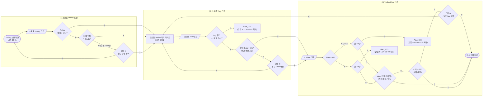

# 소모품 Trolley 적재 정책서

## 1. 개요

| 항목 | 내용 |
|---|---|
| 대상 | 소모품 Trolley 적재 |
| 시나리오 | (1) 소모품 Trolley 스캔 → (2) 적재할 소모품 Tray 스캔 → (3) 적재할 Trolley Floor 스캔 |
| LCR-02-01 | `LI-TSS-PSI-LCR-02-01` Trolley 스캔 화면 |
| 적재 가이드 | `LI-TSS-PSI-LCR-02-02` 이동/적재 가이드 |
| 가이드 순서 | `1. Tray 스캔` → `2. Floor 스캔` |

- Tray 스캔과 Floor 스캔은 동일한 적재 가이드에서 진행한다.
- 본 메뉴의 목적은 소모품 Tray의 적재이다.
- 소모품 Trolley에는 소모품 Tray 또는 빈 Tray만 적재할 수 있다.
- 적재 가이드(LCR-02-02)에는 `[Remove]` 기능이 있어, 스캔한 Trolley의 Floor에 적재된 Tray를 제거할 수 있다. `[Remove]`도 변경 예정 사항으로 기록되며 `[Done]`을 눌러야 반영된다(7장).
- 공통 데이터·컨펌·저장·복귀 원칙은 `common-loading-policy.md`를 따른다.

## 2. 소모품 Trolley 고유 정책

### 2.1 Floor별 적재 가능 조건

| Floor | 소모품/시약이 적재된 소모품 Tray | 빈 소모품 Tray | 검체 Tray |
|---|---|---|---|
| 1F | 적재 불가: `Alert_035` | 적재 가능 | 적재 불가: `Alert_027` |
| 2~6F | 적재 가능 | 적재 불가: Alert_040 | 적재 불가: `Alert_027` |

- **1F를 빈 Tray로 비워 두는 이유**: 소모품/시약은 전처리 장비(Sample preparation)의 버퍼 공간 2개에 거치해서 사용한다. 소모품 Trolley를 교체할 때 이전 Trolley의 소모품/시약은 버퍼 공간에 남은 채로 교체되는데, 새로 들어온 Trolley가 가득 차 있으면 이 소모품/시약을 돌려놓을 곳이 없다. 그래서 1F는 반환용으로 빈 Tray만 둔다.
- 빈 소모품 Tray는 Tray 스캔 단계에서 빈 상태임을 확인하더라도, 적재 가능 여부는 Floor 스캔 후 판정한다.
- 따라서 빈 소모품 Tray 스캔 후 Floor 스캔을 진행하고, 1F이면 정상 적재를 진행하며 2~6F이면 Alert_040를 노출한다.
- 얼럿을 닫으면 적재 가이드로 복귀하며 Tray 스캔부터 다시 시작한다.
- 소모품 Tray에 적재되는 소모품/시약의 종류와 결합 구조는 공통 정책서 2.1을 따른다.

## 3. 전체 플로우

- 흐름은 좌 → 우 방향이며, 얼럿 박스에는 닫힘 후 복귀 화면을 함께 표기했다(복귀 화살표는 생략).

> 플로우에서 빈 Tray의 분기는 Floor 스캔 후 최종 판정한다.
>
> **빈 Tray**는 Tray에 소모품/시약이 연결되어 있지 않은 Tray이다. Tray 데이터가 전혀 없는 Tray를 포함하며, 물리적인 적재 여부와는 무관하다. 물리적으로 비어 있어도 연결된 소모품/시약 데이터가 있으면 빈 Tray가 아니다.
>
> "정상 적재 완료"는 Tray 1건의 스캔 흐름이 끝난 상태이며, 데이터는 `[Done]`을 눌러야 저장된다.

## 4. 단계별 정책

### 4.1 (1) 소모품 Trolley 스캔

- Trolley는 검체 Trolley, 소모품 Trolley, 빈 Trolley(데이터 없음) 세 가지이다.
- 소모품 Trolley 흐름에서 컨펌 A는 검체가 적재된 Trolley를 스캔했을 때 노출된다.

| 조건 | 노출 | 다음 |
|---|---|---|
| Trolley 데이터 없음 | 없음 | 적재 가이드 노출 → Tray 스캔 |
| Trolley 데이터 있음 + 기존 적재 항목 = 소모품 | 없음 | 적재 가이드 노출 → Tray 스캔 |
| Trolley 데이터 있음 + 기존 적재 항목 = 검체 | 컨펌 A | Y: 적재 가이드 노출 → Tray 스캔 / N: LCR-02-01 복귀 |

### 4.2 (2) 소모품 Tray 스캔

| 조건 | 노출 | 다음 |
|---|---|---|
| 소모품 Tray가 비어 있음 + 상위 Trolley 매핑 없음 | 즉시 차단하지 않음 | Floor 스캔 후 Floor에 따라 판정 |
| 소모품 Tray가 비어 있음 + 상위 Trolley 매핑 있음 | 컨펌 C | Y: Floor 스캔 / N: 적재 가이드 복귀 및 초기화 |
| Tray 데이터 있음 + 적재 항목 = 검체 | `Alert_027` | 얼럿 닫힘 → 적재 가이드 복귀 및 초기화 |
| Tray 데이터 있음 + 적재 항목 = 소모품 + 상위 Trolley 매핑 없음 | 없음 | Floor 스캔 |
| Tray 데이터 있음 + 적재 항목 = 소모품 + 상위 Trolley 매핑 있음 | 컨펌 C | Y: Floor 스캔 / N: 적재 가이드 복귀 및 초기화 |

- 빈 Tray의 정의는 3장 주석을 따른다. 빈 Tray도 상위 Trolley와 매핑되어 있으면 컨펌 C를 노출한다.
- 변경 예정 상태에 이미 Floor 연결이 기록된 Tray를 같은 작업 안에서 다시 스캔한 경우에도 컨펌 C를 노출한다.
- `[Remove]`로 제거한 Tray는 상위 연결이 없는 것으로 보아 다시 스캔해도 컨펌 C를 노출하지 않는다.

### 4.3 (3) Trolley Floor 스캔

| 조건 | 노출 | 다음 |
|---|---|---|
| Floor = 1F + Tray가 비어 있음 + Floor 적재 데이터 없음 | 없음 | 정상 적재 완료 |
| Floor = 1F + Tray가 비어 있음 + Floor 적재 데이터 있음 + 해당 연결이 C에서 해제 예정으로 기록되지 않음 | 컨펌 B | Y: 정상 적재 완료 / N: 적재 가이드 복귀 및 초기화 |
| Floor = 1F + Tray가 비어 있음 + Floor 적재 데이터 있음 + 해당 연결이 C에서 이미 해제 예정으로 기록됨 | 없음 | 정상 적재 완료 |
| Floor = 1F + 소모품/시약이 적재된 Tray | `Alert_035` | 얼럿 닫힘 → 적재 가이드 복귀 및 초기화 |
| Floor = 2~6F + Tray가 비어 있음 | Alert_040 | 얼럿 닫힘 → 적재 가이드 복귀 및 초기화 |
| Floor = 2~6F + 소모품/시약이 적재된 Tray + Floor 적재 데이터 없음 | 없음 | 정상 적재 완료 |
| Floor = 2~6F + 소모품/시약이 적재된 Tray + Floor 적재 데이터 있음 + 해당 연결이 C에서 해제 예정으로 기록되지 않음 | 컨펌 B | Y: 정상 적재 완료 / N: 적재 가이드 복귀 및 초기화 |
| Floor = 2~6F + 소모품/시약이 적재된 Tray + Floor 적재 데이터 있음 + 해당 연결이 C에서 이미 해제 예정으로 기록됨 | 없음 | 정상 적재 완료 |

- Floor에 적재 데이터가 있으면(1F 빈 Tray, 2~6F 소모품/시약이 적재된 Tray 모두) 기존 Tray가 어떤 Tray이든 컨펌 B를 노출한다. 단, 해당 Floor–Tray 연결이 직전 컨펌 C에서 이미 해제 예정으로 기록된 경우(예: 같은 Tray를 같은 Floor에 다시 적재)에는 B를 노출하지 않는다.
- C에서 해제 예정으로 기록한 연결이 아닌 다른 Tray 연결이 있는 Floor를 스캔하면 B를 노출한다.
- 컨펌 A에서 Y로 동의한 Trolley는 변경 예정 상태에서 모든 Floor가 빈 값이므로, Floor 스캔 시 적재 데이터 없음으로 판단하고 B를 노출하지 않는다.
- 변경 예정 상태에 이미 기록된 Floor 연결도 B 판단 대상이다. 예) Tray B를 4F에 적재한 뒤 `[Done]` 전에 Tray C를 4F에 적재하면 4F에 Tray B 연결이 기록되어 있으므로 B를 노출한다.
- `[Remove]`로 Tray를 제거한 Floor는 변경 예정 상태에서 빈 값이므로 B를 노출하지 않는다.
- 기존 Trolley 매핑 여부는 Tray의 상위 정보 매핑 유무를 기준으로 판단한다.

## 5. 컨펌 정의

### 5.1 컨펌 A — 검체 Trolley 스캔

| 구분 | 내용 |
|---|---|
| 노출 조건 | Trolley 데이터 있음 + 기존 적재 항목 = 검체 |
| Main | `Use this trolley for consumables/reagents?` |
| Sub | `Loaded trays will be unlinked, but their data remains valid.` |
| Y | 동의 기록 후 적재 가이드 진입. 데이터 변경은 `[Done]` 시점에 반영 |
| N | LCR-02-01 복귀 |

신규 작업 시 정의:
- 기존 검체 Trolley를 신규 Trolley(소모품 Trolley 작업 대상)로 전환(Data reset)한다.
- Trolley와 내부에 적재된 모든 Tray 간 데이터 연결을 끊는다.
- 내부 Tray와 그 Tray에 적재된 검체 socket의 데이터 연결은 유지한다.
- 신규 작업 대상으로 전환된 Trolley에 물리적으로 적재되어 있는 Tray는 사용자가 제거해야 한다. 이 안내는 화면에 노출하지 않는 내부 메모이다.

추가 규칙:
- A에 Y로 동의했더라도 `[Done]` 전에 메뉴를 벗어나면 동의 및 변경 예정 사항을 폐기하며, 같은 Trolley를 다시 스캔하면 A를 다시 노출한다.
- A에 Y로 동의하면 변경 예정 상태에서 해당 Trolley의 모든 Floor는 빈 값으로 기록한다. `[Done]` 전까지 그 Trolley의 Floor를 스캔하면 적재 데이터가 없는 것으로 판단하므로 컨펌 B를 노출하지 않는다.

### 5.2 컨펌 C — 소모품 Tray 스캔

| 구분 | 내용 |
|---|---|
| 노출 조건 | 소모품 Tray(빈 Tray 포함)가 상위 Trolley와 매핑되어 있음 |
| Main | `Reassign this tray to a new floor?` |
| Sub | `The previous floor link will be removed, but the other trays on that trolley remain valid.` |
| Y | 동의 기록(스캔한 Tray와 기존 Floor 연결을 해제 예정으로 기록) 후 Floor 스캔 |
| N | 적재 가이드 복귀 및 초기화 |

신규 작업 시 정의:
- `[Done]` 시 스캔한 Tray와 기존 Trolley Floor 간 데이터 연결을 끊는다.
- Tray와 Tray 내부의 소모품/시약 데이터는 보존한다.

### 5.3 컨펌 B — Floor 스캔

| 구분 | 내용 |
|---|---|
| 노출 조건 | Floor(1F 빈 Tray, 2~6F 소모품/시약이 적재된 Tray)에 적재 데이터가 존재하고, 해당 연결이 C에서 이미 해제 예정으로 기록되지 않음 |
| Main | `Replace the tray on this floor?` |
| Sub | `The current tray will be unlinked, but its data remains valid.` |
| Y | 동의 기록(대상 Floor의 기존 Tray 연결을 해제 예정으로 기록) 후 정상 적재 완료 |
| N | 적재 가이드 복귀 및 초기화 |

신규 작업 시 정의:
- `[Done]` 시 해당 Floor의 기존 Tray 연결을 해제하고 새 Tray–Floor 연결을 생성한다(기존 Floor–Tray 연결 reset).
- 기존 Tray와 그 내부의 소모품/시약 데이터 연결은 유지한다.

## 6. 얼럿 정의

| 얼럿 | 노출 조건 | Main / Sub | 닫힘 후 |
|---|---|---|---|
| Alert_040 | 빈 소모품 Tray를 스캔한 뒤 Floor 2~6F를 스캔 | `This tray has no consumables/reagents loaded.` / `Load consumables/reagents into the tray and try again.` | 적재 가이드 복귀 및 초기화 |
| `Alert_027` | 검체 Tray 스캔 | `Invalid code for the current workflow.` / `Verify the required item for this step and try again.` | 적재 가이드 복귀 및 초기화 |
| `Alert_035` | 소모품/시약이 적재된 Tray를 스캔한 뒤 1F 스캔 | `Trolley 1F is unavailable.` / `Please place the tray on a different floor.` | 적재 가이드 복귀 및 초기화 |

- 빈 소모품 Tray는 1F에 적재할 수 있으므로 `Alert_035`를 노출하지 않는다.

## 7. 데이터 저장, 취소 및 복귀

### 7.1 데이터 반영 시점

- 컨펌 A/C/B에서 Y를 선택해도 즉시 데이터를 변경하지 않고 동의와 변경 예정 사항만 기록한다. `[Remove]`도 같다.
- 사용자가 필요한 Tray를 모두 처리하고 `[Done]`을 누르면 변경 예정 사항을 일괄 저장하고 적용한다.
- A: Trolley와 내부 Tray 간 연결 해제. Tray 및 검체 socket 데이터 유지.
- C: Tray와 기존 Floor 간 연결 해제. Tray 및 소모품/시약 데이터 유지.
- B: 대상 Floor의 기존 Tray 연결 해제(C에서 이미 해제 예정으로 기록된 연결은 제외). 기존 Tray 및 소모품/시약 데이터 유지.
- 공통: 스캔한 소모품 Tray와 대상 Floor의 신규 매핑 생성.

### 7.2 메뉴 이탈

- `[Done]` 전에 메뉴를 벗어나면 A·B·C 동의 기록과 `[Remove]`를 포함한 모든 변경 예정 사항을 폐기하고 기존 데이터는 변경하지 않는다.

### 7.3 저장 실패

- 저장 중 오류가 발생해도 부분 반영은 허용하지 않으며, 기존 저장 데이터는 유지한다.
- 저장 실패 시 현재 적재 가이드 화면과 변경 예정 상태를 유지한다. Alert 확인 후 현재 화면에서 재시도할 수 있으며, 재시도 시 유지 중인 변경 예정 사항을 다시 저장한다.
- 저장 실패 Alert는 Alert_045(Main: `Failed to save.` / Sub: `Your changes are kept. Please try again.`)를 사용한다.

### 7.4 복귀

- 얼럿 닫힘 또는 컨펌 C/B에서 N을 선택하면 적재 가이드로 복귀하고 Tray 스캔부터 다시 시작한다. 이때 데이터 변경은 없다.
- 위 "초기화"는 현재 진행 중인 Tray의 스캔 및 동의 상태에 한한다. 이미 정상 적재 완료로 기록된 다른 Tray의 변경 예정 사항은 유지되며 `[Done]` 시 저장된다.
- 컨펌 A에서 N을 선택하면 Trolley 스캔 화면(LCR-02-01)으로 복귀한다. 이때 데이터 변경은 없다.

## 8. 후속 정리 항목

| # | 항목 | 상태 |
|---|---|---|
| 1 | Alert_040 ID | 확정 (2026-10-29 화면 설계서 검토) |
| 2 | 저장 실패 Alert (Alert_045) ID 및 문구 | 확정 (2026-10-29 화면 설계서 검토) |
