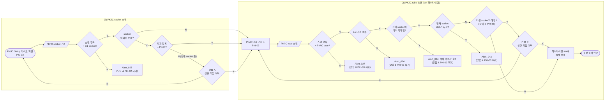

# PK/IC Setup 적재 정책서

## 1. 개요

| 항목 | 내용 |
|---|---|
| 대상 | PK/IC tube의 PK/IC socket 적재 (PK/IC Setup) |
| 시나리오 | (1) Trolley 선택 또는 Skip → (2) PK/IC socket 스캔 → (3) PK/IC tube 스캔 (적재 slot 하이라이팅) |
| PKI-02 | `LI-TSS-PSI-PKI-02` PK/IC Setup 가이드 화면. PK/IC socket을 스캔하는 화면 |
| PKI-03 | `LI-TSS-PSI-PKI-03` PK/IC 적재 가이드. 흐름도의 복귀 지점이며, PK/IC tube 스캔은 이 가이드에서 진행한다 |

- 이 메뉴의 목적은 **PK/IC tube를 PK/IC socket의 slot에 적재하는 행위**이다.
- Trolley 선택 또는 Skip은 적재 정책(컨펌·얼럿 판단)에 영향을 주지 않는다.
- 이 흐름은 **하이라이팅 적재 흐름**이다(공통 정책서 4.4). PK/IC tube를 스캔하면 시스템이 적재할 slot을 하이라이팅하며, 사용자는 위치를 스캔하지 않는다. 따라서 **컨펌 B가 없다**.
- PKI-03에는 **[Remove] 기능**이 있어, PK/IC socket의 slot에 적재된 PK/IC tube를 제거할 수 있다. slot을 비우는 방법은 `[Remove]`뿐이다. `[Remove]`도 변경 예정 사항으로 기록되며 `[Done]`을 눌러야 반영된다(8장).
- PK/IC Setup을 마친 PK/IC socket은 소모품 Tray 흐름(`consumables-tray-policy.md`)에서 Tray에 적재한다.
- 공통 데이터·컨펌·저장·복귀 원칙은 `common-loading-policy.md`를 따른다. 공통 정책서의 Trolley·Tray는 이 흐름에서 PK/IC socket·PK/IC tube로 읽는다(공통 정책서 2.6).

---

## 2. 용어 및 적재 계층

### 2.1 적재 단위

적재 단위의 종류와 소모품/시약의 결합 구조는 공통 정책서 2.1·2.2를 따른다.

### 2.2 PK/IC socket과 PK/IC tube

- **PK/IC socket**: G1 socket(= G10 socket)이다. 흐름도의 "PCR socket", "스캔할 socket", "스캔 socket"은 모두 같은 대상이며, 본 정책서에서는 **PK/IC socket**으로 표기한다.
- G1 socket에는 검체 또는 PK/IC만 사용한다. 적재 항목은 적재된 내용물로 판단하며, PK/IC tube가 연결되어 있으면 `적재 항목 = PK/IC`, 검체가 연결되어 있으면 `적재 항목 = 검체`(검체 socket)이다.
- 시약 중 Standard tube도 G1 socket에 사용할 수는 있으나, 재질이 다르고 사용 완료 시 폐기하므로 별도 분기를 두지 않는다. Standard tube가 적재된 socket은 `적재 항목 ≠ PK/IC`로 판단한다.
- **PK/IC tube**: Lot이 구성된 PK/IC(시약) tube이다. PK/IC는 소모품/시약 계열에 속한다(공통 정책서 2.2).
- **slot**: PK/IC socket 내부에서 PK/IC tube가 적재되는 위치이다.

### 2.3 적재 계층

| 구분 | 하위 | 상위 |
|---|---|---|
| PK/IC 계열 | PK/IC tube | PK/IC socket (slot) |

- 본 정책서에서 "상위"는 **PK/IC socket(slot)**, "하위"는 PK/IC socket에 적재된 **PK/IC tube**를 뜻한다.
- PK/IC Setup에서 PK/IC socket에는 PK/IC tube만 적재할 수 있다.

---

## 3. 공통 정책 적용

### 3.1 컨펌 적용

| 스캔 대상 | 데이터 상태 | 컨펌 / 얼럿 |
|---|---|---|
| socket | 스캔 항목 ≠ G1 socket | **Alert_027** |
| socket | 데이터 없음 | 없음 |
| socket | 데이터 있음 + 적재 항목 = PK/IC | 없음 (기존 PK/IC socket에 이어서 적재하는 것이 정상) |
| socket | 데이터 있음 + 적재 항목 ≠ PK/IC (검체 socket, Standard tube socket) | **컨펌 A** |
| tube | 스캔 항목 ≠ PK/IC tube | **Alert_027** |
| tube | 폐기된 PK/IC tube | **Alert_047** |
| tube | 유효기간이 만료된 PK/IC tube | **Alert_029** |
| tube | PK/IC tube + Lot 미구성 | **Alert_024** |
| tube | PK/IC tube + Lot 구성 + 현재 작업 중인 socket에 이미 적재됨 (저장된 연결과 변경 예정 상태에 기록된 연결 모두 포함) | **Alert_044** |
| tube | PK/IC tube + Lot 구성 + 현재 socket의 모든 slot이 가득 참 (변경 예정 상태 기준) | **Alert_043** |
| tube | PK/IC tube + Lot 구성 + 다른 socket과 연결됨 (저장된 연결과 변경 예정 상태에 기록된 연결 모두 포함) | **컨펌 C** |
| tube | PK/IC tube + Lot 구성 + 어떤 socket과도 연결 없음 | 없음 (하이라이팅 slot에 적재) |
| tube | `[Remove]`로 제거 예정인 tube | 상위 연결 없음으로 판단 (Alert_044·컨펌 C 없음) |

### 3.2 다른 흐름과의 대응

| 구분 | Trolley 흐름 | Tray 흐름 | PK/IC Setup (본 정책서) |
|---|---|---|---|
| 진입 단위 (컨펌 A) | Trolley | Tray | PK/IC socket |
| 하위 단위 (컨펌 C) | Tray | 검체 socket·소모품/시약 | PK/IC tube |
| 적재 위치 (컨펌 B) | Floor | Tray 내부 위치 | 없음 (slot 하이라이팅) |

- 적재 위치를 스캔하지 않으므로 컨펌 B와 B 판단 규칙(공통 정책서 4.1의 C–B 관계)은 이 흐름에 적용하지 않는다.

---

## 4. 전체 플로우

- 흐름은 좌 → 우 방향이며, 얼럿 박스에는 닫힘 후 복귀 화면을 함께 표기했다(복귀 화살표는 생략).
- 위 플로우에서 `G`(PKI-03)로의 복귀는 모두 **초기화**(PK/IC tube 스캔부터 다시 시작)이다.
- PK/IC socket 스캔 단계의 Alert_027 닫힘과 컨펌 A의 N만 PK/IC Setup 가이드 화면(PKI-02)으로 복귀한다.
- Alert_027 분기와 Alert_043·044 분기는 흐름도에 추가될 예정이다. Alert_044 → Alert_043 → 컨펌 C의 판단 순서는 흐름도 반영 시 확인한다(10장).
- "정상 적재 완료"는 tube 1건의 스캔 흐름이 끝난 상태이며, 데이터는 `[Done]`을 눌러야 저장된다.

---

## 5. 단계별 정책

### 5.1 (2) PK/IC socket 스캔 (PKI-02)

| # | 조건 | 노출 | 다음 |
|---|---|---|---|
| 1 | 스캔 항목 ≠ G1 socket (Tray, Trolley, tube 등 포함) | Alert_027 | 얼럿 닫힘 & PKI-02 복귀 |
| 2 | socket 데이터 없음 | 없음 | PK/IC 적재 가이드 노출(PKI-03) → PK/IC tube 스캔 |
| 3 | socket 데이터 있음 + 적재 항목 = PK/IC | 없음 | PK/IC 적재 가이드 노출(PKI-03) → PK/IC tube 스캔 |
| 4 | socket 데이터 있음 + 적재 항목 ≠ PK/IC | 컨펌 A | Y: PK/IC 적재 가이드 노출 후 PK/IC tube 스캔 / N: PKI-02 복귀 |

- G1 socket인지 가장 먼저 판단한다. G1 socket이 아니면 데이터 유무와 관계없이 Alert_027을 노출하고 PKI-02로 복귀한다.

### 5.2 (3) PK/IC tube 스캔 (PKI-03)

| # | 조건 | 노출 | 다음 |
|---|---|---|---|
| 1 | 스캔 항목 ≠ PK/IC tube | Alert_027 | 얼럿 닫힘 & PKI-03 복귀 |
| 1-1 | 폐기된 PK/IC tube | Alert_047 | 얼럿 닫힘 & PKI-03 복귀 |
| 1-2 | 유효기간이 만료된 PK/IC tube | Alert_029 | 얼럿 닫힘 & PKI-03 복귀 |
| 2 | PK/IC tube + Lot 미구성 | Alert_024 | 얼럿 닫힘 & PKI-03 복귀 |
| 3 | PK/IC tube + Lot 구성 + 현재 socket에 이미 적재됨 | Alert_044 | 얼럿 닫힘 & PKI-03 복귀 |
| 4 | PK/IC tube + Lot 구성 + 현재 socket의 모든 slot이 가득 참 | Alert_043 | 얼럿 닫힘 & PKI-03 복귀 |
| 5 | PK/IC tube + Lot 구성 + 다른 socket과 매핑 없음 | 없음 | 하이라이팅 slot에 적재 → 정상 적재 완료 |
| 6 | PK/IC tube + Lot 구성 + 다른 socket과 매핑 있음 | 컨펌 C | Y: 하이라이팅 slot에 적재 → 정상 적재 완료 / N: PKI-03 복귀 |

- 판단 순서: Alert_027 → Alert_047 → Alert_029 → Alert_024 → Alert_044 → Alert_043 → 컨펌 C (2026-11-02 추가).
- 스캔 항목이 PK/IC tube인지 먼저 판단하고, PK/IC tube에 대해서만 Lot 구성 여부를 판단한다.
- PKI-03에서 스캔할 수 있는 것은 PK/IC tube뿐이다. socket(작업 중인 socket 포함)을 스캔하면 Alert_027이다. 기존 디스크립션의 socket 중복 스캔(Alert_006)·다른 socket 스캔(Alert_007)은 쓰지 않는다.
- 현재 socket에 이미 적재된 tube(저장된 연결, 또는 같은 작업에서 적재하여 변경 예정 상태에 기록된 연결)를 다시 스캔하면 컨펌 C 대신 **Alert_044**으로 적재 위치를 알린다. 같은 socket 안에서 tube의 slot을 옮기려면 `[Remove]`로 제거한 뒤 다시 스캔한다.
- **기존 데이터 매핑**은 스캔한 tube가 현재 socket이 아닌 다른 PK/IC socket(상위)과 연결되어 있는지를 기준으로 판단한다. 변경 예정 상태에 기록된 연결도 포함한다.
- `[Remove]`로 제거한 tube는 상위 연결이 없는 것으로 보아 다시 스캔해도 Alert_044과 컨펌 C를 노출하지 않는다.

### 5.3 slot 하이라이팅

- PK/IC tube가 적재 가능하다고 판단되면 시스템이 적재할 slot을 하이라이팅한다.
- slot은 순차적으로 채운다. `[Remove]`로 앞 slot을 비운 경우에도 마지막 slot까지 먼저 채운 뒤, 비워 둔 앞 slot을 하이라이팅한다. *(세부 규칙은 개발 정의를 따른다)*
- **가득 참**은 PK/IC socket의 모든 slot에 PK/IC tube가 적재된 상태이며, 변경 예정 상태를 기준으로 판단한다. `[Remove]`로 비운 slot과 컨펌 A로 비운 slot은 빈 slot으로 본다.
- 가득 찬 socket에서 새 tube를 적재하려면 `[Remove]`로 slot을 비워야 한다.

---

## 6. 컨펌 정의

### 6.1 컨펌 A (검체 socket 스캔)

| 구분 | 내용 |
|---|---|
| 노출 조건 | socket 데이터 있음 + 적재 항목 ≠ PK/IC |
| Main | Use this socket for PK/IC tubes? |
| Sub | Loaded specimens will be unlinked. Reload them through their menu. |
| Y | 동의 기록 → PK/IC 적재 가이드 노출 후 PK/IC tube 스캔 (데이터 반영은 `[Done]` 시점) |
| N | PKI-02 복귀 |

**신규 작업 시 정의**
- `[Done]` 시 검체 socket → PK/IC socket으로 변경 (Data reset)
- `[Done]` 시 socket과 내부에 적재된 모든 검체 간의 데이터 끊김
  - 단, 검체 데이터는 유지
- `[Done]` 시 socket과 상위 Tray 내부 위치 간의 연결도 해제한다. *(검체 Tray에 PK/IC socket이 연결된 상태를 방지)*
- 신규가 된 socket에 적재된 검체는 사용자가 물리적으로 제거 필요 *(화면에는 노출하지 않는 메모)*

**추가 규칙**
- A에 Y로 동의하면 변경 예정 상태에서 해당 socket의 모든 slot은 빈 값으로 기록한다. 하이라이팅과 가득 참 판단은 이 상태를 기준으로 한다.
- A에 Y로 동의했더라도 `[Done]` 전에 메뉴를 벗어나면 동의 및 변경 예정 사항을 폐기하며, 같은 socket을 다시 스캔하면 A를 다시 노출한다.

### 6.2 컨펌 C (PK/IC tube 스캔)

| 구분 | 내용 |
|---|---|
| 노출 조건 | PK/IC tube + Lot 구성 + 다른 socket과 매핑 있음 |
| Main | Reassign this PK/IC tube to a new socket? |
| Sub | The previous socket link will be removed, but the other PK/IC tubes in that socket remain valid. |
| Y | 동의 기록(스캔한 tube와 기존 socket slot 연결을 해제 예정으로 기록) → 하이라이팅 slot에 적재 진행 |
| N | PKI-03 복귀 (현재 진행 중인 tube의 스캔 및 동의 상태 초기화. 이미 정상 적재 완료로 기록된 다른 tube의 변경 예정 사항은 유지) |

**신규 작업 시 정의**
- `[Done]` 시 스캔한 tube와 기존 socket slot 간의 연결 해제
- tube와 tube의 PK/IC(Lot) 데이터는 보존

---

## 7. 얼럿 정의

| 얼럿 | 노출 조건 | Main | Sub | 닫힘 후 |
|---|---|---|---|---|
| Alert_027 | PK/IC socket 스캔 시 스캔 항목 ≠ G1 socket | Invalid code for the current workflow. | Verify the required item for this step and try again. | PKI-02 복귀 |
| Alert_027 | PK/IC tube 스캔 시 스캔 항목 ≠ PK/IC tube | Invalid code for the current workflow. | Verify the required item for this step and try again. | PKI-03 복귀 |
| Alert_047 | 폐기된 PK/IC tube 스캔 | This item has been discarded. | Scan another consumable/reagent. | PKI-03 복귀 |
| Alert_029 | 유효기간이 만료된 PK/IC tube 스캔 | The scanned reagent has expired. | Scan a reagent that is within its expiration date. | PKI-03 복귀 |
| Alert_024 | Lot이 구성되지 않은 PK/IC tube 스캔 | Lot Group mismatch. | Scan a reagent that matches the configured Lot group. | PKI-03 복귀 |
| Alert_043 | 현재 socket의 모든 slot이 가득 찬 상태에서 PK/IC tube 스캔 | All slots in this socket are full. | To load a new PK/IC tube, [Remove] a loaded tube before loading. | PKI-03 복귀 |
| Alert_044 | 현재 socket에 이미 적재된 PK/IC tube 재스캔 | This is already loaded in [스캔 항목 적재 위치값]. |  | PKI-03 복귀 |

- Alert_027의 문구는 Trolley 정책서에서 확정된 문구와 동일하다.
- Alert_043·044은 하이라이팅 적재 흐름 공통 얼럿이다(공통 정책서 4.4). Alert_043는 흐름별로 `{socket/rack}`과 `{적재 항목}`만 바꿔 출력한다. Alert_044의 `[스캔 항목 적재 위치값]`에는 tube가 적재된 slot 위치를 출력한다.

---

## 8. 데이터 저장, 취소 및 복귀 정책

### 8.1 데이터 반영 시점

- 컨펌 A·C의 Y와 `[Remove]`는 **동의와 변경 예정 사항만 기록**한다. 어떤 동작을 하더라도 `[Done]` 전에는 실제 연결이 해제되지 않으며, 해제는 이 흐름 안에서 기록만 된다.
- 실제 데이터 변경은 사용자가 필요한 tube를 모두 처리하고 **`[Done]`을 눌렀을 때 한 번에 반영**한다.

`[Done]` 시 반영되는 내용:

| 컨펌 Y 이력 | 반영 내용 |
|---|---|
| 컨펌 A | 검체 socket → PK/IC socket으로 변경(Data reset), 내부 검체와의 데이터 끊김(모든 slot이 빈 값이 됨), socket과 상위 Tray 내부 위치 간 연결 해제 |
| 컨펌 C | 스캔한 tube와 기존 socket slot 간 연결 해제 |
| `[Remove]` | PK/IC socket slot에서 제거한 tube의 연결 해제 |
| (공통) | 스캔한 tube와 하이라이팅된 slot 간 신규 매핑 생성, PK/IC 데이터 유지 |

### 8.2 메뉴 이탈

- `[Done]` 전에 메뉴를 벗어나면 A·C 동의 기록과 `[Remove]`를 포함한 모든 변경 예정 사항을 폐기하고 기존 데이터는 변경하지 않는다.

### 8.3 저장 실패

- 저장 중 오류가 발생해도 부분 반영은 허용하지 않으며, 기존 저장 데이터는 유지한다.
- 저장 실패 시 현재 적재 가이드 화면과 변경 예정 상태를 유지한다. Alert 확인 후 현재 화면에서 재시도할 수 있으며, 재시도 시 유지 중인 변경 예정 사항을 다시 저장한다.
- 저장 실패 Alert는 Alert_045(Main: `Failed to save.` / Sub: `Your changes are kept. Please try again.`)를 사용한다.

### 8.4 복귀 시 처리

| 복귀 사유 | 복귀 화면 | 데이터 | 상태 |
|---|---|---|---|
| Alert_027 / Alert_047 / Alert_029 / Alert_024 / Alert_043 / Alert_044 닫힘 | PKI-03 | 변경 없음 | 초기화 (PK/IC tube 스캔부터 다시) |
| 컨펌 C의 N | PKI-03 | 변경 없음 | 초기화 |
| PK/IC socket 스캔 시 Alert_027 닫힘 | PKI-02 | 변경 없음 | PK/IC socket 스캔부터 다시 |
| 컨펌 A의 N | PKI-02 | 변경 없음 | PK/IC socket 스캔부터 다시 |

- 얼럿 닫힘과 C의 N은 현재 진행 중인 tube의 스캔 및 동의 상태만 초기화한다. 이미 정상 적재 완료로 기록된 다른 tube의 변경 예정 사항은 유지되며 `[Done]` 시 저장된다.
- 복귀 후 방금 스캔한 tube와 그 컨펌 C 동의는 유지하지 않는다. 같은 tube를 다시 스캔하면 컨펌 C가 다시 노출될 수 있다.

---

## 9. 비고

- Standard tube가 적재된 G1 socket을 스캔하면 `적재 항목 ≠ PK/IC`로 보아 컨펌 A를 노출한다. 이때 컨펌 A의 Sub 문구(The specimen data linked to this socket will be reset.)는 검체 기준이라 Standard tube socket과 맞지 않는다. Standard tube socket은 사용 후 폐기하므로 이론상 가능한 경우로만 기록하며, 문구는 일괄 수정 시 검토한다.
- 언어별 문구는 언어셋 등록 시 확정한다.

## 10. 후속 정리 항목

| # | 항목 | 상태 |
|---|---|---|
| 1 | 얼럿·컨펌 ID (Alert_039~045, Confirm_026~028) | 확정 (2026-10-29 화면 설계서 검토) |
| 2 | 흐름도에 Alert_027(PK/IC socket·PK/IC tube 스캔)·Alert_043·Alert_044 분기 추가, Alert_044 → Alert_043 → 컨펌 C 판단 순서 확인 | 흐름도 수정 시 확인 |
| 3 | 저장 실패 Alert (Alert_045) ID 및 문구 | 확정 (2026-10-29 화면 설계서 검토) |
