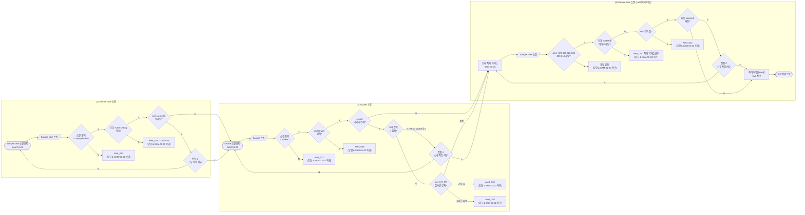

# 검체 Socket 적재 정책서

## 1. 개요

| 항목 | 내용 |
|---|---|
| 대상 | 검체(Sample tube)의 검체 socket 적재 |
| 시나리오 | (1) Sample tube 스캔 → (2) Socket 스캔 → (3) Sample tube 스캔 (적재 slot 하이라이팅, 반복) → (4) `[Done]` |
| SAM-01-01 | `LI-TSS-PSI-SAM-01-01` Sample tube 스캔 화면. 첫 Sample tube로 필요한 socket type을 정한다 |
| SAM-01-02 | `LI-TSS-PSI-SAM-01-02` Socket 스캔 화면. 앞에서 정한 socket type의 socket을 스캔한다 |
| SAM-01-03 | `LI-TSS-PSI-SAM-01-03` 검체 적재 가이드. 흐름도의 복귀 지점이며, Sample tube 스캔과 slot 하이라이팅은 이 가이드에서 진행한다 |
| SAM-01-04 | `LI-TSS-PSI-SAM-01-04` 완료 화면. 새 Sample tube를 스캔하면 SAM-01-02로, `[Add New]`는 SAM-01-01로 이동한다 |

- 이 메뉴의 목적은 **Sample tube를 검체 socket의 slot(hole)에 적재하는 행위**이다.
- 이 흐름은 **하이라이팅 적재 흐름**이다(공통 정책서 4.4). Sample tube를 스캔하면 시스템이 적재할 slot을 하이라이팅하며, 사용자는 위치를 스캔하지 않는다. 따라서 **컨펌 B가 없다**.
- PK/IC Setup과 달리 **첫 스캔이 하위 항목(Sample tube)**이다. 첫 Sample tube가 socket type을 정하고, 그 뒤에 socket을 스캔한다.
- SAM-01-03에는 **[Remove] 기능**(`LI-TSS-CMP-01`)이 있어 socket의 slot에 적재된 Sample tube를 제거할 수 있다. slot을 비우는 방법은 `[Remove]`뿐이다. `[Remove]`도 변경 예정 사항으로 기록되며 `[Done]`을 눌러야 반영된다(8장).
- `[Done]` 전에 메뉴를 벗어나면 Confirm_007(Leave without saving?)을 노출한다. 모든 Step에 적용한다.
- 공통 데이터·컨펌·저장·복귀 원칙은 `common-loading-policy.md`를 따른다. 공통 정책서의 Trolley·Tray는 이 흐름에서 검체 socket·Sample tube로 읽는다(공통 정책서 2.6).
- 검체 socket을 Tray에 적재하는 흐름은 `specimen-tray-policy.md`를 따른다.

---

## 2. 용어 및 적재 계층

### 2.1 적재 단위

적재 단위의 종류는 공통 정책서 2.1·2.2를 따른다.

### 2.2 검체 socket과 Sample tube

- **검체 socket**: 검체가 적재된 socket이다(`적재 항목 = 검체`). socket type별 적재 가능한 hole 수는 다음과 같다(SAM-01-03 디스크립션 기준).

| socket type | hole 수 |
|---|---|
| G10 | 48 |
| G20 | 24 |
| G30 | 12 |
| G40 / G41 | 6 |
| G50 | 4 |

- **Sample tube**: 검사 오더가 등록된 검체 tube이다. Tube setting에 등록된 tube type으로 필요한 socket type이 정해진다.
- **slot**: 검체 socket 내부에서 Sample tube가 적재되는 위치(hole)이다.
- 같은 socket에는 **같은 검사군**의 Sample tube만 적재한다(Alert_010).
  - 검사군은 **RP, GI-V, HPV, RTI** 4가지이며, 검사군마다 하위 검사 항목이 여러 개 연결되어 있다.
  - 예: RP 하위 검사 항목의 tube로 시작한 socket에 HPV 하위 검사 항목의 tube를 스캔하면 Alert_010이다.
- Sample tube마다 전용 socket type은 **1개**이다.
- PK/IC socket, Standard tube socket처럼 `적재 항목 ≠ 검체`인 socket을 이 흐름에서 스캔하면 컨펌 A로 검체 socket 전환 여부를 묻는다. PK/IC socket은 G1 socket(= G10 socket)이다.

### 2.3 적재 계층

| 구분 | 하위 | 상위 |
|---|---|---|
| 검체 계열 | Sample tube | 검체 socket (slot) |

- 본 정책서에서 "상위"는 **검체 socket(slot)**, "하위"는 socket에 적재된 **Sample tube**를 뜻한다.

---

## 3. 공통 정책 적용

### 3.1 컨펌 적용

| 스캔 대상 | 데이터 상태 | 컨펌 / 얼럿 |
|---|---|---|
| Sample tube (SAM-01-01) | 스캔 항목 ≠ Sample tube | **Alert_027** |
| Sample tube (SAM-01-01) | 검사 오더 미등록 / 취소된 검사 / Tube setting 미등록 | **Alert_025 / Alert_026 / Alert_033** |
| Sample tube (SAM-01-01) | 다른 socket에 이미 적재됨 (저장된 연결과 변경 예정 연결 포함) | **컨펌 C** |
| socket (SAM-01-02) | 스캔 항목 ≠ socket | **Alert_027** |
| socket (SAM-01-02) | 첫 Sample tube의 socket type과 불일치 | **Alert_008** |
| socket (SAM-01-02) | 데이터 없음 | 없음 |
| socket (SAM-01-02) | 데이터 있음 + 적재 항목 = 검체 | 없음 (기존 검체 socket에 이어서 적재하는 것이 정상) |
| socket (SAM-01-02) | 데이터 있음 + 적재 항목 = 검체 + 모든 slot이 가득 참 (변경 예정 상태 기준) | **Alert_043** |
| socket (SAM-01-02) | 데이터 있음 + 적재 항목 = 검체 + 첫 Sample tube와 검사군 다름 | **Alert_010** |
| socket (SAM-01-02) | 데이터 있음 + 적재 항목 ≠ 검체 (PK/IC socket, Standard tube socket) | **컨펌 A** |
| Sample tube (SAM-01-03) | 스캔 항목 ≠ Sample tube (socket 포함) | **Alert_027** |
| Sample tube (SAM-01-03) | 검사 오더 미등록 / 취소된 검사 / Tube setting 미등록 | **Alert_025 / Alert_026 / Alert_033** |
| Sample tube (SAM-01-03) | 현재 socket과 맞지 않는 tube type | **Alert_009** |
| Sample tube (SAM-01-03) | 현재 socket의 검사군과 다름 | **Alert_010** |
| Sample tube (SAM-01-03) | 현재 socket에 이미 적재됨 (저장된 연결과 변경 예정 연결 포함) | **Alert_044** |
| Sample tube (SAM-01-03) | 현재 socket의 모든 slot이 가득 참 (변경 예정 상태 기준) | **Alert_043** |
| Sample tube (SAM-01-03) | 다른 socket과 연결됨 (저장된 연결과 변경 예정 연결 포함) | **컨펌 C** |
| Sample tube (SAM-01-03) | 어떤 socket과도 연결 없음 | 없음 (하이라이팅 slot에 적재) |
| Sample tube (SAM-01-03) | `[Remove]`로 제거 예정인 tube | 상위 연결 없음으로 판단 (Alert_044·컨펌 C 없음) |

### 3.2 다른 흐름과의 대응

| 구분 | PK/IC Setup | 검체 Socket (본 정책서) |
|---|---|---|
| 진입 단위 (컨펌 A) | PK/IC socket | 검체 socket |
| 하위 단위 (컨펌 C) | PK/IC tube | Sample tube |
| 적재 위치 (컨펌 B) | 없음 (slot 하이라이팅) | 없음 (slot 하이라이팅) |

- 적재 위치를 스캔하지 않으므로 컨펌 B와 B 판단 규칙(공통 정책서 4.1의 C–B 관계)은 이 흐름에 적용하지 않는다.

---

## 4. 전체 플로우

- 흐름은 좌 → 우 방향이며, 얼럿 박스에는 닫힘 후 복귀 화면을 함께 표기했다(복귀 화살표는 생략).
- SAM-01-02에서 socket 확인이 끝나면, SAM-01-01에서 스캔한 첫 Sample tube가 SAM-01-03의 첫 하이라이팅 slot에 적재된다.
- 위 플로우에서 `G`(SAM-01-03)로의 복귀는 모두 **초기화**(Sample tube 스캔부터 다시 시작)이다.
- "정상 적재 완료"는 Sample tube 1건의 스캔 흐름이 끝난 상태이며, 데이터는 `[Done]`을 눌러야 저장된다.

---

## 5. 단계별 정책

### 5.1 (1) Sample tube 스캔 (SAM-01-01, SAM-01-04)

| # | 조건 | 노출 | 다음 |
|---|---|---|---|
| 1 | 스캔 항목 ≠ Sample tube | Alert_027 | 얼럿 닫힘 & 현재 화면 유지 |
| 2 | 검사 오더가 등록되지 않은 Sample | Alert_025 | 얼럿 닫힘 & 현재 화면 유지 |
| 3 | 취소된 검사의 Sample | Alert_026 | 얼럿 닫힘 & 현재 화면 유지 |
| 4 | Tube setting에 등록되지 않은 Sample | Alert_033 | 얼럿 닫힘 & 현재 화면 유지 |
| 5 | 다른 socket에 이미 적재된 Sample | 컨펌 C | Y: SAM-01-02 / N: 현재 화면 유지 |
| 6 | 정상 | 없음 | SAM-01-02로 이동 (필요한 socket type 노출) |

- SAM-01-04에서 새 Sample tube를 스캔한 경우도 같은 판단을 거친 뒤 SAM-01-02로 이동한다.

### 5.2 (2) Socket 스캔 (SAM-01-02)

| # | 조건 | 노출 | 다음 |
|---|---|---|---|
| 1 | 스캔 항목 ≠ socket | Alert_027 | 얼럿 닫힘 & SAM-01-02 복귀 |
| 2 | socket type이 첫 Sample tube의 전용 socket과 불일치 | Alert_008 | 얼럿 닫힘 & SAM-01-02 복귀 |
| 3 | socket 데이터 없음 | 없음 | SAM-01-03 → 첫 Sample tube 하이라이팅 적재 |
| 4 | 데이터 있음 + 적재 항목 = 검체 + slot 여유 + 검사군 일치 | 없음 | SAM-01-03 → 첫 Sample tube 하이라이팅 적재 (기존 적재 수 표시) |
| 5 | 데이터 있음 + 적재 항목 = 검체 + 모든 slot이 가득 참 | Alert_043 | 얼럿 닫힘 & SAM-01-02 복귀 |
| 6 | 데이터 있음 + 적재 항목 = 검체 + 첫 Sample tube와 검사군 다름 | Alert_010 | 얼럿 닫힘 & SAM-01-02 복귀 |
| 7 | 데이터 있음 + 적재 항목 ≠ 검체 (PK/IC socket, Standard tube socket) | 컨펌 A | Y: SAM-01-03 / N: SAM-01-02 복귀 |

- 판단 순서: Alert_027 → Alert_008 → 데이터 유무 → 적재 항목 → Alert_043 → Alert_010.

### 5.3 (3) Sample tube 스캔 (SAM-01-03)

| # | 조건 | 노출 | 다음 |
|---|---|---|---|
| 1 | 스캔 항목 ≠ Sample tube (socket 포함) | Alert_027 | 얼럿 닫힘 & SAM-01-03 복귀 |
| 2 | 검사 오더 미등록 / 취소된 검사 / Tube setting 미등록 | Alert_025 / Alert_026 / Alert_033 | 얼럿 닫힘 & SAM-01-03 복귀 |
| 3 | 현재 socket과 맞지 않는 tube type | Alert_009 | 얼럿 닫힘 & SAM-01-03 복귀 |
| 4 | 현재 socket의 검사군과 다름 | Alert_010 | 얼럿 닫힘 & SAM-01-03 복귀 |
| 5 | 현재 socket에 이미 적재됨 | Alert_044 | 얼럿 닫힘 & SAM-01-03 복귀 |
| 6 | 현재 socket의 모든 slot이 가득 참 | Alert_043 | 얼럿 닫힘 & SAM-01-03 복귀 |
| 7 | 다른 socket과 매핑 없음 | 없음 | 하이라이팅 slot에 적재 → 정상 적재 완료 |
| 8 | 다른 socket과 매핑 있음 | 컨펌 C | Y: 하이라이팅 slot에 적재 → 정상 적재 완료 / N: SAM-01-03 복귀 |

- 판단 순서: Alert_027 → Alert_025·026·033 → Alert_009 → Alert_010 → Alert_044 → Alert_043 → 컨펌 C. (PK/IC Setup의 Alert_027 → Alert_024 → Alert_044 → Alert_043 → 컨펌 C와 같은 구조)
- 현재 socket에 이미 적재된 Sample tube를 다시 스캔하면 컨펌 C 대신 **Alert_044**으로 적재 위치를 알린다. 같은 socket 안에서 slot을 옮기려면 `[Remove]`로 제거한 뒤 다시 스캔한다.
- **기존 데이터 매핑**은 스캔한 Sample tube가 현재 socket이 아닌 다른 검체 socket과 연결되어 있는지를 기준으로 판단한다. 변경 예정 상태에 기록된 연결도 포함한다.
- SAM-01-03에서 스캔할 수 있는 것은 Sample tube뿐이다. socket(작업 중인 socket 포함)을 스캔하면 Alert_027이다. 기존 디스크립션의 "다른 socket 스캔 → Alert_007"은 삭제한다.

### 5.4 slot 하이라이팅

- Sample tube가 적재 가능하다고 판단되면 시스템이 적재할 slot을 하이라이팅하고, 적재 수(N/M)를 1 올린다.
- **스캔이 곧 적재**이다. 스캔하면 시스템이 tube를 넣을 hole을 하이라이팅하고 적재로 기록한다. hole에 실제로 넣는 것은 사용자 몫이며, 시스템은 확인하지 않는다.
- slot은 순차적으로 채운다. `[Remove]`로 앞 slot을 비운 경우에도 마지막 slot까지 먼저 채운 뒤, 비워 둔 앞 slot을 하이라이팅한다. *(세부 규칙은 개발 정의를 따른다)*
- **가득 참**은 socket의 모든 slot에 Sample tube가 적재된 상태이며, 변경 예정 상태를 기준으로 판단한다. `[Remove]`로 비운 slot과 컨펌 A로 비운 slot은 빈 slot으로 본다.

---

## 6. 컨펌 정의

### 6.1 컨펌 A (PK/IC socket·Standard tube socket 스캔)

| 구분 | 내용 |
|---|---|
| 노출 조건 | socket 데이터 있음 + 적재 항목 ≠ 검체 |
| Main | Use this socket for specimens? |
| Sub | Loaded tubes will be unlinked. Reload them through their menu. |
| Y | 동의 기록 → SAM-01-03 → 첫 Sample tube 하이라이팅 적재 (데이터 반영은 `[Done]` 시점) |
| N | SAM-01-02 복귀 |

**신규 작업 시 정의**
- `[Done]` 시 PK/IC socket(또는 Standard tube socket) → 검체 socket으로 변경 (Data reset)
- `[Done]` 시 socket과 내부에 적재된 모든 tube 간의 데이터 끊김 (tube 데이터는 유지)
- `[Done]` 시 socket과 상위 Tray 내부 위치 간의 연결도 해제한다. *(소모품 Tray에 검체 socket이 연결된 상태를 방지)*
- 신규가 된 socket에 적재된 tube는 사용자가 물리적으로 제거 필요 *(화면에는 노출하지 않는 메모)*

**추가 규칙**
- A에 Y로 동의하면 변경 예정 상태에서 해당 socket의 모든 slot은 빈 값으로 기록한다.
- A에 Y로 동의했더라도 `[Done]` 전에 메뉴를 벗어나면 동의 및 변경 예정 사항을 폐기하며, 같은 socket을 다시 스캔하면 A를 다시 노출한다.

### 6.2 컨펌 C (Sample tube 스캔)

| 구분 | 내용 |
|---|---|
| 노출 조건 | Sample tube가 현재 socket이 아닌 다른 socket과 매핑 있음 |
| Main | Reassign this sample to a new socket? |
| Sub | The previous socket link will be removed, but the other samples in that socket remain valid. |
| Y | 동의 기록(스캔한 Sample tube와 기존 socket slot 연결을 해제 예정으로 기록) → 하이라이팅 slot에 적재 진행 (SAM-01-01에서는 SAM-01-02로 이동) |
| N | 현재 화면 복귀 (현재 진행 중인 Sample tube의 스캔 및 동의 상태 초기화. 이미 정상 적재 완료로 기록된 다른 Sample tube의 변경 예정 사항은 유지) |

**신규 작업 시 정의**
- `[Done]` 시 스캔한 Sample tube와 기존 socket slot 간의 연결 해제
- Sample tube 데이터(검사 오더 등)는 보존

---

## 7. 얼럿 정의

| 얼럿 | 노출 조건 | Main | Sub | 닫힘 후 |
|---|---|---|---|---|
| Alert_027 | 단계별 스캔 가능 항목이 아닌 항목 스캔 | Invalid code for the current workflow. | Verify the required item for this step and try again. | 현재 화면 복귀 |
| Alert_025 | 검사 오더 미등록 Sample | This sample has no registered test order. | Verify the test order and try scanning the sample again. | 현재 화면 복귀 |
| Alert_026 | 취소된 검사의 Sample | The test order for this sample has been canceled. | Verify the test order and try scanning the sample again. | 현재 화면 복귀 |
| Alert_033 | Tube setting 미등록 Sample | Tube is not registered. | Please contact a service engineer to register the tube. | 현재 화면 복귀 |
| Alert_008 | socket type 불일치 | The QR code on the socket is invalid. | Scan the QR code on the correct socket displayed on the screen. | SAM-01-02 복귀 |
| Alert_009 | 현재 socket과 맞지 않는 Sample | The sample is not compatible with this socket. | Scan the barcode of a sample compatible with the socket. | SAM-01-03 복귀 |
| Alert_010 | 검사군이 다른 Sample | The test groups do not match | Scan the sample tubes from the same test group. | 현재 화면 복귀 |
| Alert_043 | 모든 slot이 가득 참 | All slots in this socket are full. | To load a new sample, [Remove] a loaded sample before loading. | 현재 화면 복귀 |
| Alert_044 | 현재 socket에 이미 적재된 Sample 재스캔 | This is already loaded in [스캔 항목 적재 위치값]. |  | SAM-01-03 복귀 |
| 저장 실패 Alert (ID 미정) | `[Done]` 저장 실패 | (공통 정책서 5.4) | | 현재 화면·변경 예정 상태 유지 |

- Alert_025·026·033·008·009·010의 문구는 피그마 얼럿 목록의 현재 문구를 그대로 옮겼다.

---

## 8. 데이터 저장, 취소 및 복귀 정책

### 8.1 데이터 반영 시점

- 컨펌 A·C의 Y와 `[Remove]`는 **동의와 변경 예정 사항만 기록**한다.
- 실제 데이터 변경은 사용자가 필요한 Sample tube를 모두 처리하고 **`[Done]`을 눌렀을 때 한 번에 반영**한다. `[Done]`은 적재한 Sample tube가 1개 이상일 때 활성화된다.

| 컨펌 Y 이력 | 반영 내용 |
|---|---|
| 컨펌 A | PK/IC socket·Standard tube socket → 검체 socket으로 변경(Data reset), 내부 tube와의 데이터 끊김, socket과 상위 Tray 내부 위치 간 연결 해제 |
| 컨펌 C | 스캔한 Sample tube와 기존 socket slot 간 연결 해제 |
| `[Remove]` | socket slot에서 제거한 Sample tube의 연결 해제 |
| (공통) | 스캔한 Sample tube와 하이라이팅된 slot 간 신규 매핑 생성, Sample tube 데이터 유지 |

### 8.2 메뉴 이탈

- `[Done]` 전에 메뉴를 벗어나면 Confirm_007을 노출하고, Leave를 선택하면 A·C 동의 기록과 `[Remove]`를 포함한 모든 변경 예정 사항을 폐기한다. 기존 데이터는 변경하지 않는다.

### 8.3 저장 실패

- 공통 정책서 5.4를 따른다. 부분 반영 없이 기존 데이터를 유지하고, 현재 화면과 변경 예정 상태를 유지한 채 재시도할 수 있다.

### 8.4 복귀 시 처리

| 복귀 사유 | 복귀 화면 | 데이터 | 상태 |
|---|---|---|---|
| SAM-01-01의 얼럿 닫힘 / 컨펌 C의 N | SAM-01-01 | 변경 없음 | Sample tube 스캔부터 다시 |
| SAM-01-02의 얼럿 닫힘 / 컨펌 A의 N | SAM-01-02 | 변경 없음 | socket 스캔부터 다시 |
| SAM-01-03의 얼럿 닫힘 / 컨펌 C의 N | SAM-01-03 | 변경 없음 | 초기화 (Sample tube 스캔부터 다시) |

- 얼럿 닫힘과 C의 N은 현재 진행 중인 Sample tube의 스캔 및 동의 상태만 초기화한다. 이미 정상 적재 완료로 기록된 다른 Sample tube의 변경 예정 사항은 유지되며 `[Done]` 시 저장된다.

---

## 9. 기존 화면 설계서와 달라지는 점

| 기존 (SAM-01-xx 디스크립션) | 변경 |
|---|---|
| SAM-01-03: 스캔한 sample 중복 스캔 → Alert_006 | Alert_044 (적재 위치값 출력) |
| SAM-01-03: slot이 가득 찬 경우 정의 없음 | Alert_043 |
| SAM-01-03: 다른 socket에 적재된 sample 정의 없음 | 컨펌 C |
| SAM-01-02: 데이터가 있는 socket 정의 없음 | 검체 socket은 이어서 적재, PK/IC·Standard tube socket은 컨펌 A |
| SAM-01-03: socket 스캔 시 다른 socket → Alert_007 | socket 스캔 불가, Alert_027 |
| SAM-01-03: `[Remove]` → Confirm_006 → 즉시 삭제 | `[Remove]`는 변경 예정 기록, `[Done]` 시 반영 (Confirm_006 Remove 선택 후 Alert_005로 안내) |

## 10. 후속 정리 항목

| # | 항목 | 상태 |
|---|---|---|
| 1 | PK/IC socket 종류 | 확정: G1 = G10 |
| 2 | 데이터가 있는 검체 socket을 다시 스캔한 경우 | 확정: 컨펌 없이 이어서 적재 |
| 3 | SAM-01-01에서 다른 socket에 적재된 Sample을 스캔한 경우 | 확정: SAM-01-01에서 바로 컨펌 C |
| 4 | SAM-01-03에서 socket을 스캔한 경우 | 확정: Alert_027 |
| 5 | 얼럿·컨펌 ID (Alert_043·044, Confirm_026·028) | 확정 (2026-10-29 화면 설계서 검토) |
| 6 | 저장 실패 Alert (Alert_045) ID 및 문구 | 확정 (2026-10-29 화면 설계서 검토) |
