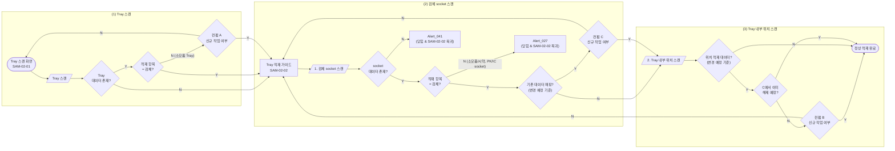

# 검체 Tray 적재 정책서

## 1. 개요

| 항목 | 내용 |
|---|---|
| 대상 | 검체 Tray 적재 |
| 시나리오 | (1) Tray 전체 바코드 스캔 → (2) 적재할 검체 socket 스캔 → (3) 적재할 Tray 내부 위치 스캔 |
| SAM-02-01 | `LI-TSS-PSI-SAM-02-01` Tray 스캔 화면. 검체 Tray 가이드 진입 화면이며 Tray를 스캔하는 화면 |
| SAM-02-02 | `LI-TSS-PSI-SAM-02-02` Tray 적재 가이드. 흐름도의 복귀 지점이며, 검체 socket 스캔과 Tray 내부 위치 스캔은 이 가이드에서 진행한다 |

- 이 메뉴의 목적은 **검체 socket을 Tray 내부 위치에 적재하는 행위**이다.
- SAM-02-02에는 **[Remove] 기능**이 있어, 스캔한 Tray의 내부 위치에 적재된 검체 socket을 제거할 수 있다. `[Remove]`도 변경 예정 사항으로 기록되며 `[Done]`을 눌러야 반영된다(8장).
- 공통 데이터·컨펌·저장·복귀 원칙은 `common-loading-policy.md`를 따른다. 공통 정책서의 Trolley·Tray·Floor는 이 흐름에서 Tray·검체 socket·Tray 내부 위치로 읽는다(공통 정책서 2.6).

---

## 2. 용어 및 적재 계층

### 2.1 적재 단위

적재 단위의 종류와 소모품/시약의 결합 구조는 공통 정책서 2.1·2.2를 따른다.

### 2.2 적재 계층

| 구분 | 하위 | 중위 | 상위 |
|---|---|---|---|
| 검체 계열 | 검체, 검체 socket | 검체 Tray | 검체 Trolley |
| 소모품 계열 | 소모품/시약 (DWP 단독, 또는 소모품 rack과 결합) | 소모품 Tray | 소모품 Trolley |

- 본 정책서에서 "상위"는 **Tray(Tray 내부 위치)**, "하위"는 Tray에 적재된 **검체 socket**을 뜻한다.
- 검체 socket에는 검체가 적재되어 있다.
- 검체 Tray에는 검체 socket만 적재할 수 있으며, **최대 10개**(Tray 내부 위치 10개)이다.
- 같은 G10 socket이라도 PK/IC tube·Standard tube가 담긴 socket은 시약 socket이므로 Alert_027, 아무것도 담기지 않은 socket은 Alert_041이다.
- PK/IC socket(적재 항목 = PK/IC인 G1 socket)은 소모품/시약으로 보며 검체 Tray에 적재할 수 없다(Alert_027).
- 흐름도와 문구에서 쓰는 "Tray 위치", "Tray 내부 위치", "Tray slot"은 모두 같은 대상이며, 본 정책서에서는 **Tray 내부 위치**로 표기한다. 영문 문구에서는 **Tray slot**(복수 slots)으로 쓴다. 이전 표기 "section"은 쓰지 않는다(2026-10-30 현업 변경).

---

## 3. 공통 정책 적용

### 3.1 컨펌 적용

| 스캔 대상 | 데이터 상태 | 컨펌 / 얼럿 |
|---|---|---|
| Tray | 데이터 없음 | 없음 |
| Tray | 데이터 있음 + 적재 항목 = 검체 | 없음 (기존 검체 Tray에 이어서 적재하는 것이 정상) |
| Tray | 데이터 있음 + 적재 항목 = 소모품 | **컨펌 A** |
| 검체 socket | 데이터 없음 | **Alert_041** |
| 스캔 항목 | 소모품/시약 (PK/IC socket 포함) | **Alert_027** |
| 검체 socket | 데이터 있음 + 적재 항목 = 검체 + 어떤 Tray 내부 위치와도 연결 없음 | 없음 |
| 검체 socket | 데이터 있음 + 적재 항목 = 검체 + 이미 Tray 내부 위치와 연결됨 (다른 Tray, 현재 작업 중인 Tray, 변경 예정 상태에 기록된 연결 포함) | **컨펌 C** |
| 검체 socket | `[Remove]`로 제거 예정인 socket (상위 연결 없음으로 판단) | 없음 |
| Tray 내부 위치 | 적재 데이터 없음 | 없음 |
| Tray 내부 위치 | 적재 데이터 있음 (저장된 연결과 변경 예정 상태에 기록된 연결 모두 포함) + 해당 연결이 C에서 해제 예정으로 기록되지 않음 | **컨펌 B** |
| Tray 내부 위치 | 적재 데이터 있음 + 해당 연결이 C에서 이미 해제 예정으로 기록됨 (동일 socket·동일 위치 포함) | 없음 |
| Tray 내부 위치 | 컨펌 A에서 Y로 동의한 Tray (변경 예정 상태에서 모든 위치가 빈 값) | 없음 |
| Tray 내부 위치 | `[Remove]`로 socket을 제거한 위치 (변경 예정 상태에서 빈 값) | 없음 |

### 3.2 Trolley 흐름과의 대응

| 구분 | Trolley 흐름 | Tray 흐름 (본 정책서) |
|---|---|---|
| 진입 단위 (컨펌 A) | Trolley | Tray |
| 하위 단위 (컨펌 C) | Tray | 검체 socket |
| 적재 위치 (컨펌 B) | Floor | Tray 내부 위치 |

---

## 4. 전체 플로우

- 흐름은 좌 → 우 방향이며, 얼럿 박스에는 닫힘 후 복귀 화면을 함께 표기했다(복귀 화살표는 생략).
- 위 플로우에서 `G`(SAM-02-02)로의 복귀는 모두 **초기화**(검체 socket 스캔부터 다시 시작)이다.
- 컨펌 A의 N만 SAM-02-01로 복귀한다.
- `P2`(C에서 이미 해제 예정인 연결의 B 제외)와 변경 예정 상태 기준의 판단은 Trolley 정책서와 동일하게 적용하는 규칙이며, 흐름도에는 표시되어 있지 않다.
- "정상 적재 완료"는 검체 socket 1건의 스캔 흐름이 끝난 상태이며, 데이터는 `[Done]`을 눌러야 저장된다.

---

## 5. 단계별 정책

### 5.1 (1) Tray 스캔 (SAM-02-01)

| # | 조건 | 노출 | 다음 |
|---|---|---|---|
| 1 | Tray 데이터 없음 | 없음 | Tray 적재 가이드 노출(SAM-02-02) → 검체 socket 스캔 |
| 2 | Tray 데이터 있음 + 적재 항목 = 검체 | 없음 | Tray 적재 가이드 노출(SAM-02-02) → 검체 socket 스캔 |
| 3 | Tray 데이터 있음 + 적재 항목 = 소모품 | 컨펌 A | Y: Tray 적재 가이드 노출 후 검체 socket 스캔 / N: SAM-02-01 복귀 |

### 5.2 (2) 적재할 검체 socket 스캔 (SAM-02-02)

| # | 조건 | 노출 | 다음 |
|---|---|---|---|
| 1 | 검체 socket 데이터 없음 | Alert_041 | 얼럿 닫힘 & SAM-02-02 복귀 |
| 2 | 스캔 항목 = 소모품/시약 (소모품/시약 적재 방어, PK/IC socket 포함) | Alert_027 | 얼럿 닫힘 & SAM-02-02 복귀 |
| 3 | 검체 socket 데이터 있음 + 적재 항목 = 검체 + 기존 데이터 매핑 없음 | 없음 | Tray 내부 위치 스캔 |
| 4 | 검체 socket 데이터 있음 + 적재 항목 = 검체 + 기존 데이터 매핑 있음 | 컨펌 C | Y: Tray 내부 위치 스캔 / N: SAM-02-02 복귀 |

- **기존 데이터 매핑**은 스캔한 검체 socket이 이미 Tray 내부 위치(상위)와 연결되어 있는지를 기준으로 판단한다. 연결된 Tray가 다른 Tray이든 현재 작업 중인 Tray이든 동일하게 컨펌 C를 노출한다.
- 변경 예정 상태에 이미 위치 연결이 기록된 검체 socket을 같은 작업 안에서 다시 스캔한 경우에도 컨펌 C를 노출한다.
- `[Remove]`로 제거한 검체 socket은 상위 연결이 없는 것으로 보아 다시 스캔해도 컨펌 C를 노출하지 않는다.

### 5.3 (3) 적재할 Tray 내부 위치 스캔 (SAM-02-02)

| # | 조건 | 노출 | 다음 |
|---|---|---|---|
| 1 | 스캔한 Tray 내부 위치에 적재 데이터 없음 | 없음 | 정상 적재 완료 |
| 2 | 스캔한 Tray 내부 위치에 적재 데이터 있음 + 해당 연결이 C에서 해제 예정으로 기록되지 않음 | 컨펌 B | Y: 정상 적재 완료 / N: SAM-02-02 복귀 |
| 3 | 스캔한 Tray 내부 위치에 적재 데이터 있음 + 해당 연결이 C에서 이미 해제 예정으로 기록됨 | 없음 | 정상 적재 완료 |

- 위치에 적재 데이터가 있으면 기존 socket이 어떤 socket이든 컨펌 B를 노출한다. 단, 해당 위치–socket 연결이 직전 컨펌 C에서 이미 해제 예정으로 기록된 경우(예: 같은 socket을 같은 위치에 다시 적재)에는 B를 노출하지 않는다.
- 변경 예정 상태에 이미 기록된 위치 연결도 B 판단 대상이다. 예) socket S1을 위치 3에 적재한 뒤 `[Done]` 전에 socket S2를 위치 3에 적재하면, 위치 3에 S1 연결이 기록되어 있으므로 B를 노출한다.
- 컨펌 A에서 Y로 동의한 Tray는 변경 예정 상태에서 모든 Tray 내부 위치가 빈 값이므로, 위치 스캔 시 적재 데이터 없음으로 판단하고 B를 노출하지 않는다.
- `[Remove]`로 socket을 제거한 위치는 변경 예정 상태에서 빈 값이므로 B를 노출하지 않는다.

---

## 6. 컨펌 정의

### 6.1 컨펌 A (소모품 Tray 스캔)

| 구분 | 내용 |
|---|---|
| 노출 조건 | Tray 데이터 있음 + 적재 항목 = 소모품 |
| Main | Use this tray for specimens? |
| Sub | Loaded consumables/reagents will be unlinked, but their data remains valid. |
| Y | 동의 기록 → Tray 적재 가이드 노출 후 검체 socket 스캔 (데이터 반영은 `[Done]` 시점) |
| N | SAM-02-01 복귀 |

**신규 작업 시 정의**
- 소모품 Tray → 신규 Tray로 변경 (Data reset)
- 신규가 된 Tray와 내부에 적재된 모든 소모품/시약 간의 데이터 끊김
  - 단, 소모품/시약의 데이터는 유지
- 신규가 된 Tray와 상위 소모품 Trolley 층 간의 연결도 해제
- 끊긴 소모품/시약은 검체 Trolley별 필요 수량 카운트에서도 빠진다 (`consumables-tray-policy.md` 1장)
- 신규가 된 Tray에 적재된 소모품/시약은 사용자가 물리적으로 제거 필요 *(화면에는 노출하지 않는 메모)*

**추가 규칙**
- A에 Y로 동의하면 변경 예정 상태에서 해당 Tray의 모든 Tray 내부 위치는 빈 값으로 기록한다. `[Done]` 전까지 그 Tray의 위치를 스캔하면 적재 데이터가 없는 것으로 판단하므로 컨펌 B를 노출하지 않는다.
- A에 Y로 동의했더라도 `[Done]` 전에 메뉴를 벗어나면 동의 및 변경 예정 사항을 폐기하며, 같은 Tray를 다시 스캔하면 A를 다시 노출한다.

### 6.2 컨펌 C (검체 socket 스캔)

| 구분 | 내용 |
|---|---|
| 노출 조건 | 검체 socket 데이터 있음 + 적재 항목 = 검체 + 기존 데이터 매핑 있음 |
| Main | Reassign this socket to a new slot? |
| Sub | The previous slot link will be removed, but the other sockets in that tray remain valid. |
| Y | 동의 기록(스캔한 검체 socket과 기존 Tray 내부 위치 연결을 해제 예정으로 기록) → Tray 내부 위치 스캔 |
| N | SAM-02-02 복귀 (현재 진행 중인 검체 socket의 스캔 및 동의 상태 초기화. 이미 정상 적재 완료로 기록된 다른 검체 socket의 변경 예정 사항은 유지) |

**신규 작업 시 정의**
- `[Done]` 시 스캔한 검체 socket과 기존 Tray 내부 위치 간의 연결 해제
- socket과 socket에 적재된 검체의 데이터는 보존

### 6.3 컨펌 B (Tray 내부 위치 스캔)

| 구분 | 내용 |
|---|---|
| 노출 조건 | 스캔한 Tray 내부 위치에 기존 socket 연결이 있고, 해당 연결이 C에서 이미 해제 예정으로 기록되지 않음 |
| Main | Replace the socket in this slot? |
| Sub | The current socket will be unlinked, but its data remains valid. |
| Y | 동의 기록(대상 위치의 기존 socket 연결을 해제 예정으로 기록) → 정상 적재 완료 |
| N | SAM-02-02 복귀 (현재 진행 중인 검체 socket의 스캔 및 동의 상태 초기화. 이미 정상 적재 완료로 기록된 다른 검체 socket의 변경 예정 사항은 유지) |

**신규 작업 시 정의**
- `[Done]` 시 해당 Tray 내부 위치의 기존 검체 socket 연결을 해제하고 새 위치–socket 연결을 생성 (이전 검체 socket data reset)
- 이전 검체 socket과 그 socket에 적재된 검체는 데이터 연결 유지

---

## 7. 얼럿 정의

| 얼럿 | 노출 조건 | Main | Sub | 닫힘 후 |
|---|---|---|---|---|
| Alert_041 | 검체 socket 데이터 없음 | This socket has no samples loaded. | Load samples into the socket and try again. | SAM-02-02 복귀 |
| Alert_027 | 소모품/시약 스캔 (소모품/시약 적재 방어, PK/IC socket 포함) | Invalid code for the current workflow. | Verify the required item for this step and try again. | SAM-02-02 복귀 |

- Alert_027의 문구는 이 흐름도에는 없으며, Trolley 정책서에서 확정된 문구와 동일하다.

---

## 8. 데이터 저장, 취소 및 복귀 정책

### 8.1 데이터 반영 시점

- 컨펌 A·C·B의 Y는 **동의와 변경 예정 사항만 기록**한다.
- 실제 데이터 변경은 사용자가 필요한 socket을 모두 처리하고 **`[Done]`을 눌렀을 때 한 번에 반영**한다.

`[Done]` 시 반영되는 내용:

| 컨펌 Y 이력 | 반영 내용 |
|---|---|
| 컨펌 A | 소모품 Tray → 신규 Tray로 변경(Data reset), 내부 소모품/시약과의 데이터 끊김 (모든 Tray 내부 위치가 빈 값이 됨), Tray와 상위 소모품 Trolley 층 간 연결 해제 |
| 컨펌 C | 스캔한 검체 socket과 기존 Tray 내부 위치 간 연결 해제 |
| 컨펌 B | 스캔한 Tray 내부 위치의 기존 socket 연결 해제 (C에서 이미 해제 예정으로 기록된 연결은 제외) |
| `[Remove]` | Tray 내부 위치에서 제거한 socket의 연결 해제 |
| (공통) | 스캔한 검체 socket과 스캔한 Tray 내부 위치 간 신규 매핑 생성, 검체 데이터 유지 |

### 8.2 메뉴 이탈

- `[Done]` 전에 메뉴를 벗어나면 A·B·C 동의 기록과 `[Remove]`를 포함한 모든 변경 예정 사항을 폐기하고 기존 데이터는 변경하지 않는다.

### 8.3 저장 실패

- 저장 중 오류가 발생해도 부분 반영은 허용하지 않으며, 기존 저장 데이터는 유지한다.
- 저장 실패 시 현재 적재 가이드 화면과 변경 예정 상태를 유지한다. Alert 확인 후 현재 화면에서 재시도할 수 있으며, 재시도 시 유지 중인 변경 예정 사항을 다시 저장한다.
- 저장 실패 Alert는 Alert_045(Main: `Failed to save.` / Sub: `Your changes are kept. Please try again.`)를 사용한다.

### 8.4 복귀 시 처리

| 복귀 사유 | 복귀 화면 | 데이터 | 상태 |
|---|---|---|---|
| Alert_041 / Alert_027 닫힘 | SAM-02-02 | 변경 없음 | 초기화 (검체 socket 스캔부터 다시) |
| 컨펌 C의 N | SAM-02-02 | 변경 없음 | 초기화 |
| 컨펌 B의 N | SAM-02-02 | 변경 없음 | 초기화 |
| 컨펌 A의 N | SAM-02-01 | 변경 없음 | Tray 스캔부터 다시 |

- C/B의 N은 현재 진행 중인 검체 socket의 스캔 및 동의 상태만 초기화한다. 이미 정상 적재 완료로 기록된 다른 검체 socket의 변경 예정 사항은 유지되며 `[Done]` 시 저장된다.
- 복귀 후 방금 스캔한 검체 socket과 그 컨펌 C 동의는 유지하지 않는다. 같은 검체 socket을 다시 스캔하면 컨펌 C가 다시 노출될 수 있다.

---

## 9. 비고

- 같은 socket을 같은 위치에 다시 적재하는 경우: socket 스캔 → 컨펌 C 노출 → C=Y → 위치 스캔. 해당 연결은 C에서 이미 해제 예정으로 기록되었으므로 컨펌 B는 노출하지 않는다. `[Done]`에서 기존 연결 해제와 새 연결 생성을 일괄 반영한다.
- 같은 위치에 다른 socket을 연속으로 적재하는 경우: 변경 예정 상태에 기존 socket 연결이 기록되어 있으므로 컨펌 B를 노출한다.
- 컨펌 문구는 현재 Main/Sub(영문)만 정의되어 있으며, 간략안 기준이다. 문구는 추후 일괄 수정하고, 언어별 문구는 언어셋 등록 시 확정한다.

## 10. 후속 정리 항목

| # | 항목 | 상태 |
|---|---|---|
| 1 | Alert_041 ID | 확정 (2026-10-29 화면 설계서 검토) |
| 2 | 저장 실패 Alert (Alert_045) ID 및 문구 | 확정 (2026-10-29 화면 설계서 검토) |
