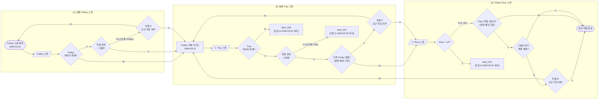

# 검체 Trolley 적재 정책서

## 1. 개요

| 항목 | 내용 |
|---|---|
| 대상 | 검체 Trolley 적재 |
| 시나리오 | (1) 검체 Trolley 스캔 → (2) 적재할 검체 Tray 스캔 → (3) 적재할 Trolley 층(Floor) 스캔 |
| SAM-03-01 | `LI-TSS-PSI-SAM-03-01` Trolley 스캔 화면 |
| SAM-03-02 | `LI-TSS-PSI-SAM-03-02` Tray 및 Trolley floor 스캔 화면 (Trolley 적재 가이드) |
| 가이드 순서 | SAM-03-02 가이드에 `1. Tray 스캔`, `2. Floor 스캔` 순서가 채번으로 안내됨 |

- SAM-03-02에서는 Tray 스캔과 Floor 스캔이 한 화면에서 이루어진다.
- 이 메뉴의 목적은 **적재 행위**이다.
- SAM-03-02에는 **[Remove] 버튼**이 있어, 스캔한 Trolley의 floor에 적재된 검체 Tray를 제거할 수 있다. `[Remove]`도 변경 예정 사항으로 기록되며 `[Done]`을 눌러야 반영된다(8장).
- 공통 데이터·컨펌·저장·복귀 원칙은 `common-loading-policy.md`를 따른다.

---

## 2. 용어 및 적재 계층

### 2.1 적재 단위

적재 단위의 종류와 소모품/시약의 결합 구조는 공통 정책서 2.1·2.2를 따른다.

### 2.2 적재 계층

| 구분 | 하위 | 중위 | 상위 |
|---|---|---|---|
| 검체 계열 | 검체, 검체 socket | 검체 Tray | 검체 Trolley |
| 소모품 계열 | 소모품/시약 (DWP 단독, 또는 소모품 rack과 결합) | 소모품 Tray | 소모품 Trolley |

- 각 적재 단위는 상위·하위 단위와 데이터로 매핑되어 있다.
- 본 정책서에서 "상위"는 Tray의 Trolley(Floor), "하위"는 Tray에 적재된 검체 socket을 뜻한다.
- 검체 Trolley에는 검체 Tray만 적재할 수 있다.
- 검체 Trolley는 1F에 Tray를 적재할 수 없으므로 적재 가능한 층은 2~6F, **최대 5개**이다(SAM-03-02 카운트 `0/5`). 사용자가 물리적으로 1F에 넣는 것은 막을 수 없으며, 1F를 스캔하면 Alert_037로 데이터 연결만 막는다.
- **빈 Tray(데이터 없는 Tray)**는 연결된 검체 socket 데이터가 없는 Tray이다. `[Done]`은 socket이 1개 이상일 때만 활성화되므로, 저장된 검체 Tray에는 socket이 1개 이상 연결되어 있다.
- Trolley는 검체 Trolley, 소모품 Trolley, 빈 Trolley(데이터 없음) 세 가지이다.

---

## 3. 공통 정책: 신규 작업 여부 확인

### 3.1 원칙

1. **데이터가 존재하는 Trolley 또는 Tray를 스캔한 경우**, 사용자에게 **"신규 작업 여부"**를 컨펌으로 확인한다.
   - 각 적재 단위는 상·하위 단위와 데이터로 매핑되어 있고, 이 메뉴의 목적이 적재 행위이기 때문이다.
2. 컨펌 **Y** = 신규 작업 동의(변경 예정 사항 기록), **N** = 작업 취소 후 복귀.
3. 신규 작업(Y) 시 스캔한 Trolley·Tray의 **기존 연결만 끊고**, 하위 항목(Tray, 검체 socket)의 데이터는 유지한다.
4. 컨펌의 Y는 동의와 변경 예정 사항만 기록하며, 실제 데이터 변경은 **`[Done]` 시점에** 한 번에 반영한다(8장 참조).
5. 정상적인 프로세스에서 당연히 일어나는 경우는 **예외**로 두고 컨펌 없이 진행한다(3.2 참조).
6. 후속 컨펌의 노출 여부는 저장된 데이터와 함께 **변경 예정 상태**를 고려하여 판단한다. 컨펌 C에서 해제 예정으로 기록한 연결은 컨펌 B 판단에서 제외한다(5.3 참조). `[Remove]`로 제거한 연결도 변경 예정 상태로 보아, 제거한 Floor는 빈 값, 제거한 Tray는 상위 연결 없음으로 판단한다.

### 3.2 예외 (컨펌 없이 진행)

검체 Trolley 적재 프로세스에서 아래 두 경우는 공통 정책의 예외이다.

| # | 예외 | 사유 |
|---|---|---|
| 1 | 데이터가 있는 **검체 Trolley** 스캔 (적재 항목 = 검체) | SAM-03-02의 [Remove] 버튼으로 해당 Trolley floor에 적재된 검체 Tray를 제거할 수 있으므로, 기존 Trolley에 이어서 적재하는 것이 정상이다. 소모품 Trolley와는 "적재 항목 = 검체" 여부로 구분한다. |
| 2 | **상위(Trolley)와 연결된 데이터가 없는** 검체 Tray 스캔 | 검체를 Tray에 적재한 상태로 Trolley에 적재하는 것이 정상 프로세스이므로, Tray에 하위 데이터가 있는 것은 당연하다. |

- 예외 2는 **상위 Trolley와 연결된 데이터가 없는 Tray에 한정**한다. 이미 해당 Trolley(또는 다른 Trolley)와 연결된 Tray를 스캔한 경우는 예외가 아니며 **컨펌 C**를 노출한다.

### 3.3 검체 Trolley 영역 적용

| 스캔 대상 | 데이터 상태 | 컨펌 |
|---|---|---|
| Trolley | 데이터 없음 | 없음 |
| Trolley | 데이터 있음 + 적재 항목 = 검체 | 없음 (예외 1) |
| Trolley | 데이터 있음 + 적재 항목 = 소모품 | **컨펌 A** |
| Tray | 상위(Trolley) 매핑 없음 | 없음 (예외 2) |
| Tray | 상위(Trolley) 매핑 있음 (현재 작업 중인 Trolley, 변경 예정 상태에 이미 연결이 기록된 경우 포함) | **컨펌 C** |
| Tray | `[Remove]`로 제거 예정인 Tray (상위 연결 없음으로 판단) | 없음 |
| Trolley floor | 적재 데이터 없음 | 없음 |
| Trolley floor | 적재 데이터 있음 (저장된 연결과 변경 예정 상태에 기록된 연결 모두 포함) + 해당 연결이 C에서 해제 예정으로 기록되지 않음 | **컨펌 B** |
| Trolley floor | 적재 데이터 있음 + 해당 연결이 C에서 이미 해제 예정으로 기록됨 (동일 Tray·동일 Floor 포함) | 없음 |
| Trolley floor | 컨펌 A에서 Y로 동의한 Trolley (변경 예정 상태에서 전 Floor 빈 값) | 없음 |
| Trolley floor | `[Remove]`로 Tray를 제거한 Floor (변경 예정 상태에서 빈 값) | 없음 |

---

## 4. 전체 플로우

- 흐름은 좌 → 우 방향이며, 얼럿 박스에는 닫힘 후 복귀 화면을 함께 표기했다(복귀 화살표는 생략).
- 위 플로우에서 `G`(SAM-03-02)로의 복귀는 모두 **초기화**(Tray 스캔부터 다시 시작)이다.
- 컨펌 A의 N만 SAM-03-01로 복귀한다.
- "정상 적재 완료"는 Tray 1건의 스캔 흐름이 끝난 상태이며, 데이터는 `[Done]`을 눌러야 저장된다.

---

## 5. 단계별 정책

### 5.1 (1) 검체 Trolley 스캔 (SAM-03-01)

| # | 조건 | 노출 | 다음 |
|---|---|---|---|
| 1 | Trolley 데이터 없음 | 없음 | Trolley 적재 가이드 노출(SAM-03-02) → Tray 스캔 |
| 2 | Trolley 데이터 있음 + 적재 항목 = 검체 | 없음 | Trolley 적재 가이드 노출(SAM-03-02) → Tray 스캔 |
| 3 | Trolley 데이터 있음 + 적재 항목 = 소모품 | 컨펌 A | Y: Trolley 적재 가이드 노출 후 Tray 스캔 / N: SAM-03-01 복귀 |

### 5.2 (2) 적재할 검체 Tray 스캔 (SAM-03-02)

| # | 조건 | 노출 | 다음 |
|---|---|---|---|
| 1 | Tray 데이터 없음 | Alert_039 | 얼럿 닫힘 & SAM-03-02 복귀 |
| 2 | Tray 데이터 있음 + 적재 항목 = 소모품 (소모품 Tray 적재 방어) | Alert_027 | 얼럿 닫힘 & SAM-03-02 복귀 |
| 3 | Tray 데이터 있음 + 적재 항목 = 검체 + 기존 Trolley 매핑 없음 | 없음 | Floor 스캔 |
| 4 | Tray 데이터 있음 + 적재 항목 = 검체 + 기존 Trolley 매핑 있음 | 컨펌 C | Y: Floor 스캔 / N: SAM-03-02 복귀 |

- 기존 Trolley 매핑은 **상위 정보 매핑 O** 여부를 기준으로 판단한다.
- 현재 작업 중인 Trolley(예: A Trolley)에 이미 적재된 Tray를 스캔한 경우에도 다른 Trolley의 Tray와 동일하게 컨펌 C를 노출한다(같은 Trolley라는 예외를 두지 않는다).
- 변경 예정 상태에 이미 Floor 연결이 기록된 Tray를 같은 작업 안에서 다시 스캔한 경우에도 컨펌 C를 노출한다.
- `[Remove]`로 제거한 Tray는 상위 연결이 없는 것으로 보아 다시 스캔해도 컨펌 C를 노출하지 않는다.

### 5.3 (3) 적재할 Trolley 층(Floor) 스캔 (SAM-03-02)

| # | 조건 | 노출 | 다음 |
|---|---|---|---|
| 1 | 검체 Tray를 스캔한 뒤 Floor = 1F | Alert_037 | 얼럿 닫힘 & SAM-03-02 복귀 |
| 2 | 스캔한 Floor = 2~6F + 적재 데이터 없음 | 없음 | 정상 적재 완료 |
| 3 | 스캔한 Floor = 2~6F + 적재 데이터 있음 + 해당 연결이 C에서 해제 예정으로 기록되지 않음 | 컨펌 B | Y: 정상 적재 완료 / N: SAM-03-02 복귀 |
| 4 | 스캔한 Floor = 2~6F + 적재 데이터 있음 + 해당 연결이 C에서 이미 해제 예정으로 기록됨 | 없음 | 정상 적재 완료 |

- Floor에 적재 데이터가 있으면 기존 Tray가 어떤 Tray이든 컨펌 B를 노출한다. 단, 해당 Floor–Tray 연결이 직전 컨펌 C에서 이미 해제 예정으로 기록된 경우에는 B를 노출하지 않는다.
- 같은 Tray를 같은 Floor에 다시 적재하는 경우가 이에 해당한다(9장 참조).
- C에서 해제 예정으로 기록한 연결이 아닌 다른 Tray 연결이 있는 Floor를 스캔하면 B를 노출한다.
- 컨펌 A에서 Y로 동의한 Trolley는 변경 예정 상태에서 모든 Floor가 빈 값이므로, Floor 스캔 시 적재 데이터 없음으로 판단하고 B를 노출하지 않는다.
- 변경 예정 상태에 이미 기록된 Floor 연결도 B 판단 대상이다. 예) Tray B를 4F에 적재한 뒤 `[Done]` 전에 Tray C를 4F에 적재하면 4F에 Tray B 연결이 기록되어 있으므로 B를 노출한다.
- `[Remove]`로 Tray를 제거한 Floor는 변경 예정 상태에서 빈 값이므로 B를 노출하지 않는다.

---

## 6. 컨펌 정의

### 6.1 컨펌 A (소모품 Trolley 스캔)

| 구분 | 내용 |
|---|---|
| 노출 조건 | Trolley 데이터 있음 + 적재 항목 = 소모품 |
| Main | Use this trolley for specimens? |
| Sub | Loaded trays will be unlinked, but their data remains valid. |
| Y | 동의 기록 → Trolley 적재 가이드 노출 후 Tray 스캔 (데이터 반영은 `[Done]` 시점) |
| N | SAM-03-01 복귀 |

**신규 작업 시 정의**
- 소모품 Trolley → 신규 Trolley로 변경 (Data reset)
- 신규가 된 Trolley와 내부에 적재된 모든 Tray 간의 데이터 끊김
  - 단, 내부에 적재된 Tray와 그 Tray에 적재된 소모품/시약은 데이터 연결 유지
- 신규가 된 Trolley에 적재된 Tray는 사용자가 물리적으로 제거 필요 *(화면에는 노출하지 않는 메모)*

**추가 규칙**
- A에 Y로 동의했더라도 `[Done]` 전에 메뉴를 벗어나면 동의 및 변경 예정 사항을 폐기하며, 같은 Trolley를 다시 스캔하면 A를 다시 노출한다.
- A에 Y로 동의하면 변경 예정 상태에서 해당 Trolley의 모든 Floor는 빈 값으로 기록한다. `[Done]` 전까지 그 Trolley의 Floor를 스캔하면 적재 데이터가 없는 것으로 판단하므로 컨펌 B를 노출하지 않는다.

### 6.2 컨펌 C (Tray 스캔)

| 구분 | 내용 |
|---|---|
| 노출 조건 | Tray 데이터 있음 + 적재 항목 = 검체 + 기존 Trolley 매핑 있음 |
| Main | Reassign this tray to a new floor? |
| Sub | The previous floor link will be removed, but the other trays on that trolley remain valid. |
| Y | 동의 기록(스캔한 Tray와 기존 Floor 연결을 해제 예정으로 기록) → Floor 스캔 |
| N | SAM-03-02 복귀 (현재 진행 중인 Tray의 스캔 및 동의 상태 초기화. 이미 정상 적재 완료로 기록된 다른 Tray의 변경 예정 사항은 유지) |

**신규 작업 시 정의**
- `[Done]` 시 스캔한 Tray와 기존 Trolley floor 간의 연결 해제
- Tray와 Tray에 적재된 검체 socket의 데이터는 보존

### 6.3 컨펌 B (Floor 스캔)

| 구분 | 내용 |
|---|---|
| 노출 조건 | 스캔한 Floor(2~6F)에 기존 Tray 연결이 있고, 해당 연결이 C에서 이미 해제 예정으로 기록되지 않음 |
| Main | Replace the tray on this floor? |
| Sub | The current tray will be unlinked, but its data remains valid. |
| Y | 동의 기록(대상 Floor의 기존 Tray 연결을 해제 예정으로 기록) → 정상 적재 완료 |
| N | SAM-03-02 복귀 (현재 진행 중인 Tray의 스캔 및 동의 상태 초기화. 이미 정상 적재 완료로 기록된 다른 Tray의 변경 예정 사항은 유지) |

**신규 작업 시 정의**
- `[Done]` 시 해당 Trolley floor의 기존 Tray 연결을 해제하고 새 Tray–Floor 연결을 생성 (이전 Tray data reset)
- 이전 Tray와 그 Tray 내부에 적재된 검체 socket은 데이터 연결 유지

---

## 7. 얼럿 정의

| 얼럿 | 노출 조건 | Main | Sub | 닫힘 후 |
|---|---|---|---|---|
| Alert_039 | Tray 데이터 없음 | This tray has no sample sockets loaded. | Load sample sockets into the tray and try again. | SAM-03-02 복귀 |
| Alert_027 | 소모품 Tray 스캔 (소모품 Tray 적재 방어) | Invalid code for the current workflow. | Verify the required item for this step and try again. | SAM-03-02 복귀 |
| Alert_037 | 1F Floor 스캔 | Trays cannot be loaded on 1F of the trolley. |  | SAM-03-02 복귀 |

- 검체 Trolley는 1F에 어떤 Tray도 적재할 수 없다.

---

## 8. 데이터 저장, 취소 및 복귀 정책

### 8.1 데이터 반영 시점

- 컨펌 A·C·B의 Y는 **동의와 변경 예정 사항만 기록**한다.
- 실제 데이터 변경은 사용자가 필요한 Tray를 모두 처리하고 **`[Done]`을 눌렀을 때 한 번에 반영**한다.

`[Done]` 시 반영되는 내용:

| 컨펌 Y 이력 | 반영 내용 |
|---|---|
| 컨펌 A | 소모품 Trolley → 신규 Trolley로 변경(Data reset), 내부 Tray와의 데이터 끊김 |
| 컨펌 C | Tray와 기존 Trolley floor 간 데이터 끊김 |
| 컨펌 B | 스캔한 Floor의 기존 Tray 연결 해제 (C에서 이미 해제 예정으로 기록된 연결은 제외) |
| `[Remove]` | 스캔한 Trolley floor에서 제거한 Tray의 연결 해제 |
| (공통) | 스캔한 Tray와 스캔한 Floor 간 신규 매핑 생성, 검체 socket 데이터 유지 |

### 8.2 메뉴 이탈

- `[Done]` 전에 메뉴를 벗어나면 A·B·C 동의 기록과 `[Remove]`를 포함한 모든 변경 예정 사항을 폐기하고 기존 데이터는 변경하지 않는다.

### 8.3 저장 실패

- 저장 중 오류가 발생해도 부분 반영은 허용하지 않으며, 기존 저장 데이터는 유지한다.
- 저장 실패 시 현재 적재 가이드 화면과 변경 예정 상태를 유지한다. Alert 확인 후 현재 화면에서 재시도할 수 있으며, 재시도 시 유지 중인 변경 예정 사항을 다시 저장한다.
- 저장 실패 Alert는 Alert_045(Main: `Failed to save.` / Sub: `Your changes are kept. Please try again.`)를 사용한다.

### 8.4 복귀 시 처리

| 복귀 사유 | 복귀 화면 | 데이터 | 상태 |
|---|---|---|---|
| Alert_039 / Alert_027 / Alert_037 닫힘 | SAM-03-02 | 변경 없음 | 초기화 (Tray 스캔부터 다시) |
| 컨펌 C의 N | SAM-03-02 | 변경 없음 | 초기화 |
| 컨펌 B의 N | SAM-03-02 | 변경 없음 | 초기화 |
| 컨펌 A의 N | SAM-03-01 | 변경 없음 | Trolley 스캔부터 다시 |

- C/B의 N은 현재 진행 중인 Tray의 스캔 및 동의 상태만 초기화한다. 이미 정상 적재 완료로 기록된 다른 Tray의 변경 예정 사항은 유지되며 `[Done]` 시 저장된다.
- 복귀 후에도 방금 스캔했던 Tray와 컨펌 C의 동의는 유지하지 않는다. 다시 스캔하면 컨펌 C가 다시 노출될 수 있다.
- SAM-03-02는 Tray 스캔 후 Floor 대기 상태를 별도로 표시하지 않는다.

---

## 9. 비고

- 동일 Tray를 동일 Floor에 다시 적재하는 경우: Tray 스캔 → 컨펌 C 노출 → C=Y → Floor 스캔. 해당 Floor–Tray 연결은 C에서 이미 해제 예정으로 기록되었으므로 컨펌 B는 노출하지 않는다. `[Done]`에서 기존 연결 해제와 새 연결 생성을 일괄 반영한다.
- 같은 Floor에 다른 Tray를 연속으로 적재하는 경우: Tray B를 4F에 적재한 뒤 `[Done]` 전에 Tray C를 4F에 적재하면, 변경 예정 상태에 4F에 Tray B 연결이 기록되어 있으므로 컨펌 B를 노출한다.
- 컨펌 문구는 현재 Main/Sub(영문)만 정의되어 있다. 언어별 문구는 언어셋 등록 시 확정한다.

## 10. 후속 정리 항목

| # | 항목 | 상태 |
|---|---|---|
| 1 | Alert_039 ID | 확정 (2026-10-29 화면 설계서 검토) |
| 2 | 저장 실패 Alert (Alert_045) ID 및 문구 | 확정 (2026-10-29 화면 설계서 검토) |
| 3 | SAM-03-02 디스크립션 ② "디폴트 : 0/6" → "0/5" (화면은 00/05) | 피그마 반영 완료 (2026-10-30) |
