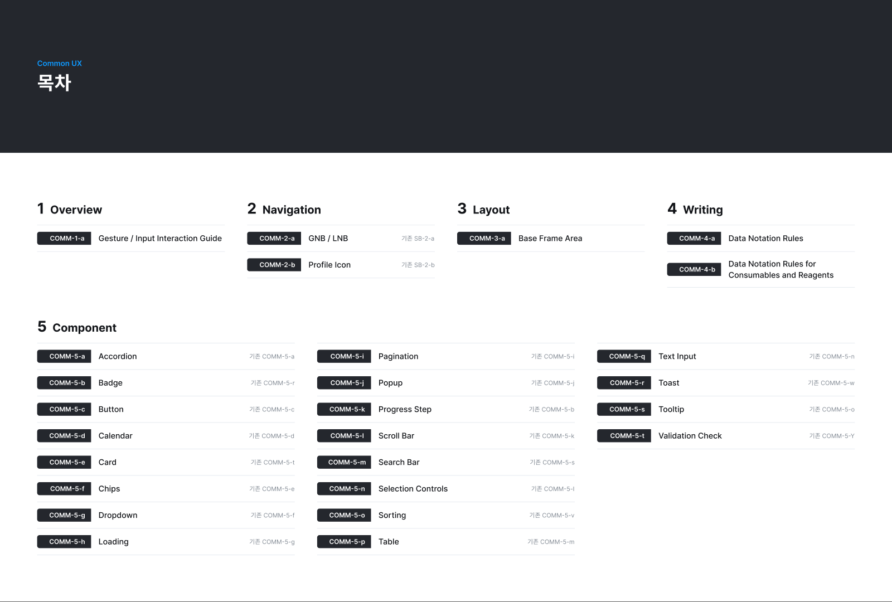

**Common UX Components · COMM-5**에 이 규칙대로 만든 Figma 컴포넌트가 있으니, 화면을 만들 때는 그 컴포넌트를 쓴다(「5. Component › Figma 컴포넌트」). 화면을 설계하거나 기존 화면을 고칠 때 이 규칙을 따른다. 상태값 · 표기 정의는 씨젠이 공유하는 「CURECA 시스템 구성 요소 및 상태 정보」 문서를 최우선으로 한다.

> 왼쪽 목차는 Figma 문서의 목차(COMM-0)와 같은 구조다. 대분류를 누르면 그 아래 항목이, 항목을 누르면 세부 내용이 오른쪽에 나온다. 그림을 누르면 크게 볼 수 있다.

### 프레임 구성

| 구분 | 크기 | 구성 |
|---|---|---|
| 목차 (`COMM-0`) | 1920 × 1295 | 대분류 1~5와 각 상세 프레임 CID · 이름, 기존 번호 |
| 대분류 표지 (`COMM-1` ~ `COMM-4`) | 1920 × 1080 | `Title`(Common UX · 대분류명 · 번호) + `Items`(하위 CID · 이름) |
| 상세 프레임 (`COMM-1-a` …) | 폭 1920, 높이는 내용에 맞춤 | `Header` + `Body` |

- **Header 항목**: Ver(예: 2.0.01) · Date · CID · 대분류(예: `1. Overview`) · 제목(예: `1-a. Gesture / Input Interaction Guide`) · 작성자 · 화면 · 화면명 · 경로 · Dev · SG, 그리고 한 줄 설명(「…을 정의합니다.」)
- 이전 문서에서 옮겨 온 프레임은 Header에 **기존 번호**를 함께 적는다(예: `기존 SB-2-a`).
- 한 주제가 길면 `(1/2)`, `(1/4)`처럼 나눠 프레임을 이어 붙인다.

*COMM-0 · 목차 (2026-10-30 판)*

문서는 5개 대분류로 구성한다. 대분류마다 표지 프레임 1장과 상세 프레임이 이어진다.

| 대분류 | 표지 | 상세 프레임 |
|---|---|---|
| 1. Overview | `COMM-1` | `COMM-1-a` Gesture / Input Interaction Guide |
| 2. Navigation | `COMM-2` | `COMM-2-a` GNB / LNB (기존 SB-2-a), `COMM-2-b` Profile Icon (기존 SB-2-b) |
| 3. Layout | `COMM-3` | `COMM-3-a` Base Frame Area (1/2 · 2/2) |
| 4. Writing | `COMM-4` | `COMM-4-a` Data Notation Rules (1/4 ~ 4/4), `COMM-4-b` Data Notation Rules for Consumables and Reagents (1/5 ~ 5/5) |
| 5. Component | `COMM-5` | `COMM-5-a` ~ `COMM-5-t` 20개 (아래 「5. Component」 번호표) |

### CID 규칙

- 형식: `COMM-{대분류 번호}-{소분류 알파벳}` · 나눈 프레임은 `({현재}/{전체})`를 붙인다(예: `COMM-4-a(2/4)`).
- 2.0에서 컴포넌트 번호를 **알파벳 순서로 다시 매겼다.** 기존 번호와 다르니 「5. Component」의 대응표를 확인한다.
