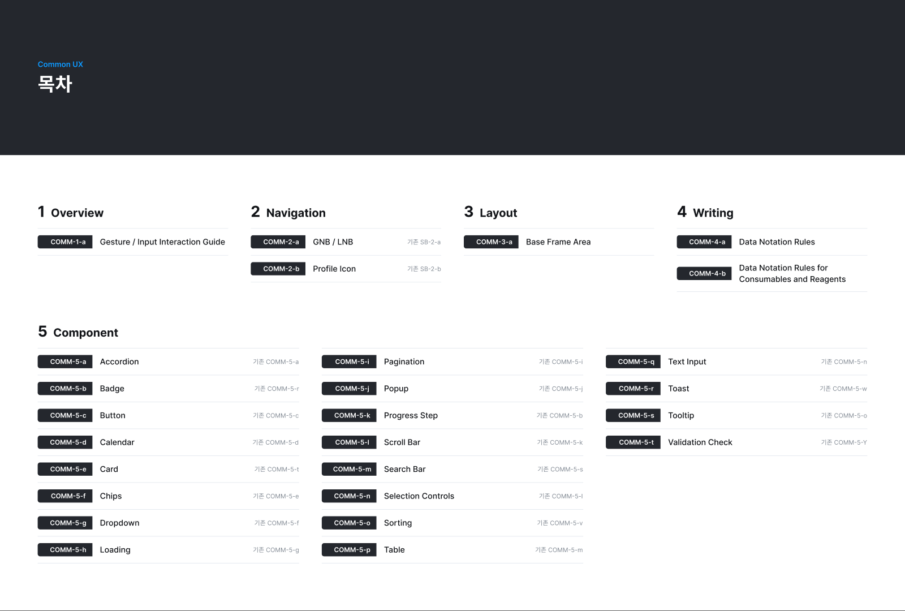

# 0. 문서 구성 (목차)

*COMM-0 · 목차 (2026-10-30 판)*

문서는 5개 대분류로 구성한다. 대분류마다 표지 프레임 1장과 상세 프레임이 이어진다.

| 대분류 | 표지 | 상세 프레임 |
|---|---|---|
| 1. Overview | `COMM-1` | `COMM-1-a` Gesture / Input Interaction Guide |
| 2. Navigation | `COMM-2` | `COMM-2-a` GNB / LNB (기존 SB-2-a), `COMM-2-b` Profile Icon (기존 SB-2-b) |
| 3. Layout | `COMM-3` | `COMM-3-a` Base Frame Area (1/2 · 2/2) |
| 4. Writing | `COMM-4` | `COMM-4-a` Data Notation Rules (1/4 ~ 4/4), `COMM-4-b` Data Notation Rules for Consumables and Reagents (1/5 ~ 5/5) |
| 5. Component | `COMM-5` | `COMM-5-a` ~ `COMM-5-t` 20개 (아래 「5. Component」 번호표) |

## CID 규칙

- 형식: `COMM-{대분류 번호}-{소분류 알파벳}` · 나눈 프레임은 `({현재}/{전체})`를 붙인다(예: `COMM-4-a(2/4)`).
- 2.0에서 컴포넌트 번호를 **알파벳 순서로 다시 매겼다.** 기존 번호와 다르니 「5. Component」의 대응표를 확인한다.
