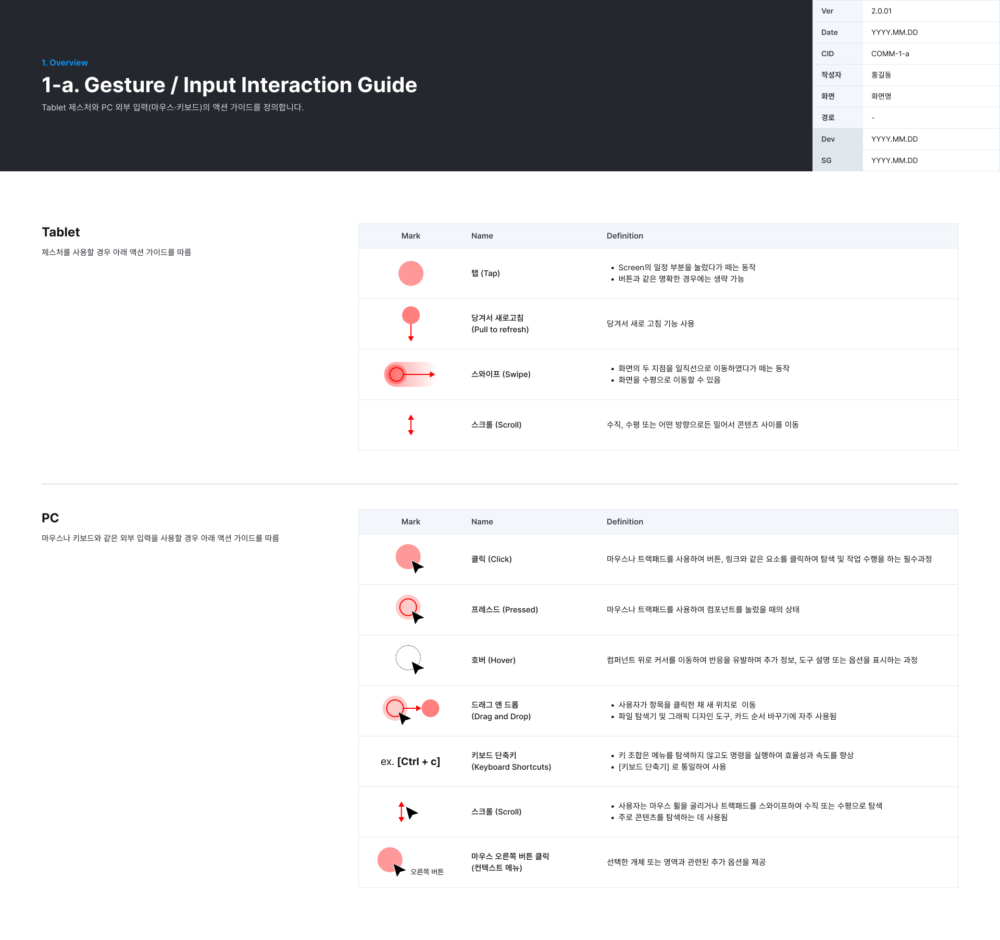

# 1. Overview

Tablet 제스처와 PC 외부 입력(마우스 · 키보드) 액션을 정의한다.

## 1-a. Gesture / Input Interaction Guide

Tablet 제스처와 PC 외부 입력(마우스 · 키보드)의 액션 가이드를 정의한다.

*COMM-1-a · Gesture / Input Interaction Guide*

**Tablet** — 제스처를 사용할 경우 아래 액션을 따른다.

| 이름 | 정의 |
|---|---|
| 탭 (Tap) | 화면의 일정 부분을 눌렀다가 떼는 동작. 버튼처럼 명확한 경우에는 표기 생략 가능 |
| 당겨서 새로고침 (Pull to refresh) | 당겨서 새로 고침 기능 사용 |
| 스와이프 (Swipe) | 화면의 두 지점을 일직선으로 이동했다가 떼는 동작. 화면을 수평으로 이동할 수 있음 |
| 스크롤 (Scroll) | 수직 · 수평 또는 어떤 방향으로든 밀어서 콘텐츠 사이를 이동 |

**PC** — 마우스 · 키보드 같은 외부 입력을 쓸 경우 아래 액션을 따른다.

| 이름 | 정의 |
|---|---|
| 클릭 (Click) | 마우스나 트랙패드로 버튼 · 링크 같은 요소를 클릭해 탐색 · 작업을 수행하는 필수 과정 |
| 프레스드 (Pressed) | 컴포넌트를 눌렀을 때의 상태 |
| 호버 (Hover) | 컴포넌트 위로 커서를 올려 추가 정보 · 도구 설명 · 옵션을 표시 |
| 드래그 앤 드롭 (Drag and Drop) | 항목을 클릭한 채 새 위치로 이동. 파일 탐색기 · 카드 순서 바꾸기 등에 사용 |
| 키보드 단축키 (Keyboard Shortcuts) | 메뉴를 거치지 않고 명령 실행. 표기는 `[키보드 단축키]`로 통일 (예: `[Ctrl + c]`) |
| 스크롤 (Scroll) | 마우스 휠 · 트랙패드 스와이프로 수직 · 수평 탐색 |
| 마우스 오른쪽 버튼 (컨텍스트 메뉴) | 선택한 개체 · 영역과 관련된 추가 옵션 제공 |
