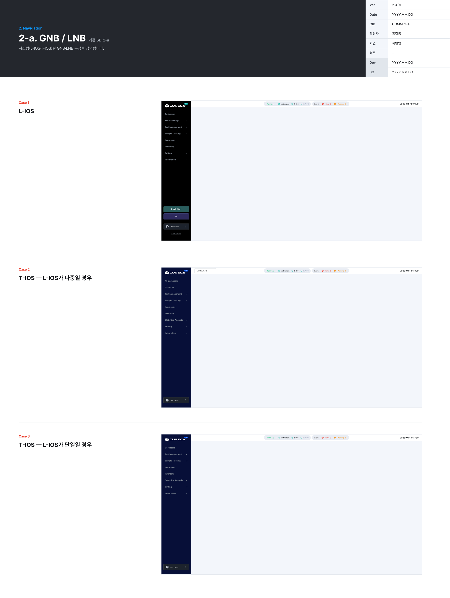
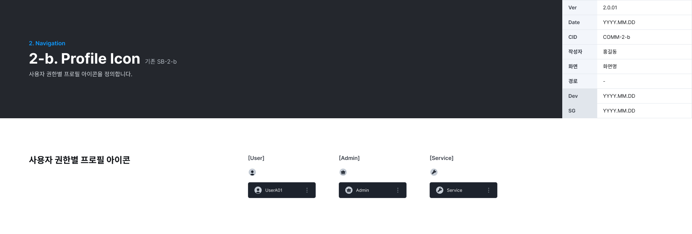

# 2. Navigation

시스템(L-IOS · T-IOS)별 GNB · LNB 구성과 사용자 권한별 프로필 아이콘을 정의한다.

## 2-a. GNB / LNB

시스템(L-IOS · T-IOS)별 GNB · LNB 구성을 정의한다. (기존 SB-2-a)

*COMM-2-a · GNB / LNB*

**GNB 표시 항목**: 시스템 표시(LIOS / TIOS) · Running 상태 · 연결 장비(Instrument · T-IOS · D.A PC 또는 L-IOS · D.A PC) · Event(Error 건수 · Warning 건수) · 일시(예: `2026-04-10 11:30`)

| Case | 시스템 | LNB 1Depth 메뉴 |
|---|---|---|
| Case 1 | L-IOS | Dashboard · Material Setup · Test Management · Sample Tracking · Instrument · Inventory · Setting · Information, 아래쪽 Quick Start · Run · User Name · Shut Down |
| Case 2 | T-IOS — L-IOS가 여러 대 | All Dashboard · Dashboard · Test Management · Sample Tracking · Inventory · Statistical Analysis · Setting · Information, GNB에 L-IOS 선택(예: `CURECA(1)`) |
| Case 3 | T-IOS — L-IOS가 한 대 | Case 2와 같고 All Dashboard · L-IOS 선택 없음 |

## 2-b. Profile Icon

사용자 권한별 프로필 아이콘을 정의한다. (기존 SB-2-b)

*COMM-2-b · Profile Icon*

| 권한 | 표시 예 |
|---|---|
| User | `UserA01` (사용자 이름) |
| Admin | `Admin` |
| Service | `Service` |
