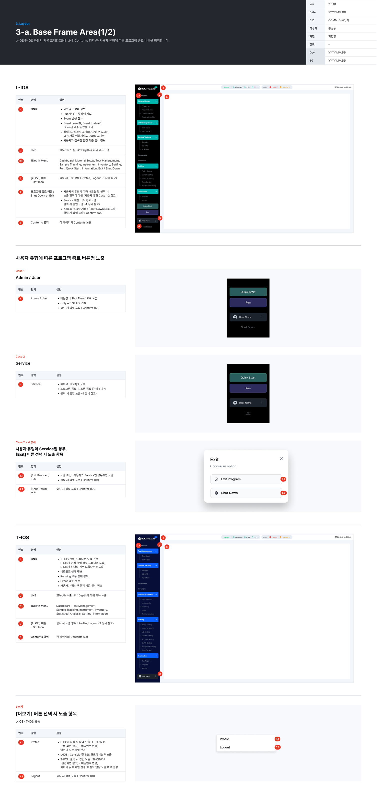
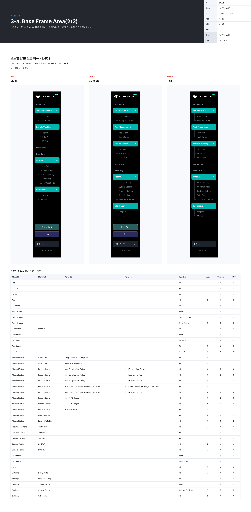

# 3. Layout

L-IOS · T-IOS 화면의 기본 프레임과 모드별 LNB 노출 · 기능 동작을 정의한다.

## 3-a. Base Frame Area (1/2) · 기본 프레임

L-IOS · T-IOS 화면의 기본 프레임(GNB · LNB · Contents 영역)과 사용자 유형에 따른 프로그램 종료 버튼을 정의한다.

*COMM-3-a(1/2) · Base Frame Area*

**L-IOS 영역 정의**

| 번호 | 영역 | 설명 |
|---|---|---|
| 1 | GNB | 네트워크 상태 · Running 구동 상태 · Event 발생 건수 · 접속 환경 기준 일시 |
| 1 | Event 건수 | Event Level별로 Status가 Open인 개수 합. 최대 3자리(999)까지, 넘어도 999로 표기 |
| 2 | LNB | 2Depth 노출: 각 1Depth의 하위 메뉴 노출 |
| 2.1 | 1Depth Menu | Dashboard, Material Setup, Test Management, Sample Tracking, Instrument, Inventory, Setting, Run, Quick Start, Information, Exit / Shut Down |
| 3 | [더보기] 버튼 (Dot 아이콘) | 클릭 시 Profile · Logout 노출 (3 상세) |
| 4 | 프로그램 종료 버튼 | 사용자 유형에 따라 버튼명 · 노출 항목이 다름 (Case 1 · 2) |
| 5 | Contents 영역 | 각 페이지의 Contents 노출 |

**L-IOS 2Depth 메뉴 예**: Material Setup › Group Lots · Prepare Carrier · Load Materials · Empty Waste Bin / Test Management › Test Order · Test Status / Sample Tracking › Samples · 96-DWP · PCR Plate / Setting › Policy · System · Protocol · Tube · AssayPack Setting / Information › Program · Manual

**사용자 유형에 따른 종료 버튼**

| Case | 사용자 | 버튼 | 동작 |
|---|---|---|---|
| Case 1 | Admin / User | `[Shut Down]` | 시스템 종료만 가능. 클릭 시 팝업 `Confirm_020` |
| Case 2 | Service | `[Exit]` | 프로그램 종료 · 시스템 종료 중 선택. 클릭 시 「Exit · Choose an option.」 팝업 |

- Case 2 › 4 상세: 4.1 `[Exit Program]`(Service일 때만 노출, 클릭 시 `Confirm_019`) · 4.2 `[Shut Down]`(클릭 시 `Confirm_020`)

**T-IOS 영역 정의**

| 번호 | 영역 | 설명 |
|---|---|---|
| 6 | GNB L-IOS 선택 | L-IOS가 여러 대면 드롭다운 노출, 한 대면 미노출 |
| — | GNB | 네트워크 상태 · Running 구동 상태 · Event 건수 · 일시 |
| — | LNB 1Depth | Dashboard, Test Management, Sample Tracking, Instrument, Inventory, Statistical Analysis, Setting, Information |
| — | 2Depth 예 | Statistical Analysis › Test Analytics · Instruments · Test Forecasting / Setting › Policy · Protocol · LIS · System · Account · SMTP · AssayPack · Tube Setting / Information › Run Report · Program · Manual |
| — | Contents 영역 | 각 페이지의 Contents 노출 |

**3 상세 — [더보기] 선택 시 노출 항목 (L-IOS · T-IOS 공통)**

| 번호 | 항목 | 동작 |
|---|---|---|
| 3.1 | Profile | L-IOS: 팝업 `LI-CPW-P`(비밀번호 · 아이디 · 이메일 변경). Console · TSS 모드에서는 미노출 / T-IOS: 팝업 `TI-CPW-P`(비밀번호 · 아이디 · 이메일 변경, 이벤트 알람 노출 여부) |
| 3.2 | Logout | 팝업 `Confirm_018` |

## 3-a. Base Frame Area (2/2) · 모드별 LNB

L-IOS 모드(Main · Console · TSS)별 LNB 노출 메뉴와 메뉴 단위 기능 동작 여부를 정의한다.

*COMM-3-a(2/2) · 모드별 LNB 노출 메뉴*

| Case | 모드 | LNB 노출 |
|---|---|---|
| Case 1 | Main | 전체 메뉴 (Dashboard · Material Setup · Test Management · Sample Tracking · Instrument · Inventory · Setting · Information · Quick Start · Run) |
| Case 2 | Console | Main 기준, 모드에서 쓰지 않는 메뉴는 미노출 (그림 참고) |
| Case 3 | TSS | Main 기준, 모드에서 쓰지 않는 메뉴는 미노출 (그림 참고) |

- 메뉴 단위 모드별 기능 동작 표: Menu(1)~(4) · Function · Main · Console · TSS 열에 `O = 동작`, `X = 미동작`으로 적는다.
- Function 값이 `All`이면서 `X`인 항목은 그 모드에서 **메뉴 자체를 노출하지 않는다.** (예: Profile은 Console · TSS에서 X)
- 대상 기능 예: Login · Logout · Profile · Event History(View · Status Control · Note Writing) · Initialize · Stop · Door Control · Group Lots · Prepare Carrier(Load Samples · Socket · Tray · Consumables and Reagents …) · Load Materials(PK/IC · PCR Reagents · MM Tubes) · Empty Waste Bin · Settings
