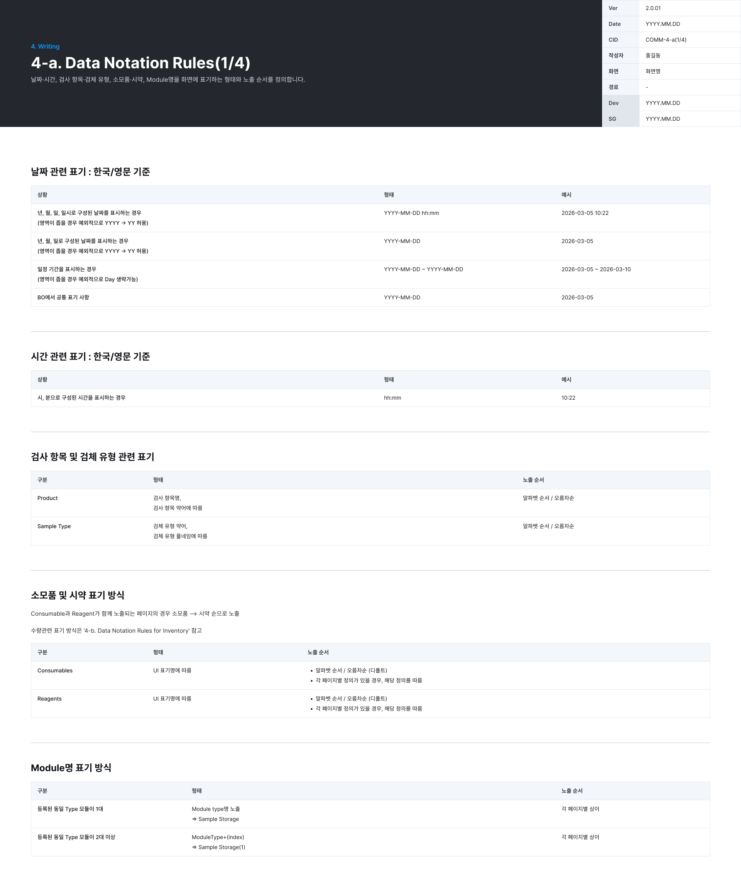
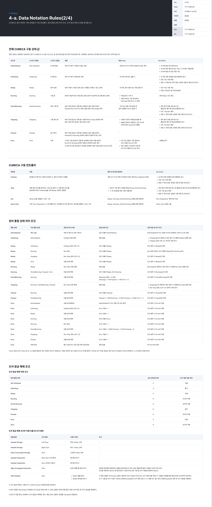
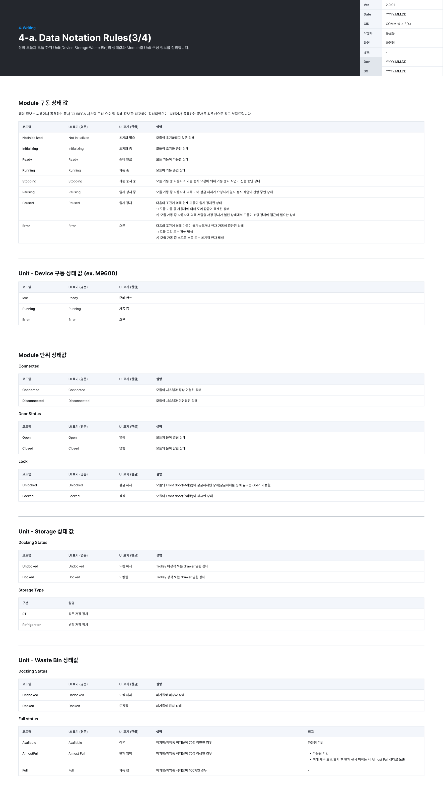
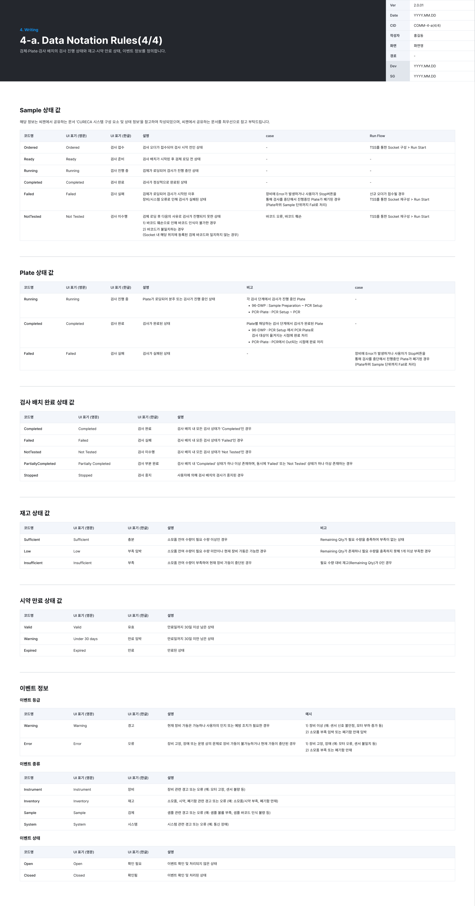
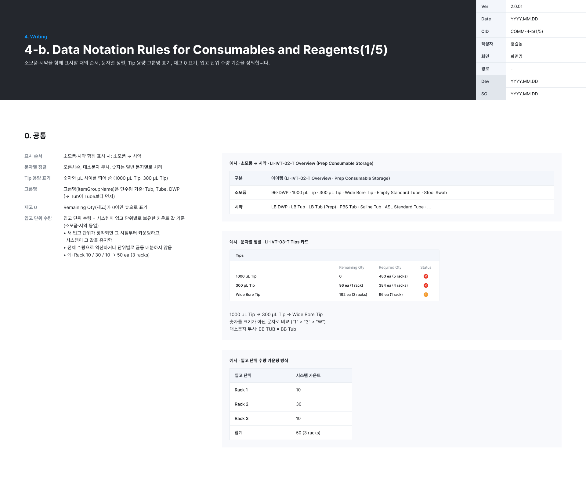
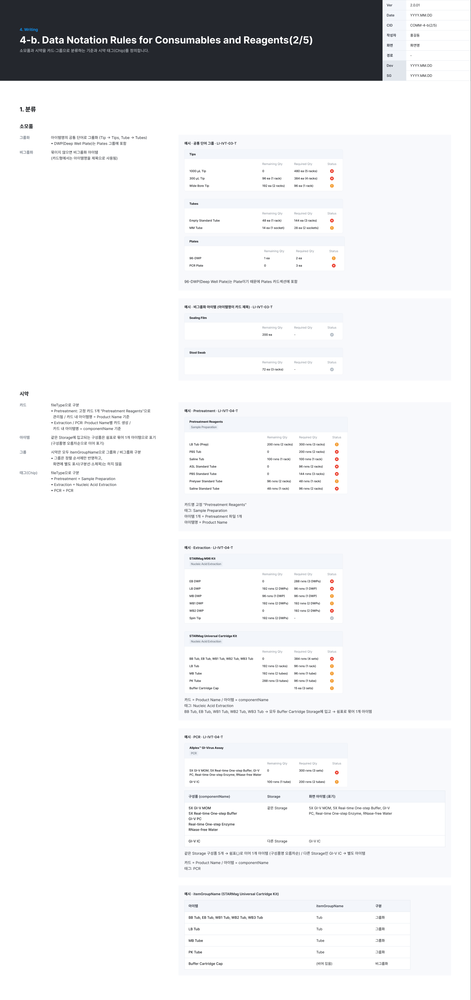
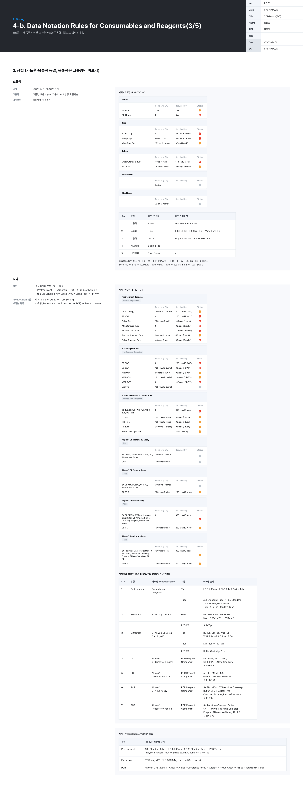
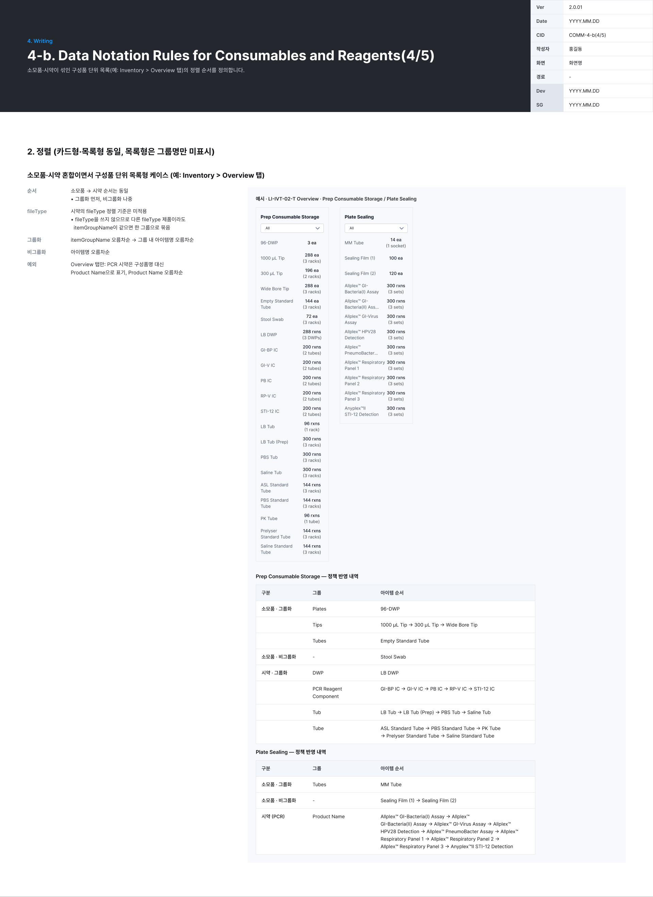
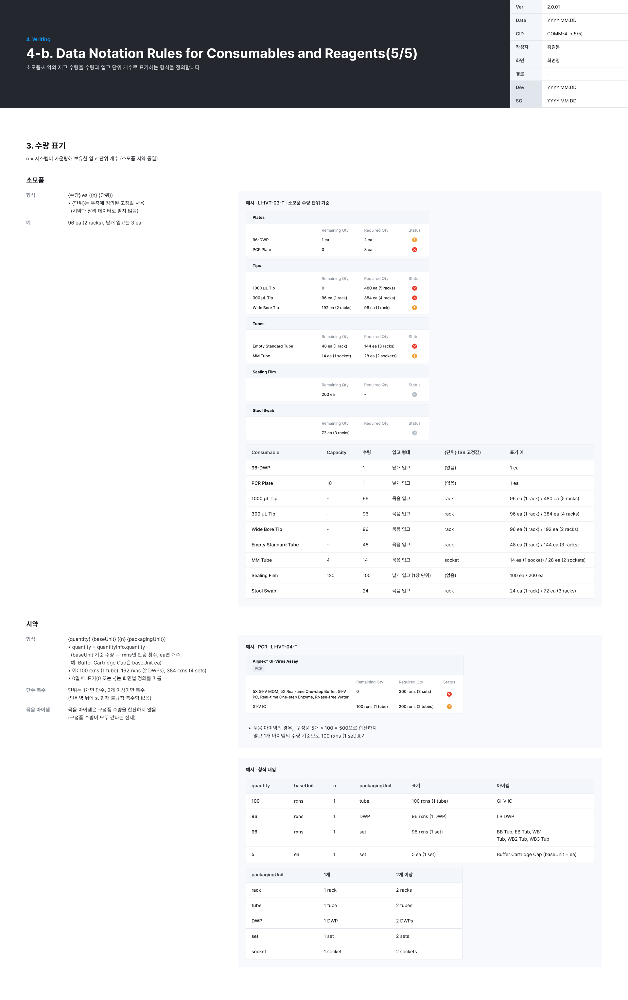

# 4. Writing

화면 표기 형식과 상태값, 소모품 · 시약 표기 규칙을 정의한다.

## 4-a. Data Notation Rules (1/4) · 날짜 · 순서 · Module명

날짜 · 시간, 검사 항목 · 검체 유형, 소모품 · 시약, Module명을 화면에 표기하는 형태와 노출 순서를 정의한다.

*COMM-4-a(1/4)*

**날짜 · 시간 (한국 / 영문 공통)**

| 상황 | 형태 | 예시 | 비고 |
|---|---|---|---|
| 년 · 월 · 일 · 시각 | `YYYY-MM-DD hh:mm` | 2026-03-05 10:22 | 영역이 좁으면 `YY` 허용 |
| 년 · 월 · 일 | `YYYY-MM-DD` | 2026-03-05 | 영역이 좁으면 `YY` 허용 |
| 기간 | `YYYY-MM-DD ~ YYYY-MM-DD` | 2026-03-05 ~ 2026-03-10 | 영역이 좁으면 Day 생략 가능 |
| BO 공통 | `YYYY-MM-DD` | 2026-03-05 | |
| 시 · 분 | `hh:mm` | 10:22 | |

**검사 항목 · 검체 유형 노출 순서**

| 구분 | 표기 | 노출 순서 |
|---|---|---|
| Product | 검사 항목명 | 검사 항목 약어 기준 알파벳 오름차순 |
| Sample Type | 검체 유형 약어 | 검체 유형 풀네임 기준 알파벳 오름차순 |

**소모품 · 시약**: 함께 노출되는 페이지는 **소모품 → 시약** 순서. 각각 UI 표기명 알파벳 오름차순(기본), 페이지별 정의가 있으면 그 정의를 따른다. 수량 표기는 4-b를 따른다.

**Module명**

| 조건 | 표기 | 예 | 노출 순서 |
|---|---|---|---|
| 같은 Type 모듈 1대 | Module type명 | Sample Storage | 각 페이지별 상이 |
| 같은 Type 모듈 2대 이상 | `ModuleType(index)` | Sample Storage(1) | 각 페이지별 상이 |

## 4-a. Data Notation Rules (2/4) · 장비 상태 · 컨트롤러

CURECA 장비 전체의 구동 상태값과 구동 컨트롤러, 장비 통합 상태 처리 조건, 도어 잠금 해제 조건을 정의한다. 씨젠이 공유하는 「CURECA 시스템 구성 요소 및 상태 정보」 문서를 참고해 작성했고, 그 문서를 최우선으로 따른다.

*COMM-4-a(2/4)*

**전체 CURECA 구동 상태값**

| 코드명 | UI (영문) | UI (한글) | 설명 | 발생 Case | UX action |
|---|---|---|---|---|---|
| NotInitialized | Not Initialized | 초기화 필요 | 초기화가 수행되지 않은 상태 | 전원 인가 후 초기화가 완료되지 않은 경우 | 초기화 안내 팝업, 초기화 관련 메뉴만 접근 가능 |
| Initializing | Initializing | 초기화 중 | 초기화 진행 중 | 초기화 프로세스 실행 시 | 로딩 · 진행바 표시, 모든 기능 제한, 완료 시 「준비 완료」 전환 · 안내 |
| Ready | Ready | 준비 완료 | 검사를 시작할 수 있는 상태 | 초기화, 중지 완료 또는 작업 종료 후 | 모든 기능 사용 가능, 작업 시작 버튼 활성화 |
| Running | Running | 가동 중 | 검사 정상 진행 중 (모듈 1대라도 Running, Error 없음) | 작업(검사) 시작 시 | 중지(Stop) 기능 제공 |
| PartialRunning | Partial Running | 부분 가동 중 | 일부 모듈 Running, 일부 Paused 또는 Error | 1대 이상 모듈 구동 중일 때 일부 모듈에서 Error 발생 시 | 장비 중지 진행 상태 표시 및 팝업으로 중지 중 로딩 · 진행바, 모든 기능 일시 제한, 완료 시 「준비 완료」 자동 전환 ⚠️ |
| Stopping | Stopping | 가동 중지 중 | 사용자 Run Stop 요청으로 정지 중 (전체 장비 Stop) | 사용자가 중지 버튼을 눌렀을 때 | 중지 진행 팝업 · 진행바, 모든 기능 일시 제한, 완료 시 「준비 완료」 |
| Paused | Paused | 일시 정지 | 일부 모듈 Paused, Running 모듈 없음 | | |
| Error | Error | 오류 | 가동 중 모든 모듈 Error, 또는 비가동 중 일부 모듈 Error | 1대 이상 모듈이 구동 중일 때 모든 모듈이 Error인 경우 / 모든 모듈이 구동 중이 아닐 때 1대 이상 모듈이 Error인 경우 | 상황별 상이 |

- ⚠️ Figma의 PartialRunning UX action이 Stopping과 거의 같은 문구다. 복사 실수일 수 있어 확인이 필요하다.

**구동 컨트롤러 (버튼)**

| 버튼 | 내용 | 활성화 조건 |
|---|---|---|
| Initialize | 장비 초기화. 로딩 · 진행바, 모든 기능 제한, 완료 시 「준비 완료」 전환 | Not Initialized 상태 |
| Stop | 진행 중인 검사 중단(폐기) → Initializing → Ready | Running · Partial Running. 그 외 상태값일 때는 버튼 비활성화 |
| Run | 검사 실행, 「Run Preparation」 페이지로 진입 | Ready · Running · Partial Running |
| Quick Start | 「Quick start」 팝업 노출. Run Preparation 3~4단계 대신 요약 팝업 하나로 검사 실행 | Ready · Running · Partial Running 상태일 때만 활성화 |

**장비 통합 상태 처리 조건 (이전 상태 → 다음 상태)**

| 다음 상태 | 이전 상태 | 트리거 · 모듈 조건 |
|---|---|---|
| NotInitialized | (부팅) | 초기화 전 모든 모듈 NotInitialized. 아닌 모듈이 있으면 Error |
| Initializing | NotInitialized | Initialize 클릭 |
| Ready | Initializing | Initialize 완료 신호 + 모든 모듈 Ready |
| Ready | Stopping | Run Stop 완료 신호 + 모든 모듈 Ready |
| Ready | Error | 모듈 상태 변화로 모든 모듈 Ready |
| Running | Ready | Run Start 클릭. Run 완료 전에는 모든 모듈이 Ready여도 Running 유지 |
| Running | PartialRunning · Paused · Error | 모든 모듈이 Ready 또는 Running |
| PartialRunning | Running | (Running ≥ 1) AND (Pausing · Paused · Error ≥ 1) |
| Stopping | Running · PartialRunning · Paused | Run Stop 클릭, 완료 신호까지 유지 |
| Paused | Running | 모든 모듈이 Paused |
| Paused | PartialRunning | Paused ≥ 1 AND Running = 0 AND Pausing = 0 AND Error = 0 |
| Error | Initializing | Initialize 완료 신호 + Error 모듈 ≥ 1 |
| Error | Ready · Stopping · Paused | Error 모듈 ≥ 1 |
| Error | Running | 모든 모듈이 Error, 또는 Run 완료 시 Error 모듈 ≥ 1 |
| Error | PartialRunning | Error ≥ 1 AND Running = 0 AND Pausing = 0 |

- 통신 단절 · 프로그램 오류는 즉시 Error.
- ※ Run 완료: Prep · Dx에 할당된 모든 검체의 검사가 끝나고 결과가 D.A PC를 통해 T-IOS로 모두 전달된 경우(L-IOS에서 최종 판단).

**도어 잠금 해제 (상태별)**

| 장비 상태 | 검사 진행 중 | 도어 개방 |
|---|---|---|
| Not Initialized | X | 허용 |
| Initializing | X | **불가** |
| Ready | X | 허용 |
| Running | O | 조건부 허용 |
| Partial Running | O | 조건부 허용 |
| Stopping | O | **불가** |
| Paused | O | 조건부 허용 |
| Error | X | 허용 |
| Error | O | 조건부 허용 |

- 조건부 허용은 아래 모듈 · 도어만 연다.

| 모듈 | 도어 | 사용자 작업 |
|---|---|---|
| Sample Storage | Left Door / Right Door | 투입 / 회수 Trolley 교체 |
| Prep Consumable Storage | Door | 소모품 Trolley 교체 |
| Sample Preparation | Rear Door (단디메카) · Door (로체시스템즈) | 폐기함 비우기 |
| High-throughput Extraction | Door | DWP 필름 폐기함 비우기 (표준형만. 맞춤형은 서랍형이라 가동 중 개방 불가) |
| Plate Sealing | Door | Sealer 필름 보충 · 폐기함 비우기 (PCR Setup과 함께 판단, 둘 중 하나라도 Running이면 둘 다 Paused 후 개방) |

- 도어 잠금 해제는 L-IOS의 **Unlock** 버튼으로 요청한다.
- 모듈이 Running이면 진행 중인 작업 단위를 마친 뒤 해제하고, 검사 중에 해제되면 그 모듈을 Paused로 바꾼다.

## 4-a. Data Notation Rules (3/4) · 모듈 · Unit 상태

장비 모듈과 하위 Unit(Device · Storage · Waste Bin)의 상태값과 Module별 Unit 구성 정보를 정의한다.

*COMM-4-a(3/4)*

**Module 구동 상태값**

| 코드명 | 한글 | 설명 |
|---|---|---|
| NotInitialized | 초기화 필요 | 초기화되지 않은 상태 |
| Initializing | 초기화 중 | 초기화 중 |
| Ready | 준비 완료 | 가동 가능 |
| Running | 가동 중 | 가동 중 |
| Stopping | 가동 중지 중 | 사용자 중지 요청으로 중지 작업 중 |
| Pausing | 일시 정지 중 | 도어 잠금 해제 요청으로 일시 정지 작업 중 |
| Paused | 일시 정지 | 도어 잠금 해제, 또는 서랍형 저장 장치가 열린 상태에서 접근이 필요한 경우 |
| Error | 오류 | 고장 · 장애, 또는 가동 중 소모품 부족 · 폐기함 만재 |

**Module 단위 상태값**

| 항목 | 값 (한글) | 설명 |
|---|---|---|
| 연결 | Connected / Disconnected | 시스템과 연결 · 미연결 |
| Door Status | Open(열림) / Closed(닫힘) | 문 열림 · 닫힘 |
| Lock | Unlocked(잠금 해제) / Locked(잠김) | Front door(유리문) 잠금 상태 |

**Unit 상태값**

| Unit | 값 | 설명 |
|---|---|---|
| Device (예: M9600) | Idle 등 | Device 구동 상태 |
| Storage — Docking | Undocked(도킹 해제) / Docked(도킹됨) | Trolley 미장착 · drawer 열림 / 장착 · 닫힘 |
| Storage — Type | RT / Refrigerator | 상온 / 냉장 저장 장치 |
| Waste Bin — Full status | Available(여유) / AlmostFull(만재 임박) / Full(가득 참) | 적재율 70% 미만 / 70% 이상 / 100%. 카운팅 기반이며 최대 개수 초과 후 만재 센서 미작동 시 Almost Full로 노출 |

## 4-a. Data Notation Rules (4/4) · 검사 · 재고 · 이벤트

검체 · Plate · 검사 배치의 진행 상태와 재고 · 시약 만료 상태, 이벤트 정보를 정의한다.

*COMM-4-a(4/4)*

**Sample 상태값**

| 코드명 | 한글 | 설명 |
|---|---|---|
| Ordered | 검사 접수 | 오더 접수, 검사 시작 전 (TSS로 Socket 구성 → Run Start) |
| Ready | 검사 준비 | 배치 시작 후 검체 로딩 전 |
| Running | 검사 진행 중 | 검체 로딩 후 검사 중 |
| Completed | 검사 완료 | 정상 완료 |
| Failed | 검사 실패 | 장비 · 시스템 오류 또는 Stop으로 진행 중 Plate 폐기(하위 Sample까지 Fail) |
| NotTested | 검사 미수행 | 바코드 훼손 · 불일치로 검사 진행 불가 |

**Plate 상태값**: Running(96-DWP: Sample Preparation ~ PCR Setup / PCR-Plate: PCR Setup ~ PCR) · Completed(96-DWP: PCR Plate로 옮겨질 때 / PCR-Plate: PCR에서 Out될 때) · Failed

**검사 배치 완료 상태값**

| 값 | 조건 |
|---|---|
| Completed | 배치 내 모든 검사가 Completed |
| Failed | 모든 검사가 Failed |
| NotTested | 모든 검사가 Not Tested |
| PartiallyCompleted (검사 부분 완료) | Completed가 하나 이상이면서 Failed 또는 Not Tested가 하나 이상 |
| Stopped (검사 중지) | 사용자가 배치 검사를 중지 |

**재고 · 시약 만료**

| 구분 | 값 (한글) | 조건 |
|---|---|---|
| 재고 | Sufficient(충분) | 잔여 수량 ≥ 필요 수량 |
| 재고 | Low(부족 임박) | 잔여 수량 < 필요 수량이나 가동 가능 |
| 재고 | Insufficient(부족) | 잔여 수량 0, 가동 중단 |
| 시약 | Valid(유효) | 만료일까지 30일 이상 |
| 시약 | Warning · Under 30 days(만료 임박) | 30일 미만 |
| 시약 | Expired(만료) | 만료됨 |

**이벤트**

| 구분 | 값 | 설명 |
|---|---|---|
| 등급 | Warning(경고) | 가동은 가능하나 인지 · 예방 조치 필요 (센서 불안정, 소모품 부족 임박 등) |
| 등급 | Error(오류) | 고장 · 장애 · 운영 문제로 가동 불가 · 중단 |
| 종류 | Instrument · Inventory · Sample · System | 장비 · 재고 · 검체 · 시스템(통신 장애 등) |
| 상태 | Open(확인 필요) / Closed(확인됨) | 처리 전 / 처리 후 |

## 4-b. Consumables and Reagents (1/5) · 공통

소모품 · 시약 표시 순서, 문자열 정렬, Tip 용량 · 그룹명 표기, 재고 0 표기, 입고 단위 수량 기준을 정의한다.

*COMM-4-b(1/5)*

| 항목 | 규칙 |
|---|---|
| 표시 순서 | 함께 표시하면 소모품 → 시약 |
| 문자열 정렬 | 오름차순, 대소문자 무시, 숫자는 문자로 비교 (`1000 μL Tip` → `300 μL Tip` → `Wide Bore Tip`) |
| Tip 용량 | 숫자와 μL 사이를 띄어 씀 (`1000 μL Tip`) |
| 그룹명 | itemGroupName은 단수형 기준: Tub, Tube, DWP (Tub이 Tube보다 먼저) |
| 재고 0 | Remaining Qty가 0이면 `0`으로 표기 |
| 입고 단위 수량 | 시스템이 입고 단위별로 보유한 카운트 값 기준. 새 단위가 장착되면 그때부터 카운팅, 역산 · 균등 배분하지 않음 (예: Rack 10 / 30 / 10 → `50 ea (3 racks)`) |

## 4-b. Consumables and Reagents (2/5) · 분류

소모품과 시약을 카드 · 그룹으로 분류하는 기준과 시약 태그(Chip)를 정의한다.

*COMM-4-b(2/5)*

**소모품**

- **그룹화**: 아이템명의 공통 단어로 묶는다 (Tip → Tips, Tube → Tubes). DWP는 Plates 그룹에 넣는다.
- **비그룹화**: 묶이지 않는 아이템. 카드형에서는 아이템명이 카드 제목이 된다 (예: Sealing Film, Stool Swab).

**시약**

| 항목 | 규칙 |
|---|---|
| 카드 | fileType으로 구분. Pretreatment는 고정 카드 「Pretreatment Reagents」 1개(아이템명 = Product Name), Extraction · PCR은 Product Name별 카드(아이템명 = componentName) |
| 아이템 | 같은 Storage에 입고되는 구성품은 쉼표로 묶어 1개 아이템 (구성품명 오름차순, 예: `BB Tub, EB Tub, WB1 Tub, WB2 Tub, WB3 Tub`) |
| 그룹 | 모두 itemGroupName으로 그룹화 · 비그룹화. 그룹은 정렬에만 쓰고 화면에 구분선 · 소제목은 표시하지 않음 |
| 태그 (Chip) | Pretreatment = Sample Preparation, Extraction = Nucleic Acid Extraction, PCR = PCR |

## 4-b. Consumables and Reagents (3/5) · 정렬 (카드형 · 목록형)

소모품 · 시약 목록의 정렬 순서를 카드형 · 목록형 기준으로 정의한다. 목록형은 그룹명만 표시하지 않는다.

*COMM-4-b(3/5)*

**소모품**: 그룹화 먼저, 비그룹화 나중 → 그룹명 오름차순 → 그룹 내 아이템명 오름차순 / 비그룹화는 아이템명 오름차순

> 예(카드형): Plates(96-DWP → PCR Plate) → Tips(1000 μL Tip → 300 μL Tip → Wide Bore Tip) → Tubes(Empty Standard Tube → MM Tube) → Sealing Film → Stool Swab
>
> 예(목록형, 그룹명 없음): 96-DWP → PCR Plate → 1000 μL Tip → 300 μL Tip → Wide Bore Tip → Empty Standard Tube → MM Tube → Sealing Film → Stool Swab
>
> 화면 예: 소모품 카드형 `LI-IVT-03-T`, 시약 카드형 `LI-IVT-04-T` (예: Pretreatment Reagents · Tub `LB Tub (Prep) → PBS Tub → Saline Tub`, STARMag M96 Kit · DWP `EB DWP → LB DWP → MB DWP → WB1 DWP → WB2 DWP`, 비그룹 Spin Tip은 뒤)

**시약**

- 구성품까지 보이는 목록: Pretreatment → Extraction → PCR → Product Name → itemGroupName 그룹화 먼저 · 비그룹화 나중 → 아이템명
- Product Name만 보이는 목록(예: Policy Setting › Cost Setting): 유형(Pretreatment → Extraction → PCR) → Product Name

## 4-b. Consumables and Reagents (4/5) · 혼합 목록 정렬

소모품 · 시약이 섞인 구성품 단위 목록(예: Inventory › Overview 탭)의 정렬 순서를 정의한다.

*COMM-4-b(4/5)*

| 항목 | 규칙 |
|---|---|
| 순서 | 소모품 → 시약, 그룹화 먼저 · 비그룹화 나중 |
| fileType | 시약의 fileType 정렬은 쓰지 않음. 다른 fileType이라도 itemGroupName이 같으면 한 그룹 |
| 그룹화 | itemGroupName 오름차순 → 그룹 내 아이템명 오름차순 |
| 비그룹화 | 아이템명 오름차순 |
| 예외 | Overview 탭만: PCR 시약은 구성품명 대신 Product Name으로 표기, Product Name 오름차순 |

> 화면 예: `LI-IVT-02-T` Overview · Prep Consumable Storage / Plate Sealing. 수량은 `288 ea (3 racks)`, `300 rxns (3 sets)`처럼 4-b(5/5)를 따른다. Prep Consumable Storage: Plates → Tips → Tubes → Stool Swab, 시약 Tube `ASL Standard Tube → PBS Standard Tube → PK Tube → Prelyser Standard Tube → Saline Standard Tube` / Plate Sealing: 비그룹 `Sealing Film (1) → Sealing Film (2)`, PCR은 Product Name 오름차순

## 4-b. Consumables and Reagents (5/5) · 수량 표기

소모품 · 시약의 재고 수량을 수량과 입고 단위 개수로 표기하는 형식을 정의한다. `n` = 시스템이 카운팅해 보유한 입고 단위 개수.

*COMM-4-b(5/5)*

| 구분 | 형식 | 예 |
|---|---|---|
| 소모품 · 묶음 입고 | `{수량} ea ({n} {단위})` | 480 ea (5 racks), 14 ea (1 socket) |
| 소모품 · 낱개 입고 | `{수량} ea` | 100 ea, 200 ea |
| 시약 | `{수량} rxns ({n} {단위})` | 200 rxns (2 racks), 288 rxns (3 DWPs) |

- **단수 · 복수**: 단위가 1개면 단수, 2개 이상이면 복수(단위명 뒤에 s) — `1 rack / 2 racks`, `1 tube / 2 tubes`, `1 DWP / 2 DWPs`, `1 set / 2 sets`, `1 socket / 2 sockets`
- **묶음 아이템**: 구성품 수량을 합산하지 않는다(구성품 수량이 모두 같다는 전제).
- baseUnit이 ea인 아이템(예: Buffer Cartridge Cap)은 `15 ea (3 sets)`처럼 표기한다.
